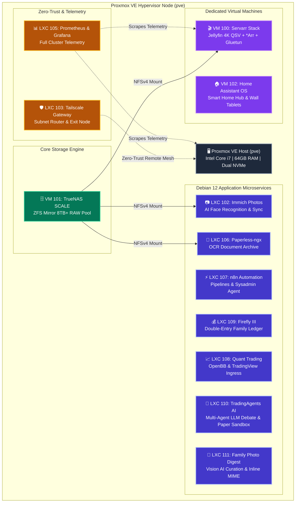

# 🏛️ Homelab Infrastructure & Service Blueprints

[](https://www.proxmox.com)
[](https://www.truenas.com)
[](https://www.docker.com)
[](https://www.debian.org)
[](https://tailscale.com)
[](https://opensource.org/licenses/MIT)

A modular, production-ready, open-source homelab reference architecture running on **Proxmox Virtual Environment (PVE)**.

Each service in this repository is packaged into its own dedicated directory containing **system architecture diagrams**, **resource sizing recommendations**, **official upstream links**, **production Docker Compose / LXC provisioning scripts**, and **health check procedures**.

---

## 🔒 Zero-Secrets & Sanitization Guarantee

> [!IMPORTANT]
> This repository is **100% sanitized**. It contains **NO private credentials, passwords, API tokens, encryption keys, personal email addresses, or account numbers**.  
> All configurations use explicit placeholders (e.g. `<SECURE_PASSWORD>`, `<PVE_NODE_IP>`, `<TELEGRAM_BOT_TOKEN>`). A pre-commit validation hook (`scripts/sanitize-check.sh`) enforces strict verification before any code or documentation is committed.

---

## 🗺️ System Topology & Workload Architecture



---

## 📁 Repository Directory Structure

```text
homelab-blueprints/
├── README.md                               <-- Root overview & quickstart
├── core/                                   <-- Foundational infrastructure
│   ├── network-topology.md                 <-- Network design, subnets, Zero-Trust
│   └── storage-architecture.md             <-- ZFS pool hierarchy, NFS/SMB permissions
├── services/                               <-- Standalone service directories
│   ├── proxmox-hypervisor/                 <-- PVE 8 base install & kernel tuning
│   ├── truenas-scale/                      <-- TrueNAS VM, ZFS pool, share config
│   ├── servarr-media-stack/                <-- Jellyfin, *Arr apps, Gluetun VPN shield
│   ├── immich-photos/                      <-- Immich Google Photos alternative
│   ├── paperless-ngx/                      <-- OCR document archive & consumption inbox
│   ├── firefly-iii-finance/                <-- Double-entry accounting & budgeting
│   ├── n8n-automation/                     <-- Workflow automation & Telegram AI bot
│   ├── tailscale-gateway/                  <-- Subnet router LXC with TUN passthrough
│   ├── monitoring-prometheus-grafana/      <-- Prometheus & Grafana telemetry
│   ├── quant-trading-engine/               <-- OpenBB & TradingView alert ingress
│   ├── home-assistant/                     <-- HAOS smart home & tablet kiosk views
│   ├── family-photo-digest/                <-- Vision AI monthly email newsletter & Immich curation
│   ├── adguard-home/                       <-- Network-wide DoH DNS, ad-blocking & wildcard rewrites
│   ├── nginx-proxy-manager/                <-- Reverse proxy gateway & local domain SSL termination
│   └── trading-agents-paper/               <-- TauricResearch Multi-Agent LLM Trading Intelligence Sandbox
├── scripts/                                <-- Automation & security scripts
│   ├── deploy-lxc-template.sh              <-- 1-click Proxmox LXC provisioning
│   └── sanitize-check.sh                   <-- Pre-commit credential leak scanner
└── templates/                              <-- Shared templates
    ├── docker-compose.servarr.yml          <-- Reference compose file
    └── .env.example                        <-- Comprehensive environment variable guide
```

---

## 📑 Service Catalog & Official Links

| Service | Category | Virtualization | Port(s) | Documentation & Official Sites |
| :--- | :---: | :---: | :---: | :--- |
| **[Proxmox VE](services/proxmox-hypervisor/)** | Hypervisor | Bare-Metal | `8006` | [Official Site](https://www.proxmox.com) • [Docs](https://pve.proxmox.com/pve-docs) • [Wiki](https://pve.proxmox.com/wiki) |
| **[TrueNAS SCALE](services/truenas-scale/)** | Storage | KVM VM | `80`, `445` | [Official Site](https://www.truenas.com) • [Docs](https://truenas.com/docs/scale) • [Forums](https://forums.truenas.com) |
| **[Servarr Media Stack](services/servarr-media-stack/)** | Streaming | Docker VM | `8096`, `5055` | [Jellyfin](https://jellyfin.org) • [Jellyseerr](https://jellyseerr.dev) • [Sonarr](https://sonarr.tv) • [Radarr](https://radarr.video) |
| **[Immich Photos](services/immich-photos/)** | Photos | Debian LXC | `2283` | [Official Site](https://immich.app) • [Docs](https://immich.app/docs) • [GitHub](https://github.com/immich-app/immich) |
| **[Paperless-ngx](services/paperless-ngx/)** | Documents | Debian LXC | `8000` | [Official Site](https://docs.paperless-ngx.com) • [GitHub](https://github.com/paperless-ngx/paperless-ngx) |
| **[Firefly III](services/firefly-iii-finance/)** | Finance | Debian LXC | `80` | [Official Site](https://firefly-iii.org) • [Docs](https://docs.firefly-iii.org) • [API](https://api-docs.firefly-iii.org) |
| **[n8n Automation](services/n8n-automation/)** | Automation | Debian LXC | `5678` | [Official Site](https://n8n.io) • [Docs](https://docs.n8n.io) • [Templates](https://n8n.io/workflows) |
| **[Tailscale Gateway](services/tailscale-gateway/)** | Networking | Debian LXC | — | [Official Site](https://tailscale.com) • [Subnet Guide](https://tailscale.com/kb/1019/subnets) • [Admin](https://login.tailscale.com/admin) |
| **[Prometheus & Grafana](services/monitoring-prometheus-grafana/)** | Monitoring | Debian LXC | `3000`, `9090` | [Prometheus](https://prometheus.io) • [Grafana](https://grafana.com) • [Dashboards](https://grafana.com/grafana/dashboards) |
| **[Quant Trading Engine](services/quant-trading-engine/)** | Finance | Debian LXC | `8080`, `4002` | [OpenBB](https://openbb.co) • [IBKR API](https://interactivebrokers.github.io) • [ib_insync](https://github.com/erdewit/ib_insync) |
| **[Home Assistant](services/home-assistant/)** | Smart Home | KVM VM | `8123` | [Official Site](https://www.home-assistant.io) • [HACS](https://hacs.xyz) • [Fully Kiosk](https://www.fully-kiosk.com) |
| **[Family Photo Digest](services/family-photo-digest/)** | AI & Family | Debian LXC | — | [Google Gemini](https://ai.google.dev) • [Immich](https://immich.app) • [Telegram Bot](https://core.telegram.org/bots) |
| **[AdGuard Home](services/adguard-home/)** | Network & DNS | Debian LXC | `53`, `80` | [Official Site](https://adguard.com/adguard-home.html) • [GitHub](https://github.com/AdguardTeam/AdGuardHome) • [Wiki](https://github.com/AdguardTeam/AdGuardHome/wiki) |
| **[Nginx Proxy Manager](services/nginx-proxy-manager/)** | Reverse Proxy | Docker LXC | `80`, `443`, `81` | [Official Site](https://nginxproxymanager.com) • [Docs](https://nginxproxymanager.com/guide/) • [GitHub](https://github.com/NginxProxyManager/nginx-proxy-manager) |
| **[TradingAgents Sandbox](services/trading-agents-paper/)** | AI & Finance | Debian LXC | `4002` (IBKR) | [Paper (arXiv:2412.20138)](https://arxiv.org/abs/2412.20138) • [GitHub](https://github.com/TauricResearch/TradingAgents) |
| **[openGym Tracker](services/opengym/)** | Health & Fitness | Docker LXC | `8080`, `8443` (TLS) | [GitHub](https://github.com/DuarteSantos8/openGym) • [Docs](https://opengym.ch) |

---

## ⚡ Quickstart: Deploying Any Container in Seconds

All services can be spun up directly on your Proxmox VE host via the CLI:

1. **SSH into your Proxmox VE host as `root`:**
   ```bash
   git clone https://github.com/nishilshah/homelab-blueprints.git
   cd homelab-blueprints
   ```

2. **Provision the container using the standardized helper script:**
   ```bash
   ./scripts/deploy-lxc-template.sh <VMID> <HOSTNAME> <MEMORY_MB> <CORES> <DISK_SIZE> <STATIC_IP/CIDR> <GATEWAY_IP>
   ```

3. **Navigate to the specific service folder:**
   ```bash
   cd services/paperless-ngx
   ```
   Follow the detailed instructions in that service's `README.md` to launch the stack!

---

## 🛡️ Pre-Commit Security Audit

To maintain the zero-secrets guarantee, run the automated security validation check before pushing any changes:

```bash
./scripts/sanitize-check.sh
```

---

## 📜 License

This project is licensed under the **MIT License** — you are free to adapt, fork, and use these blueprints for your own homelab infrastructure.
