# 🏛️ Homelab Infrastructure & Service Blueprints

A modular, production-ready, open-source homelab reference architecture running on **Proxmox Virtual Environment (PVE)**.

This repository contains step-by-step deployment blueprints, configuration files, and architecture diagrams for self-hosting media streaming, AI document archiving, photo management, workflow automation, and financial tracking across lightweight **LXC Containers** and specialized **Virtual Machines**.

---

## 🔒 Zero-Secrets & Privacy Policy

> [!IMPORTANT]
> This repository is **100% sanitized**. It contains **NO private credentials, passwords, API tokens, encryption keys, personal email addresses, or account numbers**.  
> All configurations use explicit placeholders (e.g. `<SECURE_PASSWORD>`, `<PVE_NODE_IP>`, `<TELEGRAM_BOT_TOKEN>`). A pre-commit validation hook (`scripts/sanitize-check.sh`) enforces strict verification before any code or documentation is committed.

---

## 🗺️ Homelab System Architecture

```mermaid
flowchart TD
    subgraph Hypervisor ["Proxmox VE Hypervisor Node"]
        direction TB
        PVE["Proxmox VE (PVE) Host<br/>Hardware: Intel Core i7 / 64GB RAM"]
        
        subgraph StorageCore ["Storage Foundation"]
            TrueNAS["VM: TrueNAS SCALE<br/>ZFS Mirror (8TB+ RAW)"]
        end

        subgraph CoreGateways ["Networking & Access"]
            Tailscale["LXC: Tailscale Gateway<br/>Subnet Router & Zero-Trust"]
            Monitoring["LXC: Monitoring Stack<br/>Prometheus & Grafana"]
        end

        subgraph AppsLXC ["Application Containers (Debian 12 LXCs)"]
            Immich["LXC: Immich Photos<br/>AI Face & Object Recognition"]
            Paperless["LXC: Paperless-ngx<br/>OCR Document Archive"]
            N8N["LXC: n8n Automation<br/>Workflow & Telegram Daemons"]
            Firefly["LXC: Firefly III<br/>Family Wealth & Financial Engine"]
            Quant["LXC: Quant Trading Engine<br/>TradingView Ingress & IB Gateway"]
        end

        subgraph MediaVM ["Media & Container Host (VM)"]
            DockerServarr["Ubuntu Docker Stack:<br/>Jellyfin (QuickSync 4K) + *Arr Stack<br/>+ Gluetun VPN Shield"]
            HomeAssistant["VM: Home Assistant OS<br/>Smart Home & Tablet Kiosks"]
        end
    end

    TrueNAS -->|NFS / SMB Shares| DockerServarr
    TrueNAS -->|NFS Storage| Immich
    TrueNAS -->|NFS Archive & Consume| Paperless
    Tailscale -.->|Zero-Trust Mesh| Hypervisor
    Monitoring -.->|Metrics Scraping| AppsLXC
    Monitoring -.->|Metrics Scraping| MediaVM
```



---

## 📑 Service Blueprints Directory

| # | Blueprint Document | Virtualization | Primary Role | Port(s) |
| :-: | :--- | :---: | :--- | :---: |
| **00** | [System Architecture & Network Design](docs/00-architecture.md) | Specs | Subnets, VLANs, Storage topology & sizing | — |
| **01** | [Proxmox VE Host Configuration](docs/01-proxmox-ve-host.md) | Host | Kernel tweaks, non-enterprise repos, storage pools | `8006` |
| **02** | [TrueNAS SCALE Storage Foundation](docs/02-truenas-scale-vm.md) | KVM VM | ZFS pools, dataset permissions, NFS/SMB exports | `80`, `445` |
| **03** | [Servarr & Jellyfin Media Stack](docs/03-servarr-media-stack.md) | Docker VM | 4K QuickSync transcoding, Sonarr, Radarr, VPN | `8096`, `5055` |
| **04** | [Immich Photo & Video Cloud](docs/04-immich-photos.md) | LXC | Self-hosted Google Photos alternative | `2283` |
| **05** | [Tailscale Mesh Subnet Gateway](docs/05-tailscale-gateway.md) | LXC | Zero-trust remote access, subnet routing | — |
| **06** | [Prometheus & Grafana Telemetry](docs/06-prometheus-grafana.md) | LXC | Cluster monitoring, dashboards, node exporters | `3000`, `9090` |
| **07** | [Paperless-ngx Document Archive](docs/07-paperless-ngx.md) | LXC | Optical character recognition (OCR), auto-tagging | `8000` |
| **08** | [n8n Workflow Automation Engine](docs/08-n8n-automation.md) | LXC | Automated webhook pipelines & Telegram AI bots | `5678` |
| **09** | [Firefly III Wealth & Budgeting](docs/09-firefly-iii-finance.md) | LXC | Double-entry accounting, multi-currency ledger | `80` |
| **10** | [Quant Trading & Research Engine](docs/10-quant-trading-engine.md) | LXC | OpenBB, TradingView webhooks, IB Gateway | `8000`, `8080` |
| **11** | [Home Assistant Smart Home OS](docs/11-home-assistant-os.md) | KVM VM | IoT device management, wall dashboards | `8123` |

---

## ⚡ Quick Start: Deploying Any LXC Service

All LXC blueprints are written to be deployed in seconds using standard Proxmox command-line tools:

1. SSH into your Proxmox VE host as `root`.
2. Clone this repository (or copy the desired blueprint):
   ```bash
   git clone https://github.com/<YOUR_GITHUB_USERNAME>/homelab-blueprints.git
   cd homelab-blueprints
   ```
3. Use the automated provisioning script to spin up the container:
   ```bash
   ./scripts/deploy-lxc-template.sh <VMID> <HOSTNAME> <MEMORY_MB> <CORES> <DISK_SIZE> <STATIC_IP/CIDR> <GATEWAY_IP>
   ```
   *Example:*
   ```bash
   ./scripts/deploy-lxc-template.sh 106 paperless 4096 2 20G 192.168.1.106/24 192.168.1.1
   ```
4. Follow the specific service guide in the [`docs/`](docs/) directory to install and start the service.

---

## 🛡️ Pre-Commit Security Verification

Before contributing or pushing commits, always run the automated security validation script to guarantee no sensitive tokens or passwords are staged:

```bash
./scripts/sanitize-check.sh
```

---

## 📜 License

This project is licensed under the **MIT License** — you are free to use, fork, adapt, and deploy these blueprints for personal or organizational infrastructure.
