# 🌐 Core Network Topology & Subnet Design

This blueprint establishes the physical and logical networking topology, private IP allocations, DNS resolution, and Zero-Trust remote access for the homelab.

---

## 🔗 Official Documentation & References

- **OPNsense Documentation:** [docs.opnsense.org](https://docs.opnsense.org)
- **Tailscale Subnet Routing:** [tailscale.com/kb/1019/subnets](https://tailscale.com/kb/1019/subnets)
- **WireGuard Protocol:** [wireguard.com](https://www.wireguard.com)
- **Proxmox VE Network Model:** [pve.proxmox.com/wiki/Network_Configuration](https://pve.proxmox.com/wiki/Network_Configuration)

---

## 🗺️ Logical Network Architecture

```mermaid
flowchart TD
    classDef wan fill:#9f1239,stroke:#fb7185,stroke-width:2px,color:#ffffff;
    classDef net fill:#b45309,stroke:#fbbf24,stroke-width:2px,color:#ffffff;
    classDef host fill:#334155,stroke:#94a3b8,stroke-width:2px,color:#ffffff;
    classDef lxc fill:#059669,stroke:#34d399,stroke-width:2px,color:#ffffff;
    classDef vm fill:#7c3aed,stroke:#c084fc,stroke-width:2px,color:#ffffff;
    classDef mesh fill:#0284c7,stroke:#38bdf8,stroke-width:2px,color:#ffffff;

    WAN["🌐 Internet / ISP Fiber Gateway"]:::wan --> Router["🛡️ Firewall & Gateway Router<br/>192.168.1.1"]:::net
    
    subgraph LAN ["Physical LAN (192.168.1.0/24)"]
        Switch["🔀 Managed 2.5GbE / 10GbE Switch"]:::net
        Router --> Switch

        subgraph PVE_Node ["Proxmox VE Host (192.168.1.250)"]
            vmbr0["🌉 Linux Bridge: vmbr0"]:::host
            Switch --> vmbr0
            
            subgraph LXCs ["LXC Containers"]
                TS["🛡️ LXC 103: Tailscale Router<br/>192.168.1.253"]:::lxc
                Paperless["📄 LXC 106: Paperless-ngx<br/>192.168.1.246"]:::lxc
                N8N["⚡ LXC 107: n8n Automation<br/>192.168.1.247"]:::lxc
                Quant["📈 LXC 108: Quant Trading<br/>192.168.1.248"]:::lxc
                Firefly["💰 LXC 109: Firefly III<br/>192.168.1.245"]:::lxc
                Immich["📷 LXC 102: Immich Photos<br/>192.168.1.252"]:::lxc
                Monitor["📊 LXC 105: Monitoring<br/>192.168.1.249"]:::lxc
                Flight["✈️ LXC 110: FlightScout AI<br/>192.168.1.244"]:::lxc
                Digest["📸 LXC 111: Family Digest<br/>192.168.1.243"]:::lxc
                AdGuard["🛡️ LXC 112: AdGuard Home<br/>192.168.1.242"]:::lxc
                NPM["🌐 LXC 113: Nginx Proxy Mgr<br/>192.168.1.240"]:::lxc
            end

            subgraph VMs ["Virtual Machines"]
                TrueNAS["🗄️ VM 101: TrueNAS SCALE<br/>192.168.1.139"]:::vm
                Servarr["🎬 VM 100: Servarr Docker<br/>192.168.1.251"]:::vm
                HA["🏠 VM 105: Home Assistant<br/>192.168.1.72"]:::vm
            end

            vmbr0 --> TS
            vmbr0 --> Paperless
            vmbr0 --> N8N
            vmbr0 --> Quant
            vmbr0 --> Firefly
            vmbr0 --> Immich
            vmbr0 --> Monitor
            vmbr0 --> Flight
            vmbr0 --> Digest
            vmbr0 --> AdGuard
            vmbr0 --> NPM
            vmbr0 --> TrueNAS
            vmbr0 --> Servarr
            vmbr0 --> HA
        end
    end

    subgraph TailscaleMesh ["Tailscale Zero-Trust Overlay (100.64.0.0/10)"]
        RemoteLaptop["💻 Remote Laptop"]:::mesh
        Phone["📱 Mobile Client"]:::mesh
        RemoteLaptop -.->|Encrypted WireGuard| TS
        Phone -.->|Encrypted WireGuard| TS
        TS -.->|Subnet Route 192.168.1.0/24| Switch
    end
```

---

## 📊 IP Address Allocation Matrix

| IP Address | Hostname / Service | Virtualization | Description |
| :--- | :--- | :---: | :--- |
| `192.168.1.1` | `gateway.homelab.local` | Physical Router | Core Gateway & DHCP/DNS server |
| `192.168.1.250` | `pve.homelab.local` | Bare-Metal | Proxmox VE Hypervisor Node |
| `192.168.1.139` | `truenas.homelab.local` | VM 101 | TrueNAS SCALE ZFS Storage Appliance |
| `192.168.1.251` | `servarr.homelab.local` | VM 100 | Ubuntu 24.04 Media Docker Stack & Homepage |
| `192.168.1.252` | `immich.homelab.local` | LXC 102 | Immich Photo & Video Cloud |
| `192.168.1.253` | `tailscale.homelab.local` | LXC 103 | Tailscale Subnet Router & Mesh Gateway |
| `192.168.1.249` | `monitoring.homelab.local`| LXC 105 | Prometheus & Grafana Telemetry |
| `192.168.1.72`  | `homeassistant.homelab.local`| VM 105 | Home Assistant OS (HAOS) Smart Hub |
| `192.168.1.246` | `paperless.homelab.local` | LXC 106 | Paperless-ngx OCR Document Archive |
| `192.168.1.247` | `n8n.homelab.local` | LXC 107 | n8n Workflow Engine & Telegram AI Bot |
| `192.168.1.248` | `quant.homelab.local` | LXC 108 | OpenBB & TradingView Ingress Webhook |
| `192.168.1.245` | `firefly.homelab.local` | LXC 109 | Firefly III Wealth & Budgeting Platform |
| `192.168.1.244` | `flightscout.homelab.local` | LXC 110 | FlightScout AI Multi-City Fare Engine |
| `192.168.1.243` | `familydigest.homelab.local`| LXC 111 | Family Photo Digest AI Newsletter |
| `192.168.1.242` | `adguard.homelab.local` | LXC 112 | AdGuard Home DoH DNS & Ad-Blocking |
| `192.168.1.240` | `proxy.homelab.local` | LXC 113 | Nginx Proxy Manager Reverse Proxy Gateway |

---

## 🔒 Security Principles

1. **Zero Open Inbound Ports:** No public ports are forwarded on the residential gateway.
2. **Zero-Trust Remote Access:** All off-site access from laptops and mobile phones routes through Tailscale using modern ChaCha20-Poly1305 WireGuard encryption.
3. **Download Shielding:** BitTorrent and Usenet traffic in VM 100 is strictly bound to an ephemeral WireGuard tunnel (`gluetun`), preventing residential ISP exposure.
