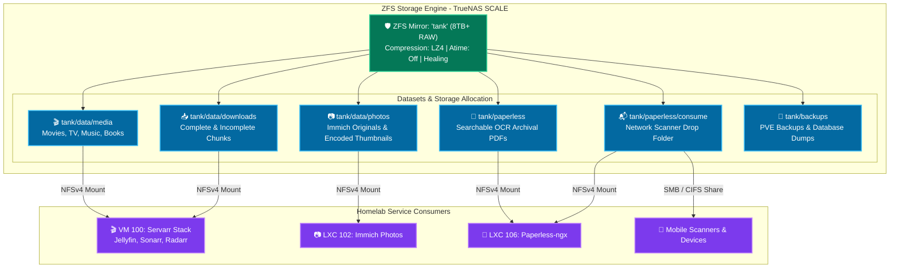

# 💾 Core Storage Architecture & ZFS Topology

This blueprint documents the ZFS pool topology, dataset hierarchies, sharing protocols (NFSv4 & SMB), and permission mappings across the homelab infrastructure.

---

## 🔗 Official Documentation & References

- **OpenZFS Documentation:** [openzfs.github.io/openzfs-docs](https://openzfs.github.io/openzfs-docs)
- **TrueNAS SCALE Storage Guide:** [truenas.com/docs/scale](https://www.truenas.com/docs/scale)
- **Linux NFSv4 How-To:** [linux-nfs.org](http://www.linux-nfs.org/wiki/index.php/Main_Page)
- **Samba CIFS Documentation:** [samba.org](https://www.samba.org)

---

## 🏗️ Storage Hierarchy Architecture

---

## 📊 Dataset Configuration Matrix

| Dataset Path | Record Size | Compression | Sync | Sharing Protocol | Consumers |
| :--- | :---: | :---: | :---: | :---: | :--- |
| `tank/data/media/movies` | `1M` | `lz4` | `standard` | NFSv4 | Jellyfin, Radarr |
| `tank/data/media/tv` | `1M` | `lz4` | `standard` | NFSv4 | Jellyfin, Sonarr |
| `tank/data/downloads` | `128K` | `lz4` | `disabled` | NFSv4 | qBittorrent, NZBGet |
| `tank/data/photos` | `128K` | `zstd` | `standard` | NFSv4 | Immich Photos |
| `tank/paperless/media` | `128K` | `zstd` | `always` | NFSv4 | Paperless-ngx Webserver |
| `tank/paperless/consume`| `128K` | `lz4` | `standard` | SMB & NFSv4 | Paperless-ngx & Mobile Scanners |
| `tank/backups` | `1M` | `zstd-3` | `always` | NFSv4 | Proxmox VE Backup (VZDump) |

---

## 👥 Permissions & UID/GID Alignment

To prevent permission conflicts across Docker containers and native LXCs:

| User / Group | UID / GID | Purpose |
| :--- | :---: | :--- |
| `root` | `0:0` | Proxmox hypervisor & ZFS pool owner |
| `media` | `1000:1000` | Shared Docker container user (Servarr, Paperless, Immich) |
| `truenas_admin` | `1001:1001` | TrueNAS SCALE web management user |

### NFS Permissions Policy:
- **Maproot User:** `root`
- **Maproot Group:** `root`
- **Mount Options (Linux Clients):** `rw,nfsvers=4,hard,timeo=14,intr,rsize=1048576,wsize=1048576`
