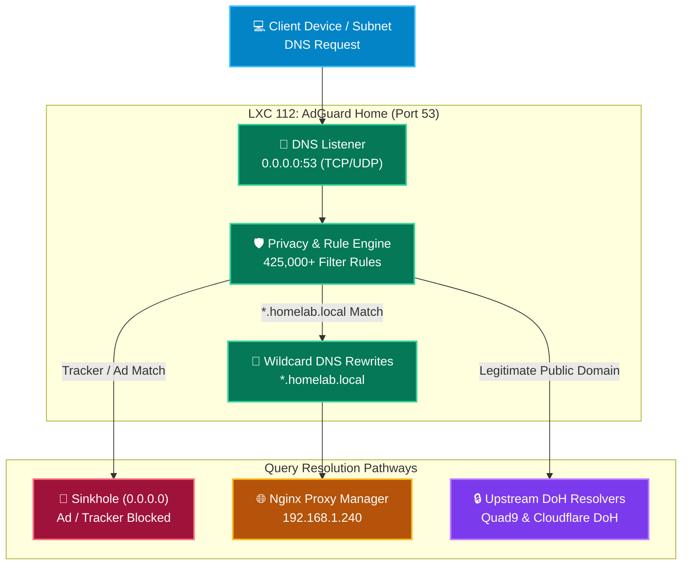

# 🛡️ AdGuard Home: Network-Wide DNS & Privacy Guard

`AdGuard Home` is a network-wide DNS server and ad/tracker blocker deployed in an isolated Debian 12 container (**LXC 112**). It intercepts DNS queries across the homelab, enforces encrypted upstream DNS via DNS-over-HTTPS (DoH), filters ads and tracking domains via curated blocklists (425,000+ active rules), and provides local wildcard DNS resolution for the homelab domain (`*.homelab.local`).

---

## 🏗️ Architecture & Query Flow



---

## ⚙️ Container Resource Specifications

| Specification | Value | Notes |
| :--- | :--- | :--- |
| **Container ID** | `112` | Debian 12 Minimal Unprivileged LXC |
| **Hostname** | `adguard-home` | Dedicated network privacy microservice |
| **Static IPv4** | `<CONTAINER_IP>/24` | Local bridge `vmbr0` |
| **Gateway** | `<GATEWAY_IP>` | Router / Subnet Gateway |
| **Bootstrap DNS** | `1.1.1.1` | Initial resolver for DoH bootstrap |
| **vCPU** | `1 Core` | Lightweight Go binary |
| **RAM Allocation** | `512 MB` | <25MB runtime memory footprint |
| **Disk Storage** | `4 GB` on `local-lvm` | Stores blocklists and query log cache |
| **Ports** | `53/udp`, `53/tcp`, `80/tcp` | DNS resolver & Web Admin Dashboard |

---

## 🔒 Upstream DNS & Privacy Configuration

### 1. Upstream Encrypted Resolvers (DoH)
- **Quad9 DNS over HTTPS:** `https://dns.quad9.net/dns-query` (Primary with threat blocking)
- **Cloudflare DNS over HTTPS:** `https://cloudflare-dns.com/dns-query` (High-speed secondary)
- **Bootstrap DNS Servers:** `9.9.9.9`, `149.112.112.112`, `1.1.1.1`, `1.0.0.1`

### 2. Curated Blocklists
1. **AdGuard Base Filter:** Official ad-blocking rule list (`filter_1.txt`, ~188,000 rules)
2. **AdGuard Tracking Protection Filter:** Privacy and telemetric tracker blocker (`filter_3.txt`, ~3,500 rules)
3. **OISD Big Filter:** Comprehensive malware, telemetry, and tracking filter (`https://big.oisd.nl`, ~233,000 rules)

### 3. Local Wildcard DNS Rewrites
All queries under the `.homelab.local` namespace route directly to the Nginx Proxy Manager gateway:
- `*.homelab.local` $\rightarrow$ `192.168.1.240`
- `homelab.local` $\rightarrow$ `192.168.1.240`

---

## 🛠️ Verification & Maintenance Commands

```bash
# Verify AdGuard Home systemd service status
systemctl status AdGuardHome

# Query internal wildcard DNS rewrite
dig @192.168.1.242 photos.homelab.local +short

# Verify ad domain sinkhole
dig @192.168.1.242 pagead2.googlesyndication.com +short
# Expected output: 0.0.0.0
```
