# 📸 Family Photo Digest: Automated Vision AI Monthly Newsletter

`Family Photo Digest` is an autonomous, self-hosted photo curation and editorial newsletter pipeline running in an isolated Debian 12 container (LXC 111). 

It queries the local Immich photo library across multiple family accounts, uses Google Gemini Vision AI to curate the top aesthetic and candid moments of the month, drafts warm natural captions, and provides a per-photo interactive review card in Telegram with **🟢 Approve** and **🔴 Reject** buttons. Once approved, it compiles an air-gapped, responsive fluid-hybrid HTML email with full-resolution inline MIME `cid:` images and dispatches it via outbound SMTP—generating **zero inbound requests** to the homelab.

---

## 🏗️ Architecture & Processing Pipeline

```mermaid
flowchart TD
    classDef trigger fill:#0284c7,stroke:#38bdf8,stroke-width:2px,color:#ffffff;
    classDef immich fill:#047857,stroke:#34d399,stroke-width:2px,color:#ffffff;
    classDef ai fill:#7c3aed,stroke:#c084fc,stroke-width:2px,color:#ffffff;
    classDef notify fill:#059669,stroke:#34d399,stroke-width:2px,color:#ffffff;
    classDef secure fill:#b45309,stroke:#fbbf24,stroke-width:2px,color:#ffffff;

    subgraph AutonomousScheduler ["1. Autonomous Execution Daemon"]
        Timer["⏰ systemd Timer: family-digest-cron.timer<br/>1st of Every Month at 09:00 AM"]:::trigger
        BotDaemon["🤖 systemd Service: family-digest-bot.service<br/>Continuous Telegram Long-Polling"]:::trigger
        Timer --> BotDaemon
    end

    subgraph DualImmichIngress ["2. Multi-Account Immich Ingestion"]
        LXCImmich["📷 Immich LXC 102 (LAN API)<br/>Internal Port 2283"]:::immich
        Account1["👤 Account 1 Library"]:::immich
        Account2["👤 Account 2 Library"]:::immich
        
        BotDaemon --> LXCImmich
        LXCImmich --> Account1
        LXCImmich --> Account2
    end

    subgraph VisionCuration ["3. Multimodal Vision AI Curation"]
        Gemini["🧠 Google Gemini Vision API<br/>Aesthetic Composition & Smile Scoring"]:::ai
        Filter["🧹 Anti-Noise Heuristics<br/>Strips screenshots, receipts, blurry shots"]:::ai
        Captioner["✍️ Natural Scene Captioner<br/>Extracts dates and warm 1-sentence stories"]:::ai
        
        Account1 --> Filter
        Account2 --> Filter
        Filter --> Gemini
        Gemini --> Captioner
    end

    subgraph TelegramReviewGate ["4. Interactive Approval Gate (Strict Human-in-the-Loop)"]
        Bot["📱 Single Telegram Bot (Shared Chat)<br/>Zero Inbound Ports (Outbound Polling)"]:::notify
        Cards["🖼️ Per-Photo Preview Cards<br/>[ 🟢 Approved ] [ 🔴 Reject ]"]:::notify
        ControlCard["📋 Control Message<br/>[ 🚀 Send Approved to Family ]"]:::notify
        
        Captioner --> Bot
        Bot --> Cards
        Cards --> ControlCard
    end

    subgraph AirGappedDelivery ["5. Air-Gapped Email Dispatcher"]
        Compiler["📐 Fluid-Hybrid Responsive Compiler<br/>Pillow 4K Optimization (2560px JPEG)"]:::secure
        MIMEPacker["📦 Self-Contained MIME cid: Packager<br/>Zero External Homelab Links"]:::secure
        SMTP["✉️ Outbound SMTP Delivery<br/>Delivered directly into Family Inboxes"]:::secure
        
        ControlCard -->|Explicit User Tap| Compiler
        Compiler --> MIMEPacker
        MIMEPacker --> SMTP
    end
```



---

## ⚙️ Container Resource Specifications

| Specification | Value | Notes |
| :--- | :--- | :--- |
| **Container ID** | `111` | Isolated Debian 12 unprivileged container |
| **Hostname** | `family-digest` | Dedicated microservice |
| **IP Address** | `<CONTAINER_IP>/24` | Static LAN assignment on `vmbr0` |
| **Gateway / DNS** | `<GATEWAY_IP>` / `1.1.1.1` | Local network bridge routing |
| **vCPU Allocation** | `2 vCPUs` | Smooth Pillow image downsampling |
| **RAM Allocation** | `1024 MB` | Ultra-low idle memory (<15MB) |
| **Disk Storage** | `10 GB` on `local-lvm` | Stores cache & SQLite state |
| **Inbound Ports** | **NONE (0)** | Completely air-gapped from incoming traffic |

---

## 🔒 Security & Privacy Guarantees

1. **Zero Homelab Ingress:**
   - Photos are packed as standard RFC-822 MIME `cid:` inline parts inside the email.
   - When family members open the email on iOS, Android, or Outlook, images render locally. No calls are made back to the homelab server.
2. **Outbound Long-Polling Only:**
   - The Telegram bot operates via HTTP `getUpdates` long-polling. No webhooks or open ports are required.
3. **Multi-Account Privacy Isolation:**
   - Assets marked as hidden or archived in Immich are excluded at the query level before the AI sees them.
4. **Hard Human Approval Gate:**
   - Zero auto-sending or silent timeouts. The email is never dispatched unless an explicit confirmation button is tapped in Telegram.

---

## 🛠️ Verification & Testing

Check service status inside LXC 111:
```bash
# Verify systemd timer
systemctl status family-digest-cron.timer

# Verify background bot listener
systemctl status family-digest-bot.service

# View live bot logs
journalctl -u family-digest-bot.service -f
```
