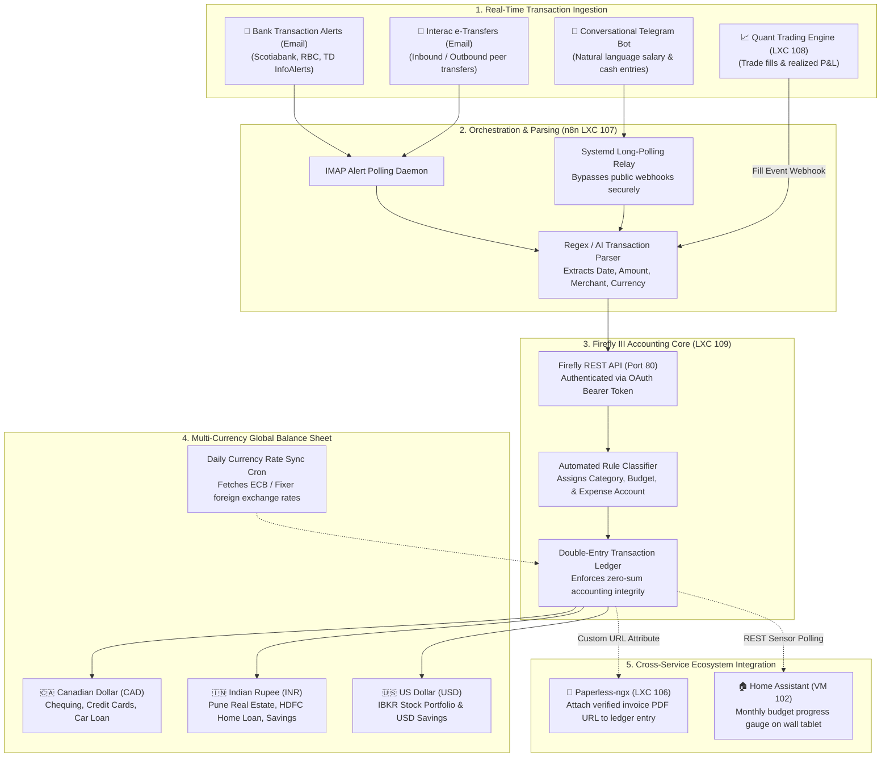

# 💰 Firefly III Family Wealth & Double-Entry Accounting Engine (LXC 109)

[](https://firefly-iii.org)
[](https://mariadb.org)
[](https://www.docker.com)
[](https://www.gnu.org/licenses/agpl-3.0)

A self-hosted, sovereign, double-entry financial accounting platform running inside an unprivileged Debian 12 LXC container on Proxmox VE. Manages multi-currency banking across international boundaries (**CAD**, **INR**, **USD**), automated real-time transaction ingestion via email alert listeners, loan amortizations, real estate valuations, and conversational Telegram salary logging.

---

## 🔗 Official Documentation & External Links

- **Official Website:** [firefly-iii.org](https://www.firefly-iii.org)
- **Documentation Hub:** [docs.firefly-iii.org](https://docs.firefly-iii.org)
- **REST API Reference:** [api-docs.firefly-iii.org](https://api-docs.firefly-iii.org)
- **GitHub Repository:** [firefly-iii/firefly-iii](https://github.com/firefly-iii/firefly-iii)
- **Data Importer Utility:** [docs.firefly-iii.org/data-importer](https://docs.firefly-iii.org/data-importer)
- **Community Forum:** [reddit.com/r/FireflyIII](https://reddit.com/r/FireflyIII)

---

## 🏗️ Multi-Currency Ledger & Financial Pipeline Architecture



---

## 🧠 Accounting Model & Decision Rationale

### 1. Strict Double-Entry Bookkeeping
Unlike consumer apps (Mint, YNAB, Monarch) that treat money as simple plus/minus buckets, Firefly III implements true **double-entry bookkeeping**:
- Every penny moved must have an origin account and a destination account:
  $$\Delta \text{Assets} - \Delta \text{Liabilities} = \text{Equity} + (\text{Revenues} - \text{Expenses})$$
- Types of Accounts Configured:
  * **Asset Accounts:** Chequing accounts, high-interest savings, investment accounts, cash wallets.
  * **Expense Accounts:** The recipient merchant or service (e.g. *Costco Wholesale*, *BC Hydro*, *Shell*).
  * **Revenue Accounts:** Employers, rental tenants, dividend disbursements.
  * **Liability Accounts:** Fixed-rate mortgages, auto financing loans, personal debts.

### 2. Multi-Currency Mechanics Across Borders
Managing assets across international jurisdictions requires careful currency isolation:
- **Primary Operational Currency (CAD):** Everyday expenses, groceries, utilities, and tax liabilities.
- **Foreign Real Estate & Banking (INR):**
  * Real estate asset tracking for property in Pune, India.
  * Rental income deposited into local Indian bank accounts.
  * Debt amortization for HDFC Home Loan.
  * Firefly maintains independent balances in native currency, preventing artificial FX distortion, while generating unified net-worth reports converted at daily ECB rates.
- **Investment Capital (USD):**
  * Equities, ETFs, and quant trading capital housed in Interactive Brokers (IBKR).

### 3. Debt Amortization Tracking
Firefly III tracks liabilities with exact amortization schedules:
- **Bi-Weekly Auto Loan (e.g. Mazda CX-5 Financing):**
  * Each payment is split: a withdrawal reduces the liability balance (Principal), while a simultaneous transfer logs interest paid to the `Interest Expense` account.
- **Real Estate Mortgage (HDFC Pune):**
  * Tracks remaining principal balance against property market valuations, providing an accurate, real-time equity picture on the balance sheet.

---

## 🔗 Cross-Service Integrations

### 1. Automated Real-Time Ingestion via n8n (LXC 107)
Rather than manually logging expenses or uploading CSV files at the end of the month:
- **Banking InfoAlerts:** Canadian banks (Scotiabank, RBC) dispatch immediate transaction notifications via email when a credit card or debit card is swiped.
- **n8n IMAP Listener:** Captures the email within 60 seconds, strips HTML markup, and extracts fields via regex:
  ```json
  {
    "date": "2026-10-12T14:32:00Z",
    "amount": "84.50",
    "currency": "CAD",
    "merchant": "COSTCO WHOLESALE W1028",
    "account": "Scotiabank Momentum Visa"
  }
  ```
- **REST API Dispatch:** Pushes the transaction to `POST /api/v1/transactions` with `type: "withdrawal"`.

### 2. Conversational Telegram Salary & Expense Bot
For logging salaries, tenant rents, or cash payments in natural language:
- User sends: *"Logged $3,450 CAD net salary deposit from employer into Scotiabank Chequing"*
- The Telegram Long-Polling Relay forwards the message to an n8n webhook.
- An AI reasoning node extracts the financial intent and posts the transaction to Firefly III.
- A confirmation receipt with current account balance is returned via Telegram.

### 3. Paperless-ngx Document Linking
- When Paperless-ngx indexes an invoice or receipt, n8n grabs the document ID.
- n8n searches Firefly for the matching dollar amount and transaction date.
- It attaches an external link attribute to the transaction: `Paperless Archive: http://192.168.1.246:8000/documents/<ID>/details`.

---

## ⚙️ Container Sizing & Recommendations

| Parameter | Specification | Rationale |
| :--- | :--- | :--- |
| **Virtualization** | Debian 12 LXC Container | Unprivileged container with `nesting=1` |
| **vCPUs** | 2 vCPUs | MariaDB relational queries + PHP-FPM web requests |
| **Memory** | 2048 MB (2 GB) | MariaDB InnoDB buffer pool (512MB) + PHP-FPM runtime |
| **Disk** | 16 GB SSD (`local-lvm`) | Database tables, indexes, and daily transaction logs |
| **Network** | `vmbr0` (Static IP) | Port 80 exposed internally (reverse-proxied via Tailscale) |

---

## 🚀 Step-by-Step Deployment Guide

### 1. Provision Proxmox LXC Container
Run on the Proxmox VE host CLI:
```bash
pct create 109 local:vztmpl/debian-12-standard_12.7-1_amd64.tar.zst \
  --hostname firefly-iii \
  --cores 2 \
  --memory 2048 \
  --swap 512 \
  --rootfs local-lvm:16 \
  --net0 name=eth0,bridge=vmbr0,ip=192.168.1.245/24,gw=192.168.1.1 \
  --unprivileged 1 \
  --features nesting=1 \
  --onboot 1 \
  --start 1
```

### 2. Deploy MariaDB & Firefly Docker Stack
Enter container (`pct enter 109`):
```bash
curl -fsSL https://get.docker.com -o get-docker.sh && sh get-docker.sh

mkdir -p /docker/firefly && cd /docker/firefly

# Copy templates from this blueprint
cp .env.example .env

# Generate 32-character base64 encryption key
APP_KEY=$(head /dev/urandom | head -c 32 | base64)
sed -i "s|<RANDOM_BASE64_32_CHAR_KEY>|$APP_KEY|" .env

# Start stack
docker compose up -d
```

### 3. Configure Administrative Account
1. Open your browser and navigate to `http://192.168.1.245`.
2. Follow the on-screen installation wizard to create the primary family administrator account.
3. Select your primary base currency (e.g. `CAD`).
4. Under **Options** ➔ **Currencies**, enable foreign currencies (`INR`, `USD`).

### 4. Generate Automation Access Token
1. Click **Profile** ➔ **OAuth** ➔ **Personal Access Tokens**.
2. Click **Create New Token**, name it `n8n-automation-engine`.
3. Save the token into your n8n credentials vault for automated ingestion.
