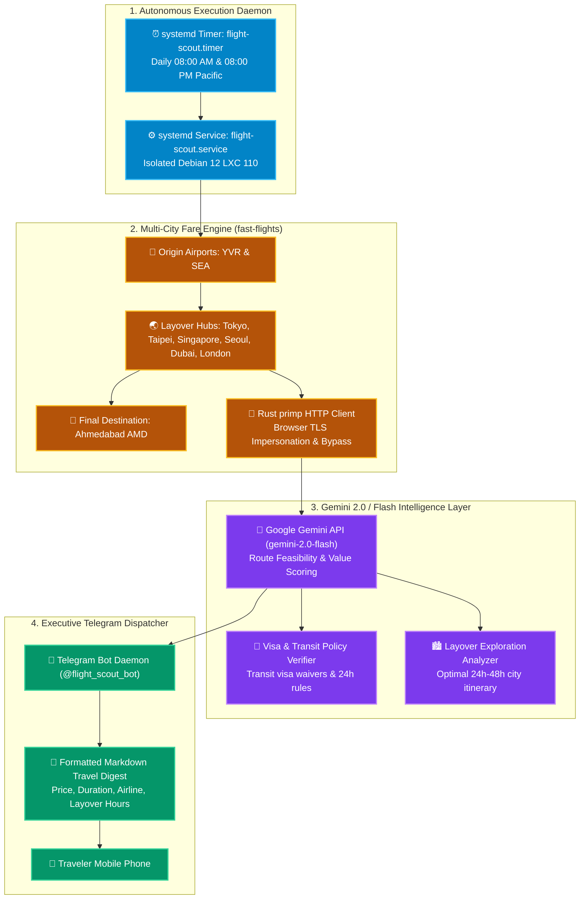

# ✈️ FlightScout AI: Multi-City Flight & Layover Deal Tracker

`FlightScout AI` is an autonomous, self-hosted flight intelligence engine running on Debian 12 (LXC 110). It continuously monitors multi-city flight prices, tracks flexible 24h-48h layover routes across Europe, Asia, and the Middle East, evaluates visa requirements and city exploration value with Google Gemini 2.0 / Flash, and pushes executive reports directly to Telegram.

---

## 🏗️ Architecture & Processing Pipeline



---

## 🧠 Architectural Deep-Dive & Engineering Decisions

### 1. Dual-Origin Multi-City Geometry (YVR & SEA)
- **Origin Optimization:** Traveling from Vancouver (`YVR`) often carries significant transpacific or transatlantic departure surcharges. Because Seattle (`SEA`) is only a 2.5-hour drive or Amtrak ride away, FlightScout evaluates parallel itineraries originating from both `YVR` and `SEA`.
- **Destination:** Ahmedabad (`AMD`), India.
- **Stopover Exploration Window:** 24 to 48 hours in a hub city (e.g. Tokyo `NRT`/`HND`, Taipei `TPE`, Singapore `SIN`, Seoul `ICN`, London `LHR`, Frankfurt `FRA`, Dubai `DXB`).

### 2. High-Speed TLS Impersonation (`fast-flights` + Rust `primp`)
- Standard Python `requests` or `urllib` libraries trigger automated bot detection and CAPTCHAs on flight search engines.
- FlightScout utilizes **`fast-flights`** backed by **Rust `primp`**, which provides genuine browser TLS fingerprinting (JA3/JA4) and HTTP/2 pseudo-header serialization, ensuring reliable, automated fare extraction without headless browser memory overhead.

### 3. Google Gemini 2.0 Qualitative Analysis
Flight prices alone do not tell the whole story. FlightScout feeds parsed fare candidate matrices into **Google Gemini 2.0 Flash** to provide:
1. **Visa & Entry Rules:** Validates whether Indian or Canadian passport holders need a transit visa or are eligible for visa-on-arrival/transit-without-visa (TWOV).
2. **City Exploration Score:** Scores whether a 24h or 48h layover gives sufficient time to visit downtown attractions without excessive airport transit times.
3. **Total Value Ratio:** Compares direct multi-city booking vs. split one-way tickets to find the lowest end-to-end price.

---

## 📦 Proxmox VE Hardware Allocation

| Parameter | Recommended Setting | Rationale |
| :--- | :--- | :--- |
| **Virtualization** | Unprivileged LXC (CT 110) | Minimal overhead; runs Python scripts and systemd timers |
| **CPU** | 2 vCPU Cores | Fast JSON parsing and concurrent fare scraping |
| **Memory** | 1024 MB (1 GB) RAM | Python virtual environment consumes ~80MB during execution |
| **Disk** | 8 GB NVMe SSD (`local-lvm`) | Lightweight Debian 12 rootfs |
| **Network** | Static IP (`192.168.1.244/24`) | Fixed IP on internal subnet; zero inbound ports required |

---

## 🚀 Step-by-Step Deployment Guide

### Step 1: Provision the Container on Proxmox VE
Run on your Proxmox VE host terminal:
```bash
./scripts/deploy-lxc-template.sh 110 flight-scout 1024 2 8G 192.168.1.244/24 192.168.1.1
```

### Step 2: Install Python & Scraping Dependencies
Inside LXC 110:
```bash
apt update && apt install -y python3 python3-pip python3-venv git curl
mkdir -p /opt/flight-scout
cd /opt/flight-scout
python3 -m venv venv
source venv/bin/activate
pip install --upgrade pip
pip install fast-flights google-genai requests
```

### Step 3: Configure Environment Variables
Create `/opt/flight-scout/.env` (restrict permissions to `600`):
```bash
cat << 'EOF' > /opt/flight-scout/.env
GEMINI_API_KEY=<YOUR_GOOGLE_GEMINI_API_KEY>
TELEGRAM_BOT_TOKEN=<YOUR_TELEGRAM_BOT_TOKEN>
TELEGRAM_CHAT_ID=<YOUR_TELEGRAM_CHAT_ID>
EOF
chmod 600 /opt/flight-scout/.env
```

### Step 4: Configure systemd Execution Service & Timer
Create `/etc/systemd/system/flight-scout.service`:
```ini
[Unit]
Description=FlightScout AI Fare Tracker
After=network-online.target

[Service]
Type=oneshot
User=root
WorkingDirectory=/opt/flight-scout
EnvironmentFile=/opt/flight-scout/.env
ExecStart=/opt/flight-scout/venv/bin/python /opt/flight-scout/scanner.py
```

Create `/etc/systemd/system/flight-scout.timer` to scan twice daily (08:00 AM & 08:00 PM Pacific):
```ini
[Unit]
Description=Run FlightScout AI twice daily

[Timer]
OnCalendar=*-*-* 08:00:00
OnCalendar=*-*-* 20:00:00
Persistent=true

[Install]
WantedBy=timers.target
```

Enable and start the schedule:
```bash
systemctl daemon-reload
systemctl enable --now flight-scout.timer
```

---

## 🛡️ Security & Zero-Leak Principles

- **No Stored Plaintext Credentials:** Secrets reside strictly in `/opt/flight-scout/.env` (chmod 600) on the isolated container.
- **Zero Public Ports:** All communications (Google Flights scraping, Gemini AI API, Telegram notifications) are strictly **outbound HTTPS (Port 443)**.
- **Audited Commits:** All committed code is pre-validated with `./scripts/sanitize-check.sh`.
