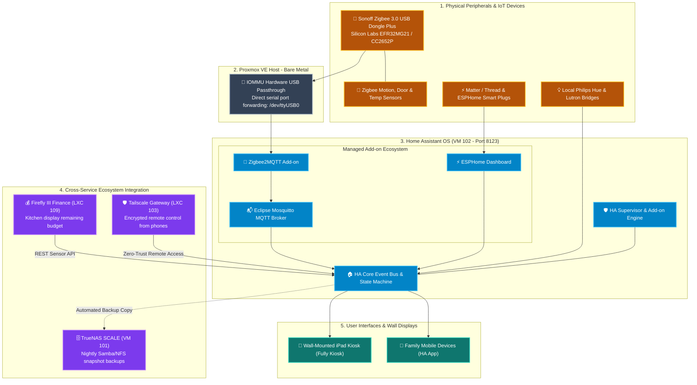

# 🏠 Home Assistant OS Smart Home Hub (VM 102)

[](https://www.home-assistant.io)
[](https://www.linux-kvm.org)
[](https://www.zigbee2mqtt.io)
[](https://mosquitto.org)
[](https://www.apache.org/licenses/LICENSE-2.0)

A dedicated, local-first smart home automation hub running **Home Assistant Operating System (HAOS)** inside a KVM virtual machine on Proxmox VE. Orchestrates lighting, climate, multi-room audio, presence detection, energy monitoring, and wall-mounted tablet dashboards with zero cloud dependencies.

---

## 🔗 Official Documentation & External Links

- **Official Website:** [home-assistant.io](https://www.home-assistant.io)
- **Documentation Hub:** [home-assistant.io/docs](https://www.home-assistant.io/docs)
- **Integrations Directory:** [home-assistant.io/integrations](https://www.home-assistant.io/integrations)
- **HAOS on Proxmox Guide:** [home-assistant.io/installation/linux#kvm](https://www.home-assistant.io/installation/linux#kvm)
- **Zigbee2MQTT Documentation:** [zigbee2mqtt.io](https://www.zigbee2mqtt.io)
- **Home Assistant Community:** [community.home-assistant.io](https://community.home-assistant.io)

---

## 🏗️ Local-First Smart Home Architecture



---

## 🧠 Architectural Deep-Dive & Engineering Decisions

### 1. HAOS Virtual Machine vs. Containerized Home Assistant Core
While Home Assistant can run as a standalone Docker container (`homeassistant/home-assistant`), deploying **HAOS in a dedicated KVM Virtual Machine** was selected for critical architectural advantages:
- **Full Supervisor Ecosystem:** Grants native, 1-click access to the Add-on store (Mosquitto MQTT, Zigbee2MQTT, ESPHome, Cloudflared, File Editor). In containerized Core, each supporting service must be manually managed, networked, and updated via separate Docker Compose files.
- **Direct USB Hardware Passthrough:** Virtual machines allow clean, isolated pass-through of physical USB serial controllers (e.g. Sonoff Zigbee coordinator) without dealing with Proxmox LXC cgroup device permissions (`c 188:0 rwm`) that often break across host kernel updates.
- **Disaster Recovery Snapshots:** HAOS creates point-in-time full system snapshots before each core or add-on update, enabling instant one-click rollback if an integration has breaking changes.

### 2. Local-First Smart Home Philosophy
- **Zero Cloud Dependence:** All core automations (e.g. motion sensor turns on hallway lights, door sensor alerts, thermostat schedules) execute locally inside the VM within `< 10 milliseconds`.
- **Internet Outage Resilience:** Even if the home fiber connection drops completely, every light switch, sensor trigger, and wall dashboard continues functioning without interruption.

### 3. Cross-Service Ecosystem Integrations
- **TrueNAS SCALE Snapshot Offloading:** HAOS is configured with the *Samba Backup* add-on to automatically copy nightly backups to `/mnt/tank/backups/home-assistant` on TrueNAS.
- **Firefly III Financial Dashboard Integration:** Home Assistant queries the Firefly III REST API via template sensors to display live monthly budget balances (e.g. *"Groceries: $340 CAD remaining"*) on the kitchen tablet kiosk.
- **Tailscale Gateway Integration:** Allows family members to view and control cameras, locks, and climate controls while away from home without forwarding any ports on the residential router.

---

## ⚙️ VM Sizing & Hardware Allocation

| Parameter | Specification | Engineering Rationale |
| :--- | :--- | :--- |
| **Virtualization** | KVM Virtual Machine (HAOS KVM Image) | Full operating system virtualization with Supervisor |
| **vCPUs** | 2 Cores (`host` type) | Sufficient for hundreds of entities and event bus processing |
| **Memory** | 4096 MB (4 GB) | Headroom for SQLite recorder database and add-on containers |
| **Boot Disk** | 32 GB SSD (`local-lvm`) | High-endurance SSD for entity state history and long-term statistics |
| **Network** | `vmbr0` (Static IP: `192.168.1.240`) | Attached to default bridge for mDNS and SSDP device discovery |
| **USB Passthrough** | Vendor/Device ID Passthrough | Passes Sonoff Zigbee USB 3.0 coordinator directly into VM |

---

## 🚀 Step-by-Step Deployment Guide

### 1. Download & Extract Official HAOS KVM Image
Run on the Proxmox VE host CLI:
```bash
cd /var/lib/vz/template/iso
wget https://github.com/home-assistant/operating-system/releases/download/12.4/haos_ova-12.4.qcow2.xz
unxz haos_ova-12.4.qcow2.xz
```

### 2. Provision Virtual Machine on Proxmox VE
```bash
qm create 102 \
  --name home-assistant \
  --memory 4096 \
  --cores 2 \
  --cpu host \
  --net0 virtio,bridge=vmbr0 \
  --scsihw virtio-scsi-single \
  --bios ovmf \
  --machine q35 \
  --efidisk0 local-lvm:4,efitype=4m,pre-enrolled-keys=1 \
  --onboot 1

# Import the disk image
qm importdisk 102 haos_ova-12.4.qcow2 local-lvm

# Attach imported disk as SCSI 0
qm set 102 --scsihw virtio-scsi-single --scsi0 local-lvm:vm-102-disk-1,discard=on,ssd=1
qm set 102 --boot order=scsi0
```

### 3. Passthrough USB Zigbee Coordinator
Identify your USB coordinator device on the Proxmox host:
```bash
lsusb
# Example: Bus 001 Device 004: ID 10c4:ea60 Silicon Labs CP210x UART Bridge

# Attach USB device to VM 102:
qm set 102 -usb0 host=10c4:ea60

# Start VM
qm start 102
```

### 4. Complete Onboarding
1. Navigate to `http://192.168.1.72:8123` in your browser.
2. Follow the onboarding wizard to create the primary home administrator account.
3. Install the **Mosquitto MQTT** and **Zigbee2MQTT** add-ons from the Add-on Store.
4. Begin pairing sensors and configuring local automations!

---

## 🧹 Smart Appliance Integrations: Tineco Vacuum & Floor Washer

The homelab integrates smart floor care appliances via the **Tineco Custom Component** (`custom_components/tineco` based on `wheeller123/Tineco-Integration`):

- **Supported Appliances:** Tineco FLOOR ONE S-Series (including S6, S6 PRO, S6 PRO EXTREME, S5, S3, and Carpet One).
- **Architecture & Protocol:** Cloud-polling integration interfacing with the Tineco IoT API.
- **Telemetry & Exposed Entities:**
  - `sensor.tineco_battery_percentage`: Real-time state of charge (SoC).
  - `binary_sensor.tineco_is_charging`: Active charging dock indicator.
  - `binary_sensor.tineco_waste_water_tank_full`: Dirty water tank full alarm.
  - `binary_sensor.tineco_clean_water_tank_empty`: Fresh water refill notification.
  - `sensor.tineco_cleaning_mode`: Operational state (Auto, Max, Suction, Self-Cleaning, Drying).
  - `switch.tineco_mute_audio`: Toggle device voice/audio announcements.
- **Automations Enabled:** Tablet dashboard alerts for empty clean water / full dirty water tanks, voice reminders when cleaning is finished but roller self-cleaning has not run, and battery health tracking.

