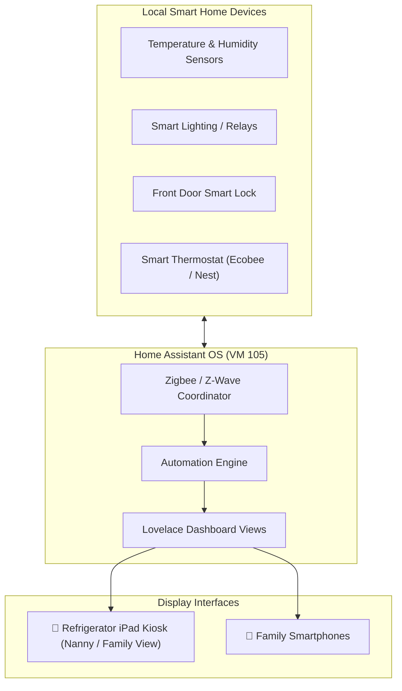

# 🏠 Home Assistant Smart Home OS (VM 105)

[](https://www.home-assistant.io)
[](https://pve.proxmox.com)
[](https://github.com/home-assistant/core/blob/dev/LICENSE.md)

A dedicated virtual machine running **Home Assistant Operating System (HAOS)** on Proxmox VE, acting as the local automation brain for smart sensors, lighting, climate controls, and refrigerator-mounted family tablet kiosks.

---

## 🔗 Official Documentation & External Links

- **Official Website:** [home-assistant.io](https://www.home-assistant.io)
- **HAOS Installation Guide:** [home-assistant.io/installation/haos](https://www.home-assistant.io/installation/haos)
- **Home Assistant Community:** [community.home-assistant.io](https://community.home-assistant.io)
- **HACS (Community Store):** [hacs.xyz](https://hacs.xyz)
- **Fully Kiosk Browser:** [fully-kiosk.com](https://www.fully-kiosk.com)
- **GitHub Core:** [home-assistant/core](https://github.com/home-assistant/core)

---

## 🏗️ Smart Home & Kiosk Architecture



---

## ⚙️ VM Sizing & Provisioning

| Parameter | Specification | Notes |
| :--- | :--- | :--- |
| **Virtualization** | KVM Virtual Machine | Direct USB & hardware device access |
| **vCPUs** | 2 Cores (`host` type) | Sufficient for hundreds of entities and automations |
| **Memory** | 4096 MB (4 GB) | Smooth Lovelace rendering and database caching |
| **Disk** | 32 GB SSD (`local-lvm`) | SQLite / MariaDB recorder database |
| **BIOS** | OVMF (UEFI) | Mandatory for official HAOS images |
| **Network** | `vmbr0` (Static IP) | Connects to primary LAN bridge |

---

## 🚀 1-Line Proxmox Deployment

Run on the Proxmox VE host CLI as `root`:

```bash
# Download official HAOS qcow2 image
wget -qO- https://github.com/home-assistant/operating-system/releases/latest/download/haos_ova-13.1.qcow2.xz | xz -d > /var/lib/vz/template/iso/haos.qcow2

# Create VM with UEFI BIOS and VirtIO SCSI
qm create 105 \
  --name homeassistant \
  --memory 4096 \
  --cores 2 \
  --cpu host \
  --bios ovmf \
  --efidisk0 local-lvm:0,efitype=4m,pre-enrolled-keys=1 \
  --net0 virtio,bridge=vmbr0 \
  --scsihw virtio-scsi-single \
  --scsi0 local-lvm:0,import-from=/var/lib/vz/template/iso/haos.qcow2,discard=on,ssd=1 \
  --boot order=scsi0 \
  --onboot 1

# Resize virtual disk to 32GB
qm resize 105 scsi0 +26G

# Start VM
qm start 105
```

---

## 📱 Tablet Kiosk Setup (Wall & Fridge Displays)

1. **Create Restricted User Profiles:**
   Go to **Settings** ➔ **People** ➔ **Users** ➔ Create user `kiosk` or `nanny` with non-admin privileges.
2. **Install Kiosk Mode (via HACS):**
   Hides the top header and sidebar for a distraction-free, dedicated full-screen interface.
3. **Configure Dedicated Dashboard (`/nanny` or `/kiosk`):**
   - Baby feeding, sleep, and diaper schedules (synced with Baby Buddy).
   - Weather forecasts, local transit times, and family shared to-do lists.
   - 1-tap quick buttons for lighting and climate controls.
