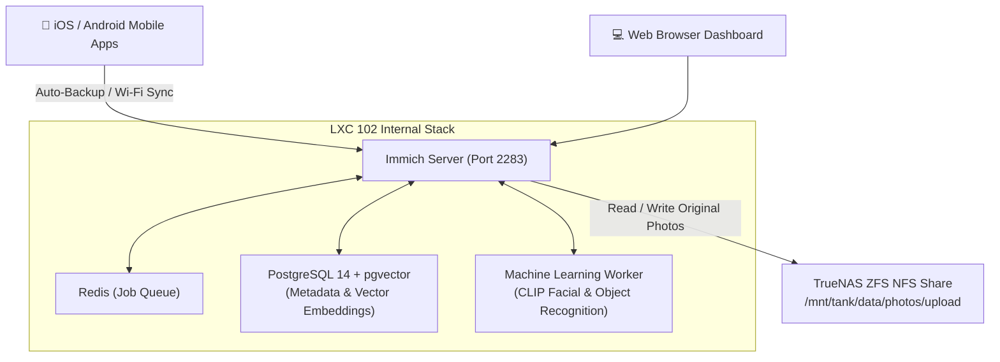

# 📸 Immich Photo & Video Cloud (LXC 102)

[](https://immich.app)
[](https://www.postgresql.org)
[](https://www.gnu.org/licenses/agpl-3.0)

A high-performance self-hosted backup solution for photos and videos (a privacy-focused Google Photos alternative), running in an unprivileged Debian 12 LXC container on Proxmox VE with hardware-accelerated machine learning for facial recognition and object clustering.

---

## 🔗 Official Documentation & External Links

- **Official Website:** [immich.app](https://immich.app)
- **Documentation:** [immich.app/docs](https://immich.app/docs)
- **GitHub Repository:** [immich-app/immich](https://github.com/immich-app/immich)
- **Mobile Apps:** [iOS App Store](https://apps.apple.com/app/immich/id1613945652) | [Google Play](https://play.google.com/store/apps/details?id=app.alextran.immich)
- **Discord Community:** [discord.gg/immich](https://discord.gg/immich)

---

## 🏗️ Storage & Machine Learning Architecture



---

## ⚙️ Container Sizing & Recommendations

| Parameter | Specification | Notes |
| :--- | :--- | :--- |
| **Virtualization** | Debian 12 LXC Container | Unprivileged with `nesting=1,keyctl=1` |
| **Cores** | 4 vCPUs | Needed for parallel ML facial clustering |
| **Memory** | 4096 MB (4 GB) | 6 GB recommended during initial mass library import |
| **Disk** | 16 GB SSD (`local-lvm`) | Root OS and Postgres index |
| **Data Storage** | NFSv4 Mount (`/mnt/photos`) | Mass storage backed by TrueNAS ZFS pool |

---

## 🚀 Step-by-Step Deployment

1. **Provision Container on Proxmox VE:**
   ```bash
   pct create 102 local:vztmpl/debian-12-standard_12.7-1_amd64.tar.zst \
     --hostname immich-photos \
     --cores 4 \
     --memory 4096 \
     --swap 1024 \
     --rootfs local-lvm:16 \
     --net0 name=eth0,bridge=vmbr0,ip=192.168.1.252/24,gw=192.168.1.1 \
     --unprivileged 1 \
     --features nesting=1,keyctl=1 \
     --onboot 1 \
     --start 1
   ```

2. **Mount TrueNAS Storage:**
   Enter the container (`pct enter 102`):
   ```bash
   apt-get update && apt-get install -y nfs-common curl wget git

   mkdir -p /mnt/photos
   cat << 'EOF' >> /etc/fstab
   <TRUENAS_IP>:/mnt/tank/data/photos /mnt/photos nfs defaults,timeo=14,intr 0 0
   EOF
   mount -a
   ```

3. **Deploy Docker Stack:**
   ```bash
   curl -fsSL https://get.docker.com -o get-docker.sh && sh get-docker.sh

   mkdir -p /opt/immich && cd /opt/immich
   # Copy docker-compose.yml and .env.example from this blueprint
   cp .env.example .env
   # Edit .env to set strong database password
   docker compose up -d
   ```

4. **Access Web Portal:**
   Navigate to `http://192.168.1.252:2283` to complete admin onboarding.
