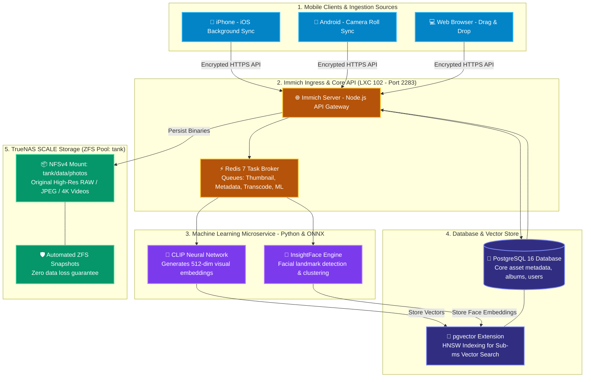

# 📸 Immich Family Photo & AI Media Hub (LXC 102)

[](https://immich.app)
[](https://github.com/tensorchord/VectorChord)
[](https://valkey.io)
[](https://immich.app/docs/features/ml-hardware-acceleration)
[](https://www.gnu.org/licenses/agpl-3.0)

A high-performance, self-hosted photo and video management system running inside an unprivileged Debian 12 LXC container on Proxmox VE. Functions as a sovereign alternative to Google Photos and Apple iCloud Photos, featuring **on-premise AI semantic vector search**, **automatic facial recognition and clustering**, **seamless mobile background backup**, and **direct TrueNAS ZFS storage integration**.

---

## 🔗 Official Documentation & External Links

- **Official Website:** [immich.app](https://immich.app)
- **Documentation Hub:** [immich.app/docs/overview/introduction](https://immich.app/docs/overview/introduction)
- **GitHub Repository:** [immich-app/immich](https://github.com/immich-app/immich)
- **Hardware Transcoding & ML Guide:** [immich.app/docs/features/ml-hardware-acceleration](https://immich.app/docs/features/ml-hardware-acceleration)
- **Mobile Apps (iOS & Android):** [immich.app/docs/install/mobile](https://immich.app/docs/install/mobile)
- **Community Forum:** [reddit.com/r/immich](https://reddit.com/r/immich)

---

## 🏗️ Photo Ingestion & Vector AI Search Architecture



---

## 🧠 Architectural Deep-Dive & Engineering Decisions

### 1. On-Premise Semantic Vector Search (CLIP + pgvector)
Traditional photo albums rely strictly on manual tags, dates, or filename lookups. Immich implements modern neural search without sending private photos to any third-party cloud:
- **CLIP (Contrastive Language-Image Pre-Training):**
  When a photo is ingested, the ML container passes the image through a vision transformer model, extracting a dense **512-dimensional vector** representing semantic features.
- **pgvector Indexing in PostgreSQL:**
  Vectors are indexed using Hierarchical Navigable Small World (HNSW) graphs.
- **Natural Language Search:**
  When you search for *"red sports car in snow"* or *"dog sleeping on couch"*, Immich vectorizes your search query and computes cosine similarity against your database in milliseconds:
  $$\text{Cosine Similarity} = \frac{\mathbf{u} \cdot \mathbf{v}}{\|\mathbf{u}\|_2 \|\mathbf{v}\|_2}$$
  Matches are returned instantly without needing manual keywords.

### 2. Facial Recognition & Clustering (InsightFace)
- Detects bounding boxes for every human face in images.
- Extracts unique facial biometric landmark embeddings.
- Automatically groups recurring faces into named people albums, continuously improving accuracy as more family photos are added.

### 3. Decoupled Microservices Architecture
- Ingesting 500 photos from a vacation shouldn't lock up the mobile app UI.
- Immich's microservices separation ensures that the `immich-server` immediately acknowledges uploads and saves the original files to disk.
- Thumbnail generation, video transcoding, and ML vector extraction are enqueued onto Redis and processed asynchronously by background worker threads.

### 4. TrueNAS ZFS Storage Integration
- Photos and home videos are irreplaceable family archives. Rather than storing them on ephemeral VM disks, Immich connects directly to `/mnt/tank/data/photos` on TrueNAS SCALE via NFSv4.
- **ZFS Configuration:**
  - `recordsize=256K`: Optimized for typical photo asset sizes (5MB - 30MB).
  - `compression=lz4`: Transparent, line-rate compression for metadata and thumbnails.
  - `atime=off`: Eliminates unnecessary disk write operations during photo browsing.
  - Hourly snapshots guarantee that accidentally deleted albums can be rolled back with zero data loss.

---

## ⚙️ Container Sizing & Recommendations

| Parameter | Specification | Engineering Rationale |
| :--- | :--- | :--- |
| **Virtualization** | Debian 12 LXC Container | Unprivileged container with `nesting=1` |
| **vCPUs** | 4 Cores | Machine learning embeddings and thumbnail generation are heavily CPU-bound |
| **Memory** | 6144 MB (6 GB) | PostgreSQL + pgvector (1.5GB) + ML ONNX Runtime (2GB) + Node server (1GB) |
| **Disk** | 24 GB SSD (`local-lvm`) | OS, Docker images, and local temporary transcoding cache |
| **Storage Mount** | NFSv4 (`/mnt/tank/data/photos`) | High-capacity redundant storage anchored on TrueNAS ZFS mirror |

---

## 🚀 Step-by-Step Deployment Guide

### 1. Provision Proxmox LXC Container
Run on the Proxmox VE host CLI:
```bash
pct create 102 local:vztmpl/debian-12-standard_12.7-1_amd64.tar.zst \
  --hostname immich-photos \
  --cores 4 \
  --memory 6144 \
  --swap 1024 \
  --rootfs local-lvm:24 \
  --net0 name=eth0,bridge=vmbr0,ip=192.168.1.252/24,gw=192.168.1.1 \
  --unprivileged 1 \
  --features nesting=1 \
  --onboot 1 \
  --start 1
```

### 2. Configure TrueNAS NFS Storage Mount
Enter container (`pct enter 102`):
```bash
apt-get update && apt-get install -y nfs-common curl wget git

mkdir -p /mnt/photos

cat << 'EOF' >> /etc/fstab
<TRUENAS_IP>:/mnt/tank/data/photos /mnt/photos nfs defaults,nfsvers=4,timeo=14,intr 0 0
EOF

mount -a
df -h | grep photos
```

### 3. Deploy Immich Stack via Docker Compose
```bash
curl -fsSL https://get.docker.com -o get-docker.sh && sh get-docker.sh

mkdir -p /docker/immich && cd /docker/immich

# Copy blueprint templates
cp .env.example .env

# Set secure database password and storage path
DB_PW=$(openssl rand -hex 24)
sed -i "s|<GENERATE_STRONG_DB_PASSWORD>|$DB_PW|" .env
sed -i "s|UPLOAD_LOCATION=.*|UPLOAD_LOCATION=/mnt/photos|" .env

docker compose up -d
```

### 4. Initial Setup & Mobile Pairing
1. Navigate to `http://192.168.1.252:2283` in your browser.
2. Complete the initial administrator registration.
3. Download the **Immich mobile app** on iOS or Android.
4. Connect using your local/Tailscale IP (`http://192.168.1.252:2283`) and enable background photo backup.

---

## 🌐 Public Album Sharing & Contributor Uploads (Tailscale Funnel)

To allow friends and family outside your home network to view shared albums, download original media, and upload photos directly from their phone browsers without requiring an account or VPN:

1. **Configure External Domain in Immich:**
   * Go to **Administration (Gear Icon)** $\rightarrow$ **Settings** $\rightarrow$ **Server Settings**.
   * Set **External Domain** to: `https://<GATEWAY_TAILSCALE_DOMAIN>`.
   * Immich will automatically use this public URL for all generated share links instead of the local IP.
2. **Expose Ingress via Tailscale Funnel:**
   * Handled transparently by `tailscale-gateway` (LXC 103) routing `https://<GATEWAY_TAILSCALE_DOMAIN>/` to `http://192.168.1.252:2283`.
3. **Generate Public Shared Link:**
   * Open any Album $\rightarrow$ tap **Share** $\rightarrow$ **Create Link**.
   * Toggle **Allow Upload** to **ON** (enables guest photo submissions).
   * Toggle **Allow Download** to **ON**.
   * Copy the generated HTTPS link and send to friends.

