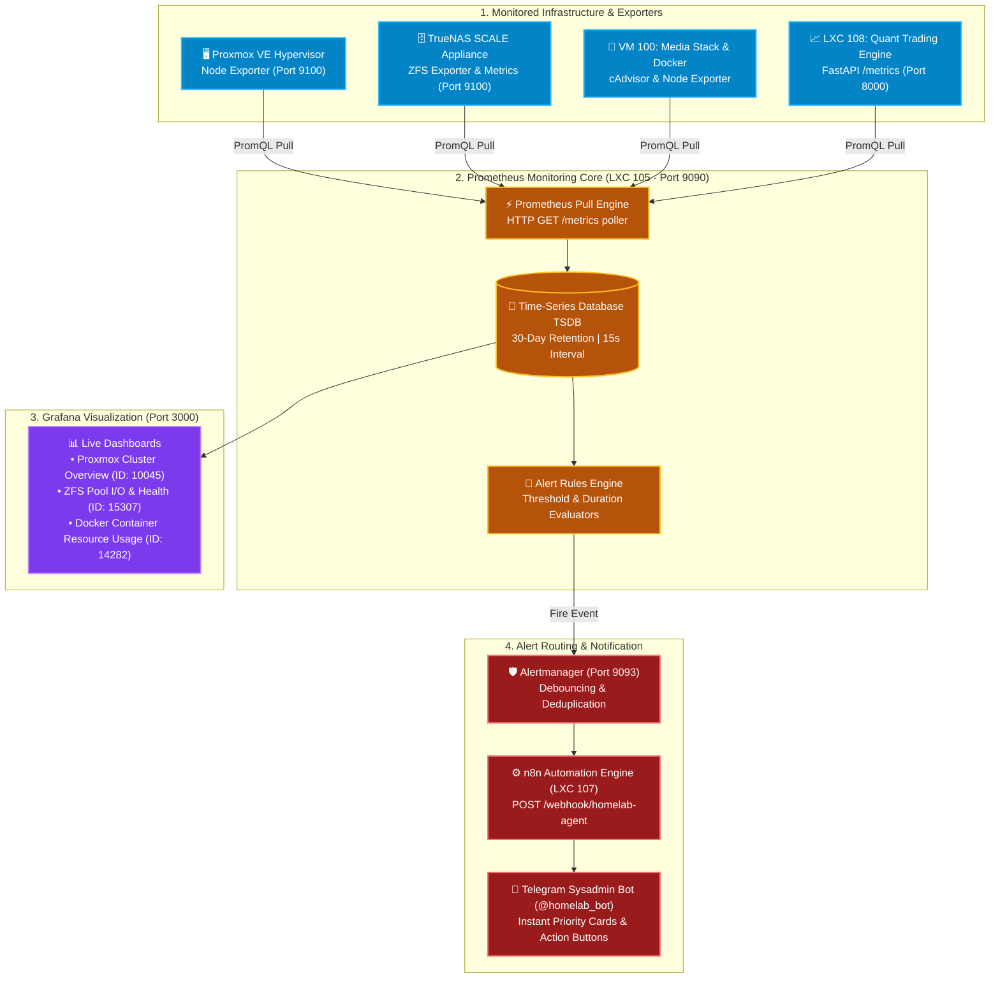

# 📊 Observability & Monitoring: Prometheus & Grafana (LXC 105)

[](https://prometheus.io)
[](https://grafana.com)
[](https://github.com/google/cadvisor)
[](https://core.telegram.org/bots)
[](https://www.apache.org/licenses/LICENSE-2.0)

A comprehensive, self-hosted observability, metrics scraping, and automated alerting engine running inside an unprivileged Debian 12 LXC container on Proxmox VE. Collects real-time telemetry from the **Proxmox hypervisor**, **TrueNAS ZFS pools**, **Docker containers**, and **microservices**, routing instant incident alerts to Telegram via n8n.

---

## 🔗 Official Documentation & External Links

- **Prometheus Official Website:** [prometheus.io](https://prometheus.io)
- **Prometheus Documentation:** [prometheus.io/docs](https://prometheus.io/docs)
- **Grafana Official Website:** [grafana.com](https://grafana.com)
- **Grafana Documentation:** [grafana.com/docs/grafana/latest](https://grafana.com/docs/grafana/latest)
- **Grafana Dashboards Library:** [grafana.com/grafana/dashboards](https://grafana.com/grafana/dashboards)
- **Node Exporter:** [github.com/prometheus/node_exporter](https://github.com/prometheus/node_exporter)
- **cAdvisor Container Metrics:** [github.com/google/cadvisor](https://github.com/google/cadvisor)

---

## 🏗️ Telemetry Scraping & Alerting Architecture



---

## 🧠 Architectural Deep-Dive & Engineering Decisions

### 1. Pull vs. Push Metrics Model
Prometheus was selected over push-based solutions (like InfluxDB or Graphite) due to its superior reliability in homelab environments:
- **Centralized Polling Control:** Prometheus controls the scraping cadence (15s interval) and connection concurrency, preventing resource-constrained IoT nodes or LXCs from being overwhelmed by uncoordinated push bursts.
- **Instant Outage Detection (`InstanceDown`):** If a container crashes, a VM kernel panics, or a network cable is unplugged, Prometheus notices the missing HTTP response on the very next scrape cycle and fires an immediate alert. Push systems require complex heartbeat timeout logic to detect dead targets.

### 2. Low-Overhead cAdvisor & Node Exporter Deployment
- **Node Exporter:** Installed directly on bare-metal Proxmox and TrueNAS as lightweight Go binaries consuming `< 15MB` RAM. Exposes host CPU states, memory commit limits, network saturation, and disk IO queues.
- **cAdvisor (Container Advisor):** Runs as a lightweight Docker container on VM 100. Inspects the Linux kernel cgroups of running Docker containers to record per-container memory usage, CPU throttling, and network throughput.

### 3. Critical Production Alerting Rules

| Alert Name | Expression / Condition | Duration | Severity | Action Triggered |
| :--- | :--- | :--- | :--- | :--- |
| **`NodeDown`** | `up == 0` | 2 minutes | Critical | Pushes Telegram alert with failing host IP |
| **`HostHighCpuLoad`** | `100 - (avg by (instance) (rate(node_cpu_seconds_total{mode="idle"}[5m])) * 100) > 90` | 15 minutes | Warning | Identifies run-away processes or stuck OCR jobs |
| **`HostOutOfMemory`** | `(node_memory_MemAvailable_bytes / node_memory_MemTotal_bytes) * 100 < 10` | 5 minutes | Critical | Alerts prior to Linux kernel OOM-killer invocations |
| **`ZfsPoolDegraded`** | `zfs_pool_state{state!="online"} > 0` | 1 minute | Critical | Immediate warning of drive failure or parity corruption |
| **`DiskSpaceLow`** | `(node_filesystem_free_bytes / node_filesystem_size_bytes) * 100 < 15` | 10 minutes | Warning | Prevents ZFS performance degradation (>80% capacity) |

---

## ⚙️ Container Sizing & Storage Recommendations

| Parameter | Specification | Engineering Rationale |
| :--- | :--- | :--- |
| **Virtualization** | Debian 12 LXC Container | Unprivileged container with `nesting=1` |
| **vCPUs** | 2 vCPUs | PromQL query evaluations and dashboard rendering |
| **Memory** | 2048 MB (2 GB) | Prometheus TSDB memory cache + Grafana web application |
| **Disk** | 24 GB SSD (`local-lvm`) | Retains 30 days of metrics at 15-second scrape intervals |
| **Ports** | `9090` (Prometheus), `3000` (Grafana), `9093` (Alertmanager) | Internal LAN and Tailscale access only |

---

## 🚀 Step-by-Step Deployment Guide

### 1. Provision Proxmox LXC Container
Run on the Proxmox VE host CLI:
```bash
pct create 105 local:vztmpl/debian-12-standard_12.7-1_amd64.tar.zst \
  --hostname monitoring-stack \
  --cores 2 \
  --memory 2048 \
  --swap 512 \
  --rootfs local-lvm:24 \
  --net0 name=eth0,bridge=vmbr0,ip=192.168.1.249/24,gw=192.168.1.1 \
  --unprivileged 1 \
  --features nesting=1 \
  --onboot 1 \
  --start 1
```

### 2. Deploy Prometheus & Grafana via Docker Compose
Enter container (`pct enter 105`):
```bash
curl -fsSL https://get.docker.com -o get-docker.sh && sh get-docker.sh

mkdir -p /docker/monitoring && cd /docker/monitoring

# Copy prometheus.yml from this blueprint
cat << 'EOF' > prometheus.yml
global:
  scrape_interval: 15s
  evaluation_interval: 15s

scrape_configs:
  - job_name: "proxmox-node"
    static_configs:
      - targets: ["192.168.1.250:9100"]

  - job_name: "truenas-scale"
    static_configs:
      - targets: ["192.168.1.139:9100"]

  - job_name: "docker-media-vm"
    static_configs:
      - targets: ["192.168.1.251:9100", "192.168.1.251:8080"]
EOF

# Launch containers
cat << 'EOF' > docker-compose.yml
version: "3.8"
services:
  prometheus:
    image: prom/prometheus:v2.50.1
    container_name: prometheus
    restart: unless-stopped
    volumes:
      - ./prometheus.yml:/etc/prometheus/prometheus.yml:ro
      - ./promdata:/prometheus
    command:
      - '--config.file=/etc/prometheus/prometheus.yml'
      - '--storage.tsdb.path=/prometheus'
      - '--storage.tsdb.retention.time=30d'
    ports:
      - "9090:9090"

  grafana:
    image: grafana/grafana:11.0.0
    container_name: grafana
    restart: unless-stopped
    depends_on:
      - prometheus
    volumes:
      - ./grafanadata:/var/lib/grafana
    ports:
      - "3000:3000"
EOF

docker compose up -d
```

### 3. Import Recommended Grafana Dashboards
1. Open `http://192.168.1.249:3000` (default login: `admin` / `admin`).
2. Add Prometheus data source: `http://prometheus:9090`.
3. Go to **Dashboards** ➔ **Import** and enter the following official dashboard IDs:
   - **Node Exporter Full:** `1860` (Comprehensive host hardware telemetry)
   - **Proxmox VE Cluster:** `10045` (CPU, memory, and container status)
   - **Docker Container Metrics (cAdvisor):** `14282`
