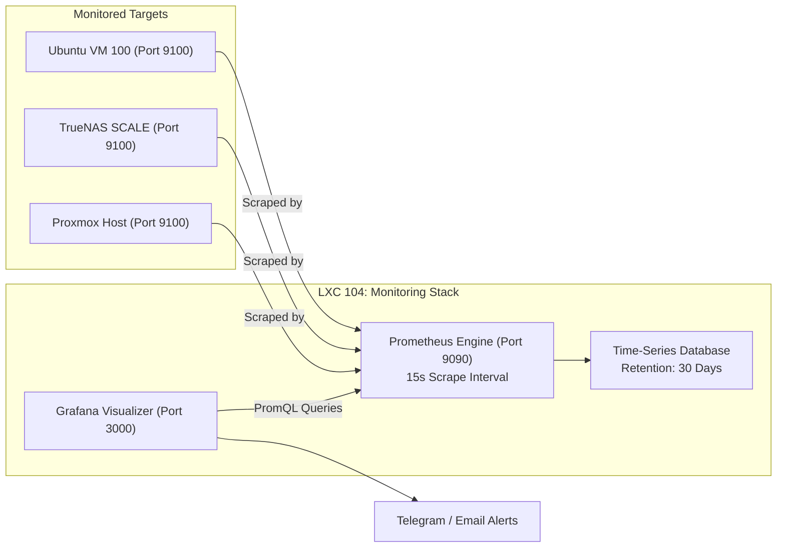

# 📊 Prometheus & Grafana Telemetry Stack (LXC 104)

[](https://prometheus.io)
[](https://grafana.com)
[](https://www.apache.org/licenses/LICENSE-2.0)

A lightweight telemetry, metrics collection, and alerting stack running natively inside a Debian 12 LXC container. Collects hardware metrics, ZFS pool utilization, and container resource stats across the entire Proxmox cluster.

---

## 🔗 Official Documentation & External Links

- **Prometheus Official:** [prometheus.io](https://prometheus.io)
- **Prometheus Docs:** [prometheus.io/docs](https://prometheus.io/docs)
- **Grafana Official:** [grafana.com](https://grafana.com)
- **Grafana Docs:** [grafana.com/docs](https://grafana.com/docs)
- **Node Exporter:** [github.com/prometheus/node_exporter](https://github.com/prometheus/node_exporter)
- **Community Dashboards:** [grafana.com/grafana/dashboards](https://grafana.com/grafana/dashboards)

---

## 🏗️ Metrics Scraping & Visualization Architecture



---

## ⚙️ Container Sizing & Recommendations

| Parameter | Specification | Notes |
| :--- | :--- | :--- |
| **Virtualization** | Debian 12 LXC Container | Unprivileged |
| **Cores** | 2 vCPUs | PromQL queries & dashboard rendering |
| **Memory** | 2048 MB (2 GB) | Handles scraping 10+ targets comfortably |
| **Disk** | 20 GB SSD (`local-lvm`) | Stores 30-day time-series history |
| **Ports** | `3000` (Grafana), `9090` (Prometheus) | Internal web management ports |

---

## 🚀 Step-by-Step Deployment

1. **Provision Container:**
   ```bash
   pct create 104 local:vztmpl/debian-12-standard_12.7-1_amd64.tar.zst \
     --hostname monitoring \
     --cores 2 \
     --memory 2048 \
     --swap 512 \
     --rootfs local-lvm:20 \
     --net0 name=eth0,bridge=vmbr0,ip=192.168.1.249/24,gw=192.168.1.1 \
     --unprivileged 1 \
     --onboot 1 \
     --start 1
   ```

2. **Install Prometheus & Grafana Packages:**
   Enter container (`pct enter 104`):
   ```bash
   apt-get update && apt-get install -y prometheus prometheus-node-exporter

   # Add Grafana Official Repository
   mkdir -p /etc/apt/keyrings
   wget -q -O - https://apt.grafana.com/gpg.key | gpg --dearmor | tee /etc/apt/keyrings/grafana.gpg > /dev/null
   echo "deb [signed-by=/etc/apt/keyrings/grafana.gpg] https://apt.grafana.com stable main" | tee /etc/apt/sources.list.d/grafana.list

   apt-get update && apt-get install -y grafana
   systemctl daemon-reload
   systemctl enable --now prometheus grafana-server prometheus-node-exporter
   ```

3. **Configure Prometheus:**
   Copy `prometheus.yml` from this blueprint into `/etc/prometheus/prometheus.yml` and restart:
   ```bash
   systemctl restart prometheus
   ```

4. **Import Community Dashboards:**
   In Grafana (`http://192.168.1.249:3000`):
   - Add data source: `http://localhost:9090`
   - Import **Node Exporter Full** (Dashboard ID: `1860`)
   - Import **Proxmox Cluster Metrics** (Dashboard ID: `10347`)
