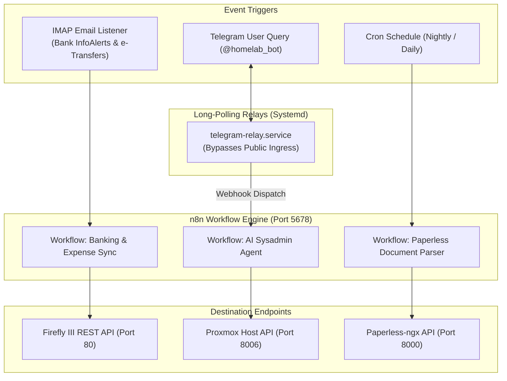

# 🤖 n8n Workflow Automation Engine (LXC 107)

[](https://n8n.io)
[](https://www.docker.com)
[](https://core.telegram.org/bots)
[](https://n8n.io/license)

The central orchestrator of the homelab: a self-hosted node-based workflow automation platform running in an unprivileged Debian 12 LXC container. Features **email-to-financial ingestion**, **proactive 24/7 cluster monitoring**, and **conversational Telegram AI bots**.

---

## 🔗 Official Documentation & External Links

- **Official Website:** [n8n.io](https://n8n.io)
- **Documentation:** [docs.n8n.io](https://docs.n8n.io)
- **Workflow Templates Library:** [n8n.io/workflows](https://n8n.io/workflows)
- **GitHub Repository:** [n8n-io/n8n](https://github.com/n8n-io/n8n)
- **Community Forum:** [community.n8n.io](https://community.n8n.io)
- **Telegram Bot API:** [core.telegram.org/bots/api](https://core.telegram.org/bots/api)

---

## 🏗️ Automation Architecture & Ingestion Flows



---

## ⚙️ Container Sizing & Recommendations

| Parameter | Specification | Notes |
| :--- | :--- | :--- |
| **Virtualization** | Debian 12 LXC Container | Unprivileged with `nesting=1` |
| **Cores** | 2 vCPUs | Python relays + Node.js workflow execution |
| **Memory** | 4096 MB (4 GB) | Multi-workflow concurrency and memory buffers |
| **Disk** | 20 GB SSD (`local-lvm`) | n8n execution history and SQLite/Postgres logs |
| **Port** | `5678` | Web UI & Webhook ingress |

---

## 🚀 Step-by-Step Deployment

1. **Provision Container:**
   ```bash
   pct create 107 local:vztmpl/debian-12-standard_12.7-1_amd64.tar.zst \
     --hostname n8n-automation \
     --cores 2 \
     --memory 4096 \
     --swap 1024 \
     --rootfs local-lvm:20 \
     --net0 name=eth0,bridge=vmbr0,ip=192.168.1.247/24,gw=192.168.1.1 \
     --unprivileged 1 \
     --features nesting=1 \
     --onboot 1 \
     --start 1
   ```

2. **Deploy n8n via Docker:**
   Enter container (`pct enter 107`):
   ```bash
   curl -fsSL https://get.docker.com -o get-docker.sh && sh get-docker.sh

   mkdir -p /opt/n8n && cd /opt/n8n
   # Copy docker-compose.yml and .env.example
   cp .env.example .env
   docker compose up -d
   ```

3. **Deploy 24/7 Telegram Long-Polling Daemon (Optional):**
   To interact with Telegram bots behind your firewall without exposing public ports:
   ```bash
   apt-get install -y python3-venv python3-pip
   python3 -m venv /opt/telegram-relay/.venv
   /opt/telegram-relay/.venv/bin/pip install requests flask
   ```
   *Create `/etc/systemd/system/telegram-relay.service` to forward Telegram updates to `http://127.0.0.1:5678/webhook/homelab-agent`.*
