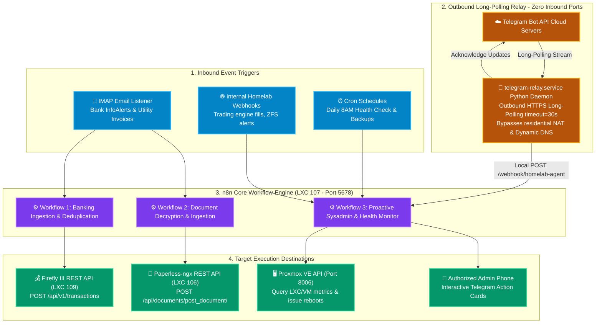

# 🤖 n8n Workflow Automation Engine & Sysadmin Bot (LXC 107)

[](https://n8n.io)
[](https://www.docker.com)
[](https://core.telegram.org/bots)
[](https://www.python.org)
[](https://n8n.io/license)

The central nervous system of the homelab: an enterprise-grade, node-based workflow automation platform running inside an unprivileged Debian 12 LXC container on Proxmox VE. Orchestrates **real-time banking ingestion**, **document pre-processing**, **proactive 24/7 cluster monitoring**, and **firewall-free conversational Telegram AI bots**.

---

## 🔗 Official Documentation & External Links

- **Official Website:** [n8n.io](https://n8n.io)
- **Documentation Hub:** [docs.n8n.io](https://docs.n8n.io)
- **Workflow Templates Library:** [n8n.io/workflows](https://n8n.io/workflows)
- **GitHub Repository:** [n8n-io/n8n](https://github.com/n8n-io/n8n)
- **Community Forum:** [community.n8n.io](https://community.n8n.io)
- **Telegram Bot API Reference:** [core.telegram.org/bots/api](https://core.telegram.org/bots/api)

---

## 🏗️ Orchestration & Ingestion Architecture



---

## 🧠 Architectural Deep-Dive & Decision Rationale

### 1. The Outbound Long-Polling Relay Architecture
Most self-hosted Telegram bots require configuring an inbound webhook:
- Opening public router ports (`80`/`443`) or using Cloudflare Tunnels.
- Maintaining dynamic DNS (DDNS) records.
- Exposing an attack surface to WAN port scanners.

**Our Zero-Exposure Solution:**
- We deploy an isolated Python long-polling systemd daemon (`telegram-relay.service`) on `LXC 107`.
- The daemon initiates **outbound-only HTTPS connections** to Telegram's cloud servers (`https://api.telegram.org/bot<TOKEN>/getUpdates?timeout=30`).
- When a user sends a message or taps an inline button, Telegram responds immediately over the open outbound socket.
- The daemon validates the sender's Telegram user ID against a strict whitelist. If authorized, it dispatches the payload to n8n over the loopback interface (`http://127.0.0.1:5678/webhook/...`) with a shared secret header.
- **Zero inbound firewall ports are opened**, and the bot functions seamlessly behind double-NAT or cellular connections.

---

## 🔄 Core Production Workflows

### Workflow 1: Banking & Expense Ingestion (`bank-email-to-firefly`)
- **Trigger:** IMAP poller triggers on incoming unread emails matching `from:alerts@scotiabank.com` or `from:alerts@rbc.com`.
- **Parsing & Normalization:**
  - Extracts transaction date, dollar amount, merchant name, and account last-4 digits using JavaScript regex nodes.
  - Normalizes merchant strings (e.g. `COSTCO WHOLESALE #1028 VANCOUVER` ➔ `Costco Wholesale`).
- **Deduplication Safeguard:**
  - Generates an MD5 fingerprint: `MD5(Date + Amount + Merchant + Account)`.
  - Checks an internal SQLite cache to ensure accidental duplicate alert emails are ignored.
- **Ledger Posting:** Posts a verified withdrawal transaction to Firefly III REST API.

### Workflow 2: Automated Document Decryption & Ingestion (`paperless-ingestion`)
- **Trigger:** IMAP poller catches PDF attachments from utility companies and banks.
- **Decryption Routine:** If the PDF is encrypted (common with banking e-statements), n8n executes an external `qpdf` script using a local passphrase vault to generate an unencrypted PDF/A stream.
- **REST Ingestion:** Submits the file directly to Paperless-ngx REST API with pre-populated tags (`#Utilities`, `#Tax-2026`).

### Workflow 3: Proactive 24/7 Homelab Sysadmin Agent (`homelab-sysadmin-bot`)
- **Schedule:** 24/7 continuous audit daemon running every 180s (3 minutes), plus daily executive briefings at 8:00 AM.
- **Metrics Collection:** Queries Proxmox VE API, TrueNAS ZFS pool status, container uptime, and core HTTP service endpoints.
- **Resilient Health Check Parameters:**
  - Standard REST/HTTP services: 5.0-second timeout.
  - High-I/O Torrent Services (`qBittorrent`): Configured with a **15.0-second timeout** and an automatic **2-second retry mechanism** to prevent false-positive "service down" alerts during heavy 4K HDR network saturation and TrueNAS NFS flushing.
- **Interactive Triage:** Supports natural-language commands via Telegram (`Fix <service>`, `Restart <service>`, `Check storage`, `Prune docker`).
- **Actionable Digest:** Sends a formatted Markdown summary to Telegram with inline interactive buttons:
  ```text
  🟢 Proxmox Node: Online (CPU: 12% | RAM: 18.4 / 32 GB)
  🟢 TrueNAS Pool: tank (ONLINE - 0 errors, 4.2 / 8 TB used)
  🟢 Active Containers: 9 running / 0 degraded
  ```
  - **Inline Action Buttons:** `[ 📊 Detailed Report ]`, `[ 🔄 Restart LXC 106 ]`, `[ 💾 Run Backup ]`.
- **Callback Enforcement:** When a button is tapped, n8n verifies `callback_query.from.id == AUTHORIZED_CHAT_ID` before executing the privileged command against the Proxmox API.

---

## ⚙️ Container Sizing & Recommendations

| Parameter | Specification | Rationale |
| :--- | :--- | :--- |
| **Virtualization** | Debian 12 LXC Container | Unprivileged with `nesting=1` |
| **vCPUs** | 2 vCPUs | Python long-polling relays + Node.js async event loops |
| **Memory** | 4096 MB (4 GB) | n8n execution memory buffers and JSON parsing arrays |
| **Disk** | 20 GB SSD (`local-lvm`) | Workflow history, SQLite execution logs, temporary files |
| **Pruning Policy** | Auto-prune enabled | Prunes execution logs older than 7 days to prevent disk exhaustion |

---

## 🚀 Step-by-Step Deployment Guide

### 1. Provision Proxmox LXC Container
Run on the Proxmox VE host CLI:
```bash
pct create 107 local:vztmpl/debian-12-standard_12.7-1_amd64.tar.zst \
  --hostname n8n-automation \
  --cores 2 \
  --memory 4096 \
  --swap 1024 \
  --rootfs local-lvm:20 \
  --net0 name=eth0,bridge=vmbr0,ip=192.168.1.247/24,gw=192.168.1.1 \
  --unprivileged 1 \
  --features nesting=1 \
  --onboot 1 \
  --start 1
```

### 2. Deploy n8n Container Stack
Enter container (`pct enter 107`):
```bash
curl -fsSL https://get.docker.com -o get-docker.sh && sh get-docker.sh

mkdir -p /opt/n8n && cd /opt/n8n

# Copy templates from this blueprint
cp .env.example .env

# Generate secure random encryption key
N8N_KEY=$(openssl rand -hex 32)
sed -i "s|<GENERATE_RANDOM_32_CHAR_KEY>|$N8N_KEY|" .env

# Start stack
docker compose up -d
```

### 3. Deploy the Telegram Long-Polling Relay Daemon
```bash
apt-get install -y python3-venv python3-pip

mkdir -p /opt/telegram-relay
cd /opt/telegram-relay
python3 -m venv .venv
.venv/bin/pip install requests

# Create systemd service
cat << 'EOF' > /etc/systemd/system/telegram-relay.service
[Unit]
Description=Telegram Outbound Long-Polling Relay for n8n
After=network.target docker.service

[Service]
Type=simple
User=root
WorkingDirectory=/opt/telegram-relay
ExecStart=/opt/telegram-relay/.venv/bin/python /opt/telegram-relay/relay.py
Restart=always
RestartSec=5

[Install]
WantedBy=multi-user.target
EOF

systemctl daemon-reload
systemctl enable --now telegram-relay.service
```

### 4. Post-Installation Verification
- Open `http://192.168.1.247:5678` in your browser to complete owner setup.
- Ensure `EXECUTIONS_DATA_PRUNE=true` and `EXECUTIONS_DATA_MAX_AGE=168` are active in `.env` to keep the database lean.
- Import production workflows from the `workflows/` directory.
