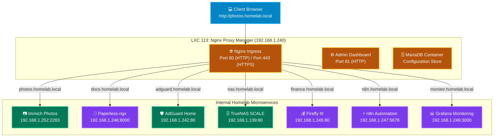

# 🌐 Nginx Proxy Manager (NPM): Reverse Proxy & Local Domain Gateway

`Nginx Proxy Manager` is a reverse proxy, SSL termination engine, and domain routing gateway deployed in an isolated Debian 12 container (**LXC 113**). It operates via Docker Compose with a MariaDB backing store, receiving wildcard traffic for `*.homelab.local` from AdGuard Home and routing requests cleanly to homelab container ports.

---

## 🏗️ Ingress Routing Architecture



---

## ⚙️ Container Resource Specifications

| Specification | Value | Notes |
| :--- | :--- | :--- |
| **Container ID** | `113` | Debian 12 Minimal Unprivileged LXC (`nesting=1`, `keyctl=1`) |
| **Hostname** | `nginx-proxy-manager` | Local domain reverse proxy gateway |
| **Static IPv4** | `<CONTAINER_IP>/24` | Local bridge `vmbr0` |
| **Gateway** | `<GATEWAY_IP>` | Router / Subnet Gateway |
| **DNS Resolvers** | `192.168.1.242`, `1.1.1.1` | AdGuard Home primary, Cloudflare fallback |
| **vCPU** | `1 Core` | OpenResty Nginx engine |
| **RAM Allocation** | `1024 MB` (1 GB) | Docker daemon + MariaDB + OpenResty |
| **Disk Storage** | `8 GB` on `local-lvm` | Host volumes for `/data`, `/letsencrypt`, `/mysql` |
| **Ports** | `80/tcp`, `443/tcp`, `81/tcp` | HTTP, HTTPS, and Admin Dashboard |

---

## 🗺️ Pre-Configured Homelab Proxy Hosts

All proxy hosts are provisioned with **Block Common Exploits** and **Websockets Support** enabled:

| Domain | Forward Scheme | Forward Host | Forward Port | Service Description |
| :--- | :---: | :--- | :---: | :--- |
| `adguard.homelab.local` | `http` | `192.168.1.242` | `80` | AdGuard Home Network-wide DNS & Privacy |
| `photos.homelab.local` | `http` | `192.168.1.252` | `2283` | Immich Photo & Video Cloud |
| `docs.homelab.local` | `http` | `192.168.1.246` | `8000` | Paperless-ngx OCR Document Archive |
| `nas.homelab.local` | `http` | `192.168.1.139` | `80` | TrueNAS SCALE Storage Appliance UI |
| `portal.homelab.local` | `http` | `192.168.1.251` | `80` | Homelab Homepage Dashboard |
| `home.homelab.local` | `http` | `192.168.1.72` | `80` | Home Assistant OS Smart Home Hub |
| `finance.homelab.local` | `http` | `192.168.1.245` | `80` | Firefly III Personal Wealth Management |
| `n8n.homelab.local` | `http` | `192.168.1.247` | `5678` | n8n Workflow Automation Engine |
| `monitor.homelab.local` | `http` | `192.168.1.249` | `3000` | Prometheus & Grafana System Telemetry |

---

## 🛠️ Verification & Maintenance Commands

```bash
# Verify container states inside LXC 113
docker ps

# Verify HTTP proxy routing to Immich
curl -sI -H "Host: photos.homelab.local" http://192.168.1.240

# Access Admin UI
http://192.168.1.240:81
```
