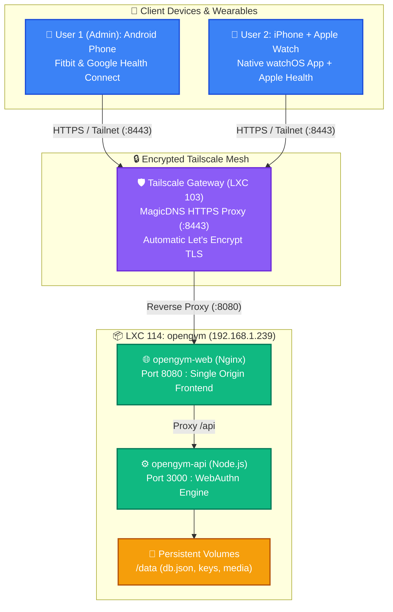

# 🏋️ openGym — Self-Hosted Fitness & Workout Tracker

A privacy-first, local-first fitness and workout tracking platform deployed on Proxmox VE LXC with native Passkey (WebAuthn) biometrics, dual-user isolation, Apple Watch / Apple Health integration, and Android Health Connect support.

---

## 🏗️ Architecture Overview



---

## 📋 Service Details

| Attribute | Specification |
| :--- | :--- |
| **Node / Host** | Proxmox VE `pve` |
| **Container ID** | `LXC 114` (`opengym`) |
| **IP Address** | `192.168.1.239` (Static on `vmbr0`) |
| **Gateway / DNS** | `192.168.1.254` / `192.168.1.242` (AdGuard Home) |
| **Hardware Allocations** | 1 vCPU, 1024 MB RAM, 512 MB Swap, 10 GB Root Disk (`local-lvm`) |
| **Remote Access URL** | `https://<TAILSCALE_GATEWAY_MAGICDNS>:8443` |
| **Docker Compose** | `/opt/opengym/docker-compose.yml` |

---

## 🔐 WebAuthn & Security Configuration

openGym relies on WebAuthn Passkeys for biometric sign-in (Face ID, Touch ID, Fingerprint). WebAuthn strictly rejects insecure origins (`http://`) on mobile devices.

To enable secure access both at home and while at the gym:
1. **TLS Termination:** Handled by **Tailscale Serve** on LXC 103 on HTTPS port `8443` with automatic Let's Encrypt TLS certificates bound to MagicDNS.
2. **Origin & RP ID Mapping:**
   - `RP_ID`: `<TAILSCALE_GATEWAY_MAGICDNS>` (Bare domain without scheme or port)
   - `ORIGIN`: `https://<TAILSCALE_GATEWAY_MAGICDNS>:8443` (Full scheme + port)
3. **Multi-User Isolation:**
   - `FIRST_USER_ADMIN=1`: The first registered account gains full administrative rights.
   - `INVITE_ONLY=1`: Public sign-ups are blocked. New user profiles require a cryptographic invite link generated from the admin panel.
   - `ALLOW_GUEST=0`: Disables unauthenticated local guest mode to ensure all workout data persists in per-user profiles.

---

## 📱 Mobile Pairing & Health Sync Protocol

### 1. Pairing Procedure (Both Android & iOS)
1. Open `https://<TAILSCALE_GATEWAY_MAGICDNS>:8443` on a web browser with Tailscale active.
2. Sign in to your profile using your Passkey.
3. Navigate to **Settings** $\rightarrow$ **Account** $\rightarrow$ **Pair the mobile app**.
4. Tap **Generate Pairing Code** (generates a time-limited 5-minute pairing code).
5. Open the openGym app on your phone:
   - Go to **Settings** $\rightarrow$ **Account** $\rightarrow$ **Connect to my server**.
   - Enter your server URL (`https://<TAILSCALE_GATEWAY_MAGICDNS>:8443`) and paste the 5-minute code.

### 2. User 1: Android + Google Fitbit / Health Connect Setup
1. In the openGym Android app, navigate to **Settings** $\rightarrow$ **Integrations** $\rightarrow$ **Health Connect**.
2. Grant permissions for openGym to:
   - **Write:** Workouts / Exercise sessions.
   - **Read:** Heart rate and Body weight / Measurements.
3. In the Google Health Connect system app, verify both **openGym** and **Fitbit** are permitted to share data. Workouts logged in openGym will automatically sync to Fitbit, and Fitbit weight logs will sync into openGym.

### 3. User 2: iPhone + Apple Watch + Apple Health Setup
1. Install **openGym: Workout Tracker** from the iOS App Store. The companion watchOS app installs automatically on Apple Watch.
2. Complete pairing using an invite code and pairing code generated from the web portal.
3. In openGym iOS, go to **Settings** $\rightarrow$ **Apple Health** and allow Read/Write access for:
   - Workouts, Active Energy, Heart Rate, and Weight.
4. On Apple Watch:
   - Workouts started on iPhone sync live to the watch.
   - Sets can be logged using the large "Done" button, weights adjusted with the Digital Crown, and heart rates recorded directly to the session.

---

## 🛠️ Operations & Maintenance

### Starting / Stopping the Service
```bash
# Inside LXC 114
cd /opt/opengym
docker compose up -d
docker compose stop
docker compose logs -f
```

### Data Backup
All database records, passkeys, per-user states, and session tokens are stored in `/opt/opengym/data`:
```bash
tar czf opengym-backup-$(date +%F).tar.gz -C /opt/opengym data/
```
