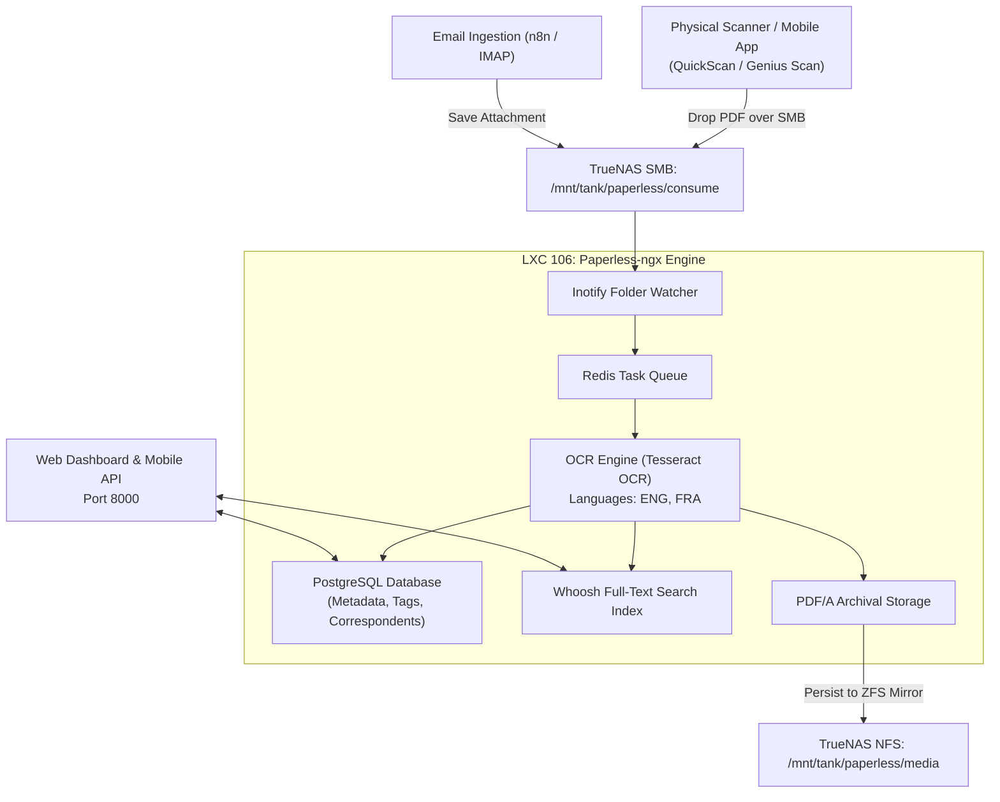

# 📄 Paperless-ngx Document Archive (LXC 106)

[](https://docs.paperless-ngx.com)
[](https://www.postgresql.org)
[](https://www.gnu.org/licenses/gpl-3.0)

An intelligent, open-source document management system that transforms physical paperwork, utility statements, tax forms, and PDF receipts into searchable digital archives using Optical Character Recognition (OCR).

---

## 🔗 Official Documentation & External Links

- **Official Website:** [docs.paperless-ngx.com](https://docs.paperless-ngx.com)
- **Documentation Hub:** [docs.paperless-ngx.com/setup](https://docs.paperless-ngx.com/setup)
- **GitHub Repository:** [paperless-ngx/paperless-ngx](https://github.com/paperless-ngx/paperless-ngx)
- **REST API Guide:** [docs.paperless-ngx.com/api](https://docs.paperless-ngx.com/api)
- **Subreddit:** [reddit.com/r/PaperlessNGX](https://reddit.com/r/PaperlessNGX)

---

## 🏗️ Document Ingestion Pipeline Architecture



---

## ⚙️ Container Sizing & Recommendations

| Parameter | Specification | Notes |
| :--- | :--- | :--- |
| **Virtualization** | Debian 12 LXC Container | Unprivileged with `nesting=1` |
| **Cores** | 2 vCPUs (4 recommended) | Multi-core OCR processing for multi-page documents |
| **Memory** | 4096 MB (4 GB) | OCR processing is memory intensive |
| **Disk** | 20 GB SSD (`local-lvm`) | OS & local search indexes |
| **Data Storage** | NFSv4 Mounts | Permanent document store on TrueNAS ZFS mirror |

---

## 🚀 Step-by-Step Deployment

1. **Provision Container:**
   ```bash
   pct create 106 local:vztmpl/debian-12-standard_12.7-1_amd64.tar.zst \
     --hostname paperless-ngx \
     --cores 2 \
     --memory 4096 \
     --swap 1024 \
     --rootfs local-lvm:20 \
     --net0 name=eth0,bridge=vmbr0,ip=192.168.1.246/24,gw=192.168.1.1 \
     --unprivileged 1 \
     --features nesting=1 \
     --onboot 1 \
     --start 1
   ```

2. **Mount TrueNAS Datasets:**
   Enter container (`pct enter 106`):
   ```bash
   apt-get update && apt-get install -y nfs-common curl wget git

   mkdir -p /mnt/paperless/data \
            /mnt/paperless/media \
            /mnt/paperless/consume \
            /mnt/paperless/export

   cat << 'EOF' >> /etc/fstab
   <TRUENAS_IP>:/mnt/tank/paperless/data    /mnt/paperless/data    nfs defaults,timeo=14,intr 0 0
   <TRUENAS_IP>:/mnt/tank/paperless/media   /mnt/paperless/media   nfs defaults,timeo=14,intr 0 0
   <TRUENAS_IP>:/mnt/tank/paperless/consume /mnt/paperless/consume nfs defaults,timeo=14,intr 0 0
   EOF

   mount -a
   ```

3. **Deploy Docker Compose Stack:**
   ```bash
   curl -fsSL https://get.docker.com -o get-docker.sh && sh get-docker.sh

   mkdir -p /docker/paperless && cd /docker/paperless
   # Copy docker-compose.yml and .env.example from this blueprint
   cp .env.example .env
   # Edit .env to set secure random secrets
   docker compose up -d
   ```

4. **Create Superuser Account:**
   ```bash
   docker exec -it paperless-webserver python3 manage.py createsuperuser
   ```

5. **Access Dashboard:**
   Visit `http://192.168.1.246:8000` to log in.
