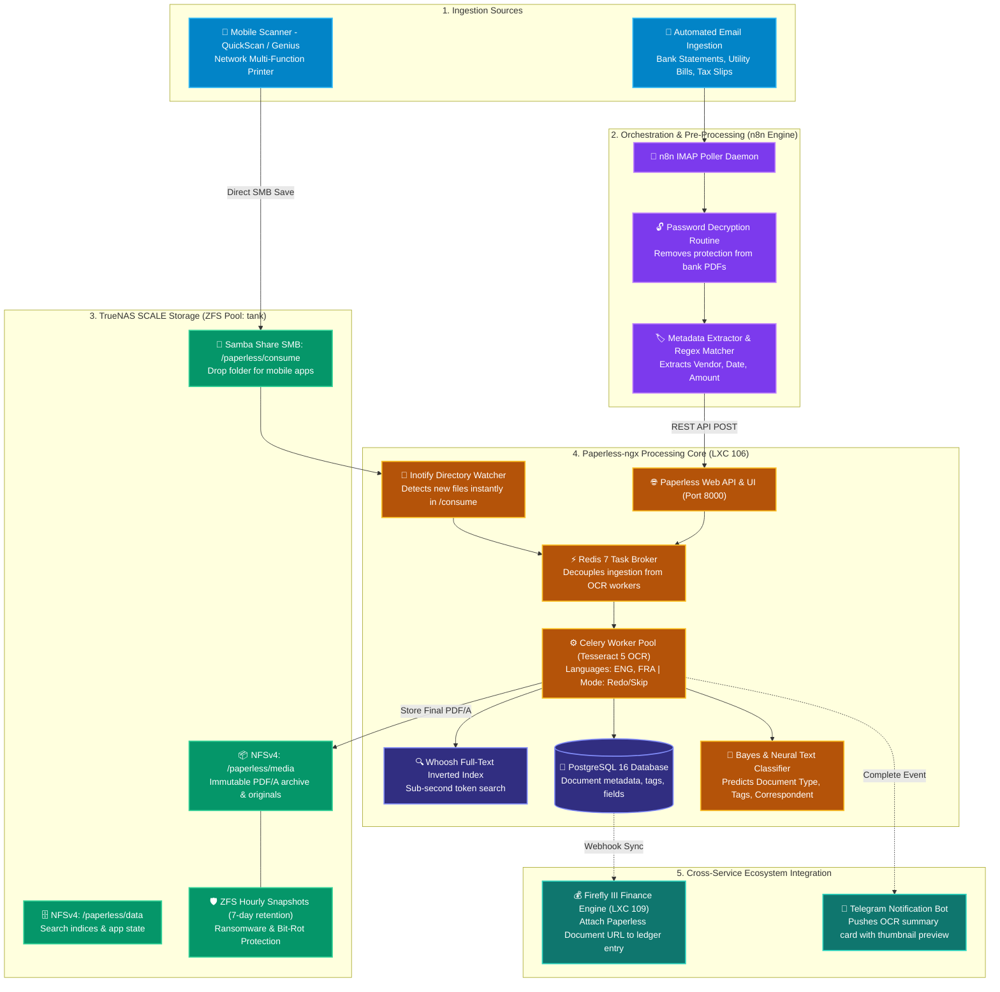

# 📄 Paperless-ngx Document Archive & OCR Engine (LXC 106)

[](https://docs.paperless-ngx.com)
[](https://www.postgresql.org)
[](https://redis.io)
[](https://www.truenas.com)
[](https://www.gnu.org/licenses/gpl-3.0)

An intelligent, self-hosted electronic document management and OCR indexing system running inside an unprivileged Debian 12 LXC container on Proxmox VE. Transforms physical receipts, utility statements, tax forms, and medical records into searchable digital archives with automatic machine-learning classification and cross-service automation.

---

## 🔗 Official Documentation & External Links

- **Official Website:** [docs.paperless-ngx.com](https://docs.paperless-ngx.com)
- **Documentation Hub:** [docs.paperless-ngx.com/setup](https://docs.paperless-ngx.com/setup)
- **GitHub Repository:** [paperless-ngx/paperless-ngx](https://github.com/paperless-ngx/paperless-ngx)
- **REST API Guide:** [docs.paperless-ngx.com/api](https://docs.paperless-ngx.com/api)
- **Configuration Reference:** [docs.paperless-ngx.com/configuration](https://docs.paperless-ngx.com/configuration)
- **Subreddit:** [reddit.com/r/PaperlessNGX](https://reddit.com/r/PaperlessNGX)

---

## 🏗️ End-to-End Ingestion & Processing Architecture

The document management pipeline unifies physical scanning, email polling, OCR extraction, full-text indexing, and automated accounting linkage:



---

## 🧠 OCR, Classification & Indexing Mechanics

### 1. OCR Engine & Archival Standards (Tesseract 5 + Ghostscript)
- **PDF/A Archival Conversion:** Every ingested document is rasterized and compiled into **ISO 19005-1 compliant PDF/A-2b** format. This embeds fonts, color profiles, and metadata permanently, ensuring readability 20+ years in the future regardless of operating system software changes.
- **Sidecar OCR Text Layer:** Tesseract performs Optical Character Recognition, generating an invisible UTF-8 text layer superimposed directly over the original document bitmap. Search highlights land exactly on the scanned word coordinates.
- **Multi-Language Dictionaries:** Container bundles both `tessdata-fast` and `tessdata-best` for English (`eng`) and French (`fra`), accommodating bilingual Canadian tax and utility documents.

### 2. Machine Learning Auto-Tagger (Naive Bayes / Neural Classifier)
Paperless-ngx trains an internal classification model each time a document is tagged:
- **Feature Extraction:** Tokenizes document plain text using TF-IDF (Term Frequency-Inverse Document Frequency).
- **Inference:** When a new document arrives, the classifier calculates conditional probabilities:
  $$P(\text{Tag}_k \mid \text{Document Text}) \propto P(\text{Tag}_k) \prod_{i=1}^n P(w_i \mid \text{Tag}_k)$$
- **Automatic Matching:** Matches correspondents (e.g. *BC Hydro*, *Scotiabank*, *CRA*), document types (*Invoice*, *Tax Return*, *Receipt*), and storage paths (*Finance/2026*) once training confidence exceeds 75%.

### 3. Asynchronous Worker Architecture
- Heavy OCR rasterization can spike CPU and memory consumption. By offloading tasks to **Redis 7**, HTTP web requests remain completely responsive.
- The web server container never blocks on a 60-page PDF document; work is pulled by Celery workers bounded by `PAPERLESS_TASK_WORKERS` to protect the Proxmox host.

---

## 🔗 Cross-Service Integrations & Decision Rationale

### Why not use Paperless-ngx's built-in email poller?
While Paperless has a native IMAP poller, it has critical real-world limitations:
1. Cannot handle password-protected statements (many Canadian banks encrypt e-statements with birthdates or account numbers).
2. Cannot perform dynamic multi-condition routing or regex manipulation prior to consumption.
3. Cannot trigger cross-service webhooks (like creating an expense entry in Firefly III simultaneously).

### 1. n8n Automated Ingestion Pipeline
We route all incoming document emails through **n8n (LXC 107)**:
- **Email Ingestion:** n8n polls an inbox dedicated to bills and e-statements over TLS IMAP every 15 minutes.
- **Attachment Filter:** Evaluates MIME types (`application/pdf`, `image/png`, `image/jpeg`).
- **Decryption Worker:** For password-protected statements, an n8n code node passes the file through `qpdf` with a pre-configured passphrase vault to strip the encryption layer.
- **REST API Injection:** Pushes the unencrypted file into Paperless-ngx via REST API:
  ```http
  POST http://192.168.1.246:8000/api/documents/post_document/
  Authorization: Token <YOUR_PAPERLESS_API_TOKEN>
  Content-Type: multipart/form-data

  document=@statement.pdf
  title="Scotiabank Statement - October 2026"
  correspondent=2
  document_type=1
  tags=[4, 7]
  ```

### 2. Linking Documents to Firefly III
- When a utility bill or invoice is ingested, n8n extracts the total dollar amount and transaction date.
- n8n searches Firefly III for matching withdrawal transactions.
- Upon finding the match, it writes a custom link attribute: `Paperless URL: http://192.168.1.246:8000/documents/<ID>/details`, giving you one-click invoice verification directly from your family balance sheet.

### 3. TrueNAS ZFS Storage Layout
- Storage is mounted inside LXC 106 via high-performance NFSv4 from TrueNAS SCALE.
- **ZFS Dataset Optimization:**
  | Dataset | ZFS Recordsize | Compression | Atime | Rationale |
  | :--- | :--- | :--- | :--- | :--- |
  | `/mnt/tank/paperless/data` | `128K` | `zstd` | `off` | Search indices, SQLite metadata, thumbnail cache |
  | `/mnt/tank/paperless/media` | `128K` | `zstd` | `off` | Archived PDF/A documents (typically 50KB - 5MB) |
  | `/mnt/tank/paperless/consume` | `128K` | `lz4` | `off` | Fast ingestion drop folder |
- **Disaster Recovery:** TrueNAS takes hourly local snapshots of `/mnt/tank/paperless` with a 14-day retention window, completely immunizing the document repository against accidental deletions or ransomware.

---

## ⚙️ Container Sizing & Tuning Guidelines

| Parameter | Recommended | Minimum | Production Rationale |
| :--- | :--- | :--- | :--- |
| **Virtualization** | Unprivileged LXC | LXC | Minimal overhead, kernel isolation, instant backups |
| **vCPUs** | 4 Cores | 2 Cores | Tesseract OCR is CPU-bound; 4 cores speeds up multi-page scans 3.5x |
| **Memory** | 4096 MB (4 GB) | 2048 MB | OCR page rasterization requires memory buffers; prevents OOM crashes |
| **Swap** | 1024 MB | 512 MB | Emergency cushion during massive 100+ page batch ingestions |
| **Root Disk** | 20 GB SSD (`local-lvm`) | 12 GB | OS base, Python dependencies, and Whoosh temporary scratch space |
| **Data Storage** | NFSv4 to TrueNAS | Local Disk | Keeps document binaries out of VM backups; leverages ZFS snapshots |

---

## 🚀 Step-by-Step Deployment Guide

### 1. Provision Proxmox LXC Container
Run on the Proxmox VE host CLI:
```bash
pct create 106 local:vztmpl/debian-12-standard_12.7-1_amd64.tar.zst \
  --hostname paperless-ngx \
  --cores 4 \
  --memory 4096 \
  --swap 1024 \
  --rootfs local-lvm:20 \
  --net0 name=eth0,bridge=vmbr0,ip=192.168.1.246/24,gw=192.168.1.1 \
  --unprivileged 1 \
  --features nesting=1 \
  --onboot 1 \
  --start 1
```

### 2. Configure TrueNAS NFS Mounts
Enter the container (`pct enter 106`):
```bash
apt-get update && apt-get install -y nfs-common curl wget git

# Create mount points
mkdir -p /mnt/paperless/data \
         /mnt/paperless/media \
         /mnt/paperless/consume \
         /mnt/paperless/export

# Add persistent NFSv4 mounts to /etc/fstab
cat << 'EOF' >> /etc/fstab
<TRUENAS_IP>:/mnt/tank/paperless/data    /mnt/paperless/data    nfs defaults,nfsvers=4,timeo=14,intr 0 0
<TRUENAS_IP>:/mnt/tank/paperless/media   /mnt/paperless/media   nfs defaults,nfsvers=4,timeo=14,intr 0 0
<TRUENAS_IP>:/mnt/tank/paperless/consume /mnt/paperless/consume nfs defaults,nfsvers=4,timeo=14,intr 0 0
EOF

mount -a
df -h | grep paperless
```

### 3. Deploy Docker & Compose Stack
```bash
# Install Docker Engine
curl -fsSL https://get.docker.com -o get-docker.sh && sh get-docker.sh

mkdir -p /docker/paperless && cd /docker/paperless

# Deploy compose file and environment templates from this blueprint
cp .env.example .env

# Generate secure random secret key
SECRET_KEY=$(openssl rand -hex 32)
sed -i "s|<GENERATE_RANDOM_SECRET_KEY>|$SECRET_KEY|" .env

# Start stack
docker compose up -d
```

### 4. Create Initial Administrator Account
```bash
docker exec -it paperless-webserver python3 manage.py createsuperuser
```

### 5. Post-Installation Checklist
- [ ] Log in at `http://192.168.1.246:8000`.
- [ ] Go to **Settings** ➔ **Users & Groups** to configure non-admin user accounts if sharing with family members.
- [ ] Create initial **Document Types**: `Invoice`, `Statement`, `Tax Return`, `Receipt`, `Medical`, `Contract`.
- [ ] Generate a REST API token under **My Profile** for n8n workflow integration.
- [ ] Connect mobile scanner (e.g. *QuickScan* on iOS) to SMB share `smb://<TRUENAS_IP>/paperless-consume`.
