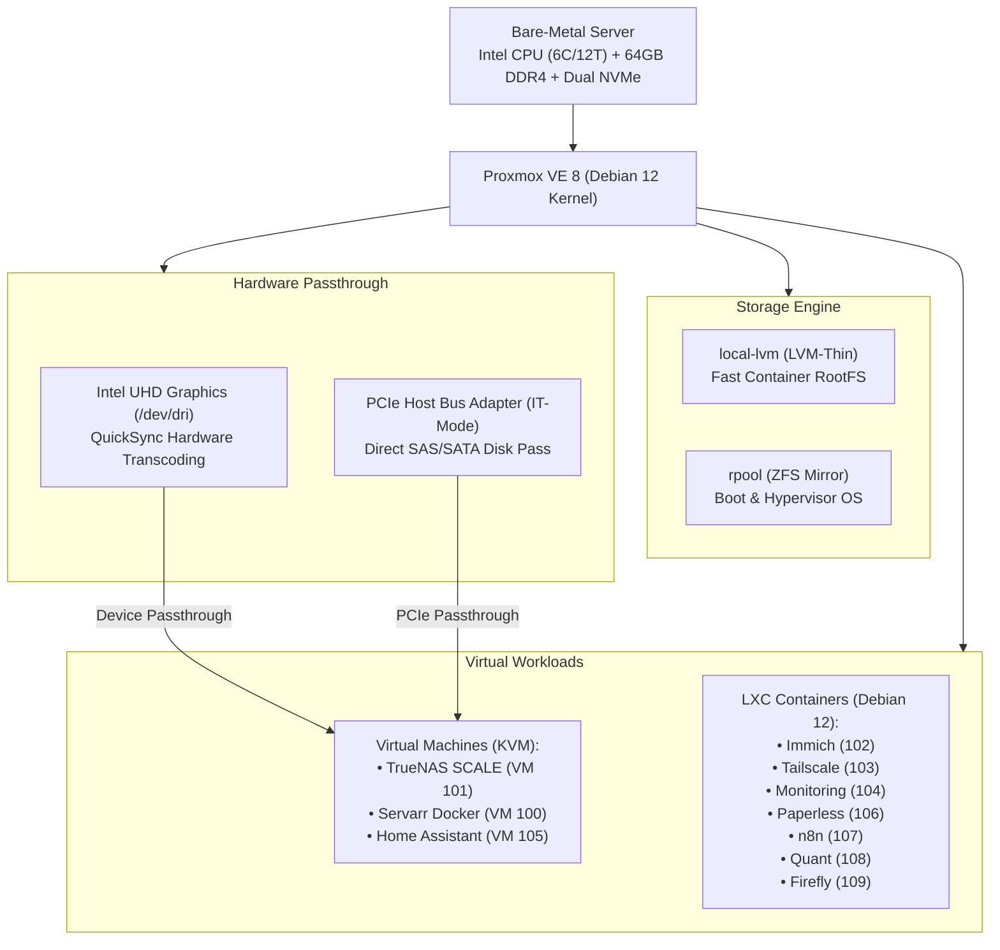

# 🖥️ Proxmox VE 8 Hypervisor Node

[](https://www.proxmox.com)
[](https://www.debian.org)
[](https://opensource.org/licenses/MIT)

The foundation of the homelab: a bare-metal Type-1 hypervisor running on an Intel Core i7 (or Xeon) processor with 64GB of RAM, providing KVM virtualization, unprivileged LXC containers, ZFS storage pools, and hardware passthrough.

---

## 🔗 Official Documentation & External Links

- **Official Website:** [proxmox.com](https://www.proxmox.com)
- **Official Documentation:** [pve.proxmox.com/pve-docs](https://pve.proxmox.com/pve-docs)
- **Community Forum:** [forum.proxmox.com](https://forum.proxmox.com)
- **Proxmox VE Wiki:** [pve.proxmox.com/wiki](https://pve.proxmox.com/wiki)
- **Proxmox Helper Scripts (Community):** [helper-scripts.com](https://helper-scripts.com)

---

## 🏗️ Architecture & Component Diagram



---

## ⚙️ Hardware Sizing & Recommended Specifications

| Component | Minimum Spec | Recommended Sizing | Notes |
| :--- | :--- | :--- | :--- |
| **CPU** | 4 Cores / 8 Threads | 6+ Cores / 12+ Threads | Intel with QuickSync for 4K media transcoding |
| **RAM** | 32 GB DDR4 | 64 GB DDR4/DDR5 | ZFS ARC cache + multi-container workload |
| **Boot Drive** | 256 GB NVMe | 512 GB NVMe (Mirrored) | `rpool` ZFS Raid 1 |
| **LXC Storage** | 500 GB NVMe | 1 TB NVMe SSD | `local-lvm` LVM-Thin |
| **Network** | 1x 1GbE NIC | 2x 2.5GbE / 10GbE | LACP Bonding on `vmbr0` |

---

## 🚀 Post-Install Optimization & Configuration

Log in via SSH as `root`:

### 1. Disable Enterprise Repos & Enable No-Subscription
```bash
rm -f /etc/apt/sources.list.d/pve-enterprise.list
cat << 'EOF' > /etc/apt/sources.list.d/pve-no-subscription.list
deb http://download.proxmox.com/debian/pve bookworm pve-no-subscription
EOF

apt-get update && apt-get dist-upgrade -y
apt-get install -y htop iotop iftop curl wget git zfsutils-linux sudo
```

### 2. Remove No-Subscription Web GUI Nag Banner
```bash
sed -Ezi.bak "s/(Ext.Msg.show\(\{\s+title: gettext\('No valid sub)/void\(\{ \/\/\1/g" /usr/share/javascript/proxmox-widget-toolkit/proxmoxlib.js
systemctl restart pveproxy.service
```

### 3. Enable Intel QuickSync GPU & IOMMU Passthrough
```bash
sed -i 's/GRUB_CMDLINE_LINUX_DEFAULT="quiet"/GRUB_CMDLINE_LINUX_DEFAULT="quiet intel_iommu=on iommu=pt i915.enable_guc=3"/' /etc/default/grub
update-grub

cat << 'EOF' >> /etc/modules
vfio
vfio_iommu_type1
vfio_pci
vfio_virqfd
kvmgt
EOF
```

---

## 🔍 Health Checks & Maintenance

```bash
# Check cluster & node status
pvecm status

# Check running LXCs and VMs
pct list
qm list

# Check storage pool usage
pvesm status
```
