# 🖥️ Proxmox Virtual Environment (PVE) Hypervisor Host

[](https://www.proxmox.com)
[](https://www.debian.org)
[](https://www.linux-kvm.org)
[](https://linuxcontainers.org)
[](https://www.gnu.org/licenses/agpl-3.0)

The bare-metal enterprise hypervisor foundation underpinning the entire homelab infrastructure. Manages **KVM hardware virtualization**, **unprivileged LXC container isolation**, **Linux bridge networking**, **PCIe/USB device passthrough**, and **automated snapshot backup schedules**.

---

## 🔗 Official Documentation & External Links

- **Official Website:** [proxmox.com/pve](https://www.proxmox.com/en/proxmox-virtual-environment/overview)
- **Documentation Hub:** [pve.proxmox.com/pve-docs](https://pve.proxmox.com/pve-docs)
- **Proxmox Community Forum:** [forum.proxmox.com](https://forum.proxmox.com)
- **Proxmox VE Helper-Scripts:** [helper-scripts.com](https://helper-scripts.com)
- **PCIe Passthrough Guide:** [pve.proxmox.com/wiki/PCI(e)_Passthrough](https://pve.proxmox.com/wiki/PCI(e)_Passthrough)
- **LXC Unprivileged Containers Guide:** [pve.proxmox.com/wiki/Unprivileged_LXC_containers](https://pve.proxmox.com/wiki/Unprivileged_LXC_containers)

---

## 🏗️ Hypervisor Architecture & Workload Layout

```mermaid
flowchart TD
    classDef bare fill:#334155,stroke:#94a3b8,stroke-width:2px,color:#ffffff;
    classDef pve fill:#b45309,stroke:#fbbf24,stroke-width:2px,color:#ffffff;
    classDef vm fill:#7c3aed,stroke:#c084fc,stroke-width:2px,color:#ffffff;
    classDef lxc fill:#059669,stroke:#34d399,stroke-width:2px,color:#ffffff;

    subgraph BareMetal ["1. Physical Bare-Metal Server Hardware"]
        CPU["⚙️ Intel & AMD Multicore Host CPU<br/>VT-x / AMD-V Enabled | IOMMU Active"]:::bare
        RAM["🧠 32GB - 64GB DDR4/DDR5 ECC/Non-ECC RAM"]:::bare
        NVMe["⚡ Fast NVMe SSD: local-lvm<br/>VM & LXC Root Disks"]:::bare
        HBA["🔌 SAS HBA / SATA Controller<br/>Disks Attached for Passthrough"]:::bare
        NIC["🌐 Gigabit / 2.5GbE Physical Network Interface"]:::bare
    end

    subgraph ProxmoxHost ["2. Proxmox VE 8.2 Host OS (Debian 12 Kernel 6.8)"]
        Bridge["🌉 Linux Network Bridge: vmbr0<br/>Subnet: 192.168.1.0/24 | GW: 192.168.1.1"]:::pve
        LVMThin["📦 LVM-Thin Storage Driver (local-lvm)<br/>Instant Thin-Provisioning & Discard/TRIM"]:::pve
        SubUID["🔒 User Namespace Mapper<br/>subuid & subgid UID 100000 Isolation"]:::pve
    end

    NIC --> Bridge
    NVMe --> LVMThin
    CPU --> SubUID

    subgraph KVM_VMs ["3. Full KVM Virtual Machines - Hardware Emulation"]
        VM100["🎬 VM 100: Servarr Media Stack<br/>Ubuntu 24.04 Docker | Intel QuickSync QSV"]:::vm
        VM101["🗄️ VM 101: TrueNAS SCALE Storage<br/>Dedicated Disk Controller Passthrough"]:::vm
        VM102["🏠 VM 102: Home Assistant OS<br/>HAOS | USB Zigbee Dongle Passthrough"]:::vm
    end

    subgraph LXC_Containers ["4. Unprivileged LXC Containers - Shared Kernel"]
        LXC102["📷 LXC 102: Immich Photos (AI CLIP Engine)"]:::lxc
        LXC103["🛡️ LXC 103: Tailscale Mesh Gateway (TUN Passthrough)"]:::lxc
        LXC105["📊 LXC 105: Prometheus & Grafana Monitoring"]:::lxc
        LXC106["📄 LXC 106: Paperless-ngx Document OCR"]:::lxc
        LXC107["⚡ LXC 107: n8n Automation & Sysadmin Agent"]:::lxc
        LXC108["📈 LXC 108: Quant Research & Trading Ingress"]:::lxc
        LXC109["💰 LXC 109: Firefly III Family Wealth Ledger"]:::lxc
        LXC110["✈️ LXC 110: FlightScout AI Fare Tracker"]:::lxc
    end

    Bridge --> VM100
    Bridge --> VM101
    Bridge --> VM102
    Bridge --> LXC102
    Bridge --> LXC103
    Bridge --> LXC105
    Bridge --> LXC106
    Bridge --> LXC107
    Bridge --> LXC108
    Bridge --> LXC109
    Bridge --> LXC110
```



---

## 🧠 Architectural Deep-Dive & Engineering Decisions

### 1. Workload Separation: Unprivileged LXC vs. Full KVM Virtual Machine
A common design dilemma in homelabs is choosing between running services in virtual machines or Linux containers:

| Metric | Unprivileged LXC Container | Full KVM Virtual Machine | Homelab Decision Rationale |
| :--- | :--- | :--- | :--- |
| **Kernel Model** | Shares host Linux kernel directly | Boots independent guest OS kernel | LXCs eliminate duplicate kernel memory overhead (~150MB saved per instance). |
| **Startup Time** | `< 2 seconds` | `20 - 45 seconds` | LXCs restart instantaneously during maintenance. |
| **RAM Footprint** | Extremely low (~30MB to 100MB idle) | High (Requires dedicated static allocation) | LXCs enable hosting 10+ services on a modest 32GB RAM home server. |
| **Hardware Passthrough** | Restricted (Requires cgroup allow rules) | Native PCIe/USB passthrough via IOMMU | VMs are strictly reserved for workloads requiring raw hardware: TrueNAS (storage controller), Servarr (iGPU), Home Assistant (USB serial). |

### 2. Unprivileged Container Security Model (UID/GID Mapping)
All application containers (n8n, Paperless, Firefly, Immich, Monitoring) run strictly as **unprivileged LXCs**:
- The container's `root` user (UID `0`) is mapped to an unprivileged user (UID `100000`) on the host kernel via `/etc/subuid` and `/etc/subgid`.
- **Security Boundary:** In the event of a critical Remote Code Execution (RCE) vulnerability inside an open-source web application, an attacker who gains root access inside the container remains an unprivileged user (`nobody`/`100000`) on the Proxmox host. They are physically barred from writing to host binaries, accessing other containers, or tampering with hypervisor memory.

### 3. Storage Architecture: `local` vs. `local-lvm`
Proxmox partitions the primary NVMe boot drive into two logical stores:
- **`local` (Directory Pool):** Formatted as standard ext4. Houses ISO installation images (`/var/lib/vz/template/iso`), LXC root templates (`/var/lib/vz/template/cache`), and temporary backup archives.
- **`local-lvm` (LVM-Thin Pool):** Formatted as raw block storage. Directly provisions raw block volumes for VM virtual disks and LXC filesystems.
  - Enables **thin provisioning** (disks only consume physical space as data is actually written).
  - Enables **instant snapshotting** and clone operations.
  - Supports continuous SSD wear reduction through automatic TRIM pass-through (`discard=on`).

### 4. Energy Efficiency & CPU Governor Tuning
Homelabs run 24/7/365 in residential environments where power consumption and fan acoustics are paramount:
- By default, Linux may run in `performance` mode, locking CPU clock speeds at maximum frequencies even at idle.
- We configure the `schedutil` or `powersave` CPU frequency scaling governor with active PCIe Active State Power Management (ASPM).
- **Result:** Drops idle host power draw from ~45W down to **12W - 18W**, dramatically lowering electricity bills and eliminating fan noise.

---

## ⚙️ Hypervisor Host Hardware Recommendations

| Component | Minimum Specification | Recommended Specification | Homelab Notes |
| :--- | :--- | :--- | :--- |
| **CPU** | 4 Cores / 8 Threads | 8 Cores / 16 Threads (Intel Core i5/i7 12th+ Gen or AMD Ryzen 5000+) | Intel QuickSync (UHD 730/770) strongly recommended for transcoding |
| **RAM** | 32 GB DDR4/DDR5 | 64 GB DDR4/DDR5 | ZFS ARC cache + microservices concurrency |
| **Boot Drive** | 256 GB NVMe SSD | 500 GB - 1 TB NVMe SSD (High TBW) | Houses `local-lvm` thin pool for VM/LXC disks |
| **Storage Disks** | 2x SATA HDD (Mirror) | 2x 8TB - 16TB Enterprise SATA/SAS (WD Red Plus / Seagate IronWolf) | Dedicated storage passed to TrueNAS SCALE |
| **Network** | 1x 1GbE NIC | 1x 2.5GbE / 10GbE NIC | Ensures smooth 4K internal streaming and rapid backups |

---

## 🚀 Post-Installation Host Optimization Guide

Run directly on the Proxmox VE host shell via SSH:

### 1. Disable Enterprise Repository & Enable Free No-Subscription Repo
```bash
# Disable enterprise repository
sed -i "s/^deb/#deb/g" /etc/apt/sources.list.d/pve-enterprise.list

# Add community no-subscription repository
cat << 'EOF' > /etc/apt/sources.list.d/pve-no-subscription.list
deb http://download.proxmox.com/debian/pve bookworm pve-no-subscription
EOF

# Update package lists
apt-get update && apt-get dist-upgrade -y
```

### 2. Disable Enterprise Subscription Nag Popup
```bash
sed -Ezi.bak "s/(Ext.Msg.show\(\{\s+title: gettext\('No valid sub)/void\(\{ \/\/\1/g" /usr/share/javascript/proxmox-widget-toolkit/proxmoxlib.js
systemctl restart pveproxy.service
```

### 3. Enable CPU Power-Saving Governor
```bash
apt-get install -y cpufrequtils
echo 'GOVERNOR="schedutil"' > /etc/default/cpufrequtils
systemctl restart cpufrequtils
```

### 4. Enable IOMMU Hardware Virtualization (Intel / AMD)
```bash
# For Intel processors:
sed -i 's/GRUB_CMDLINE_LINUX_DEFAULT="quiet"/GRUB_CMDLINE_LINUX_DEFAULT="quiet intel_iommu=on iommu=pt"/' /etc/default/grub

# For AMD processors:
# sed -i 's/GRUB_CMDLINE_LINUX_DEFAULT="quiet"/GRUB_CMDLINE_LINUX_DEFAULT="quiet amd_iommu=on iommu=pt"/' /etc/default/grub

update-grub
```
*Reboot the host (`reboot`) to apply kernel parameter changes.*
