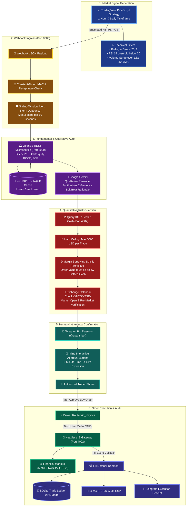
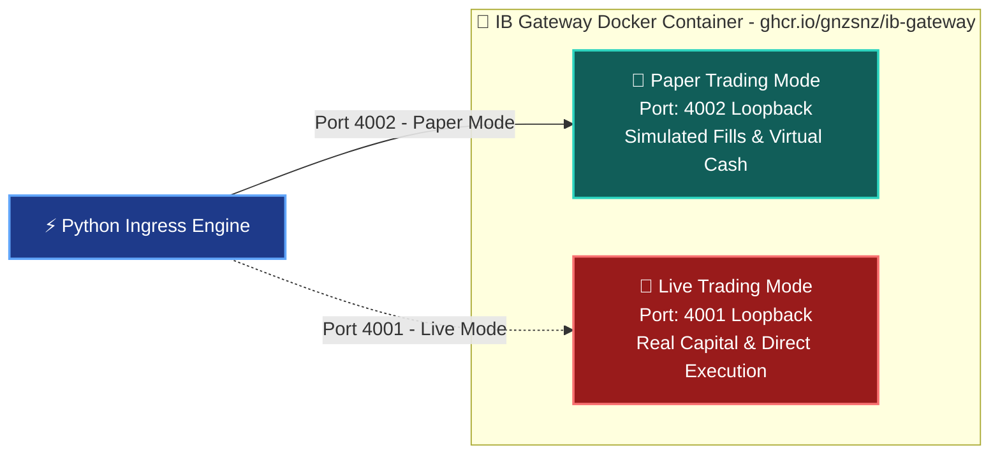

# 📈 Quantitative Research & Trading Ingress Engine (LXC 108)

[](https://openbb.co)
[](https://www.interactivebrokers.com)
[](https://www.tradingview.com)
[](https://www.python.org)
[](https://fastapi.tiangolo.com)
[](https://opensource.org/licenses/MIT)

An on-premise, enterprise-grade quantitative market research platform and automated execution system running inside a Debian 12 LXC container on Proxmox VE. Combines technical alert ingestion from **TradingView**, fundamental ratio verification via **OpenBB Platform**, an AI-driven qualitative sanity check, and **human-in-the-loop trade execution** against **Interactive Brokers (IBKR)**.

---

## 🔗 Official Documentation & External Links

- **OpenBB Platform:** [openbb.co](https://openbb.co) • [OpenBB Documentation](https://docs.openbb.co) • [GitHub](https://github.com/OpenBB-finance/OpenBB)
- **Interactive Brokers API:** [interactivebrokers.github.io](https://interactivebrokers.github.io) • [API Reference Guide](https://www.interactivebrokers.com/campus/ibkr-api-page/)
- **ib_insync Python Framework:** [github.com/erdewit/ib_insync](https://github.com/erdewit/ib_insync) • [Documentation](https://ib-insync.readthedocs.io)
- **Headless IB Gateway Container:** [github.com/gnzsnz/ib-gateway](https://github.com/gnzsnz/ib-gateway)
- **TradingView Webhook Alerts:** [tradingview.com/support/solutions/43000529348](https://www.tradingview.com/support/solutions/43000529348-about-webhooks/)
- **Exchange Calendars (XNYS / XTSE):** [github.com/gerrymanoim/exchange_calendars](https://github.com/gerrymanoim/exchange_calendars)

---

## 🧠 Algorithmic Strategy & Decision Engine

The engine implements a **Hybrid Technical-Fundamental Mean-Reversion & Breakout Architecture**:



### Detailed Strategy Architecture:

The engine executes three complementary strategies in parallel:

#### 1. Pillar 1: Sector ETF Dual Momentum (30% Target Allocation)
- **Execution Interval:** Bi-weekly on the 1st and 15th of each month at **09:45 AM America/New_York** (15 minutes after regular market open).
  - *Weekend & Holiday Guard:* If the 1st or 15th falls on a weekend or NYSE market holiday, the rebalance automatically shifts to the **immediate next valid trading session** via `exchange_calendars`.
- **Macro Market Filter:** Verifies `SPY >= 200-Day SMA`. If the macro market is in a downtrend (`SPY < 200-Day SMA`), the engine sits in 100% Cash / BIL Treasury reserves.
- **Universe:** 11 US Sector SPDR ETFs (`XLK`, `XLE`, `XLF`, `XLV`, `XLI`, `XLY`, `XLP`, `XLB`, `XLU`, `XLC`, `XLRE`).
- **Momentum Scoring:** Multi-horizon weighted momentum:
  $$\text{Score} = 0.40 \times R_{\text{1M}} + 0.30 \times R_{\text{3M}} + 0.30 \times R_{\text{6M}}$$
- **Hysteresis Band (Anti-Whipsaw Churn Reduction):**
  - **Eligible Entries:** Only sectors ranked in the **Top 2** (Rank #1 or #2) qualify for new purchases.
  - **Retention Band:** Currently held positions are **retained** as long as they remain in the **Top 4** (Rank 1, 2, 3, or 4).
  - **Rotation / Liquidation:** A sector is only liquidated if it drops below Rank 4 (Rank 5–11) or the macro regime turns defensive. This prevents costly whipsaw turnover when sectors oscillate around the Rank #2/#3 threshold.
- **Execution:** Submits strict Limit Orders with `tif="DAY"`. Target allocation: 50% of Pillar 1 capital per sector (15% of total portfolio, $15,000 per sector on $100k target).

#### 2. Pillar 2: Connors RSI(2) Dip Buying (70% Target Allocation)
- **Execution Interval:** Daily pre-close scan at **03:45 PM America/New_York** (15 minutes before market close; or 15 minutes before early close on half-days).
- **Universe:** Liquid S&P 100 mega-cap leaders (`NVDA`, `META`, `AAPL`, `MSFT`, `AMZN`, `GOOGL`, `AVGO`, `COST`, `JPM`, `V`, `LLY`, `UNH`, `GE`, `NFLX`).
- **Long Entry Rule:**
  $$\text{Price} > \text{200-Day SMA} \quad \text{and} \quad \text{Connors RSI(2)} < 10.0$$
  Identifies strong secular uptrend leaders undergoing temporary liquidity washouts. Limit orders submitted with `tif="DAY"` (unfilled orders expire automatically at market close).
- **Exit Rule:**
  $$\text{Price} > \text{5-Day SMA} \quad \text{or} \quad \text{Holding Period} \ge 10 \text{ Days}$$
  Exits dynamically once the mean-reversion snapback occurs.
- **Portfolio Sizing:** Up to 5 slots maximum, allocated 14% each ($14,000 max per position on $100k target).

#### 3. Pillar 3: TradingView Alert Webhook Ingress (Human-in-the-Loop)
- **Technical Trigger (PineScript):**
  - **Long Entry:** Price touches lower Bollinger Band (20, 2) while 14-period RSI is oversold ($< 30$) and trading volume exceeds the 20-day moving average by 1.5x.
  - **Exit Strategy:** Price crosses the 20-period SMA middle band or reaches an explicit Stop Loss / Take Profit target.
- **Fundamental Health Filter (OpenBB Platform):**
  - Automatically rejects companies with extreme insolvency or balance sheet risk:
    $$\text{Debt-to-Equity} < 2.0 \quad \text{and} \quad \text{Operating Cash Flow} > 0$$
- **Human Approval:** Dispatched to Telegram with interactive 2-step inline buttons and a 5-minute TTL.

---

### 💬 Telegram Interactive Bot & Conversational Portfolio Assistant

The Telegram Bot (`@quant_bot`, Chat ID Whitelist: `<AUTHORIZED_TELEGRAM_CHAT_ID>`) provides dual capabilities:

#### 1. Automated Scheduled Status Digests (America/New_York)
- **Pre-Market Morning Briefing (08:30 AM ET):** Delivers pre-market overview, exchange open/holiday status via `exchange_calendars`, overnight carry-over positions, settled cash, and planned scans for the session.
- **Post-Market Daily Closing Digest (04:15 PM ET):** Dispatched immediately after market close, Pillar 2 scan, and stale order cleanup. Calculates closing mark-to-market valuations, realized/unrealized P&L by pillar, distance to 5-day SMA snapback targets, and day summary.
- *On-Demand Triggers:* `/briefing` (morning status) and `/digest` (closing summary) can be requested anytime.

#### 2. Natural Language Conversational Intelligence (Google Gemini)
- Authorized trader can query the bot in plain natural English (e.g. _"How is NVDA doing?"_, _"What's our total profit today?"_, _"Why are we holding XLE and XLV?"_, _"How much cash is available?"_).
- The bot injects live SQLite state, real-time quotes, settled cash, and active strategy rules into Gemini to generate institutional-grade answers.
- **Strict Read-Only Guardrail:** Natural language chat CANNOT execute orders or move money. Order execution remains strictly automated via the quant engine daemons or gated by 2-step inline confirmation buttons.

#### 3. Command Suite
| Command | Description |
| :--- | :--- |
| `/digest` | Generate live full portfolio closing digest with P&L and pillar metrics |
| `/briefing` | Generate live pre-market morning briefing |
| `/status` | Query engine health, trading mode, settled cash, and kill switch state |
| `/positions` | List open broker positions and share quantities |
| `/pillars` | Breakdown automated holdings across Pillar 1 (30%) & Pillar 2 (70%) |
| `/history` | View recent trade ledger execution audit trail |
| `/kill` | Emergency trading halt: cancel all working orders and freeze ingress |
| `/resume` | Disengage kill switch and resume normal paper trading operations |

---

## ⚡ Gateway Auto-Reconnection & Order Lifecycle
- **Active Socket Health & Auto-Reconnection:** Prior to querying settled cash, reading positions, or routing orders, `IBKRBroker.ensure_connected()` validates socket connectivity. If the connection dropped (e.g. during IBKR nightly maintenance), it automatically re-establishes a fresh session before submitting trades.
- **No Silent Fallback:** Real broker orders are never silently downgraded to simulation fills if a temporary network hiccup occurs.
- **Race Condition & Short-Selling Guard:** On every SELL order, the broker queries both held positions and active unfilled sell orders in `openTrades()`. If available net shares $\le 0$, the order is rejected with `ValueError: Prohibited naked short-sell`.
- **Cash Over-Commitment Guard:** On every BUY order, pending unfilled buy orders and a $500 reserve buffer are subtracted from settled cash. Orders are automatically clamped to prevent margin borrowing.
- **Crash Resilience & Idempotency:** The execution daemon persists last-run dates in SQLite (`daemon_schedule_state`). Service restarts never trigger duplicate executions or accidental trades.
- **Daily Post-Close Order Cleaner (04:05 PM ET):** Reconciles unfilled DAY orders and purges stale state after regular market close.
- **Fill Listener & Tax Ledger:** Monitored via `fill_listener.py`, supporting partial fills, full fills, and immutable logging to SQLite and CSV audit exports.

---

## 🛡️ Risk Safeguards & Margin Protection Rules

| Safeguard | Exact Rule / Logic | Purpose |
| :--- | :--- | :--- |
| **Trade Sizing Ceiling** | $\text{Order Value} \le \$500.00\text{ USD}$ (Pillar 3) | Limits maximum capital exposure per manual TradingView alert |
| **No Margin Borrowing** | $\text{Order Value} \le \text{Settled Cash} - \text{Committed Cash}$ | Prevents borrowing fees, interest charges, or margin calls |
| **Order Type Enforcement**| **Strict Limit Orders ONLY** (`orderType='LMT'`) | Eliminates market order slippage during volatile opens |
| **Limit Price Buffer** | $\text{Limit Price} = \text{Alert Price} \times 1.002$ (Buy) / $0.998$ (Sell) | Tight 0.2% price buffer guarantees execution without chasing |
| **Hysteresis Band** | Top 2 Buy / Top 4 Retention Band | Eliminates whipsaw churn when sector ranks oscillate |
| **Schedule Timezone** | `America/New_York` with `exchange_calendars` | Eliminates UTC midnight shifts and handles DST transitions |
| **Alert Storm Debouncer** | Sliding window: Max 3 alerts per 60 seconds | Consolidates market open alert bursts into a single digest |
| **Signal Freshness TTL** | 5-minute expiration timestamp | Prevents stale alerts from executing hours later |
| **Sell Order Protection** | $\text{Sell Qty} \le \text{Current Long Position} - \text{Working Sells}$ | Prevents accidental naked short-selling & race conditions |
| **Emergency Kill Switch** | Command `/kill` in Telegram | Immediately cancels all open orders and halts trading |

---

## 🧪 Paper Trading vs. Live Trading Setup

The system is configured to support **Paper Trading** out-of-the-box, allowing you to validate strategies without risking real capital:



### How to Run Paper Trading:
1. **Container Port:** Set `TWS_PORT=4002` in `/docker/ib-gateway/.env`.
2. **Network Isolation:** Port `4002` is bound strictly to `127.0.0.1:4002` on the container loopback interface, preventing unauthorized access from WAN or external LAN clients.
3. **Simulated Fills:** IBKR paper trading accounts simulate order fills against real-time market data without touching real funds.
4. **Audit Verification:** Check `trading_system.db` to inspect filled prices, simulated commissions, and portfolio balances.

### Migration Checklist to Live Trading:
- [ ] Minimum 30 days of consistent paper trading logs.
- [ ] Confirm no orphaned or unhandled order states in `trading_system.db`.
- [ ] Change `TWS_PORT=4001` and update credentials to live trading credentials.
- [ ] Verify live 2FA multi-factor authentication handshake on IB Key mobile app.

---

## 🔗 Cross-Service Integrations

- **Firefly III Financial Integration:** Fills logged in the SQLite trade ledger can be synced into Firefly III under the `Quant Trading Profit / Loss` category to track realized gains/losses on your family balance sheet.
- **Telegram Alert Bot (`@quant_bot`):** Dispatches real-time human-in-the-loop trade approval cards with inline buttons.
- **Prometheus & Grafana:** Scrapes container CPU, memory, and SQLite execution latency.

---

## ⚙️ Container Sizing & Recommendations

| Parameter | Specification | Notes |
| :--- | :--- | :--- |
| **Virtualization** | Debian 12 LXC Container | Unprivileged with `nesting=1,keyctl=1` |
| **Cores** | 2 vCPUs | Handles OpenBB calculations and async event loops |
| **Memory** | 4096 MB (4 GB) | IB Gateway Java VM (~1.2GB) + Python runtime (~800MB) |
| **Disk** | 24 GB SSD (`local-lvm`) | Python virtual environments & historical market data cache |
| **Ports** | `8080` (Webhook), `8000` (OpenBB), `4002` (IB Gateway) | Loopback and internal subnet only |

---

## 🚀 Step-by-Step Deployment

1. **Provision Container:**
   ```bash
   pct create 108 local:vztmpl/debian-12-standard_12.7-1_amd64.tar.zst \
     --hostname quant-engine \
     --cores 2 \
     --memory 4096 \
     --swap 1024 \
     --rootfs local-lvm:24 \
     --net0 name=eth0,bridge=vmbr0,ip=192.168.1.248/24,gw=192.168.1.1 \
     --unprivileged 1 \
     --features nesting=1 \
     --onboot 1 \
     --start 1
   ```

2. **Deploy Python Virtual Environment & OpenBB:**
   Enter container (`pct enter 108`):
   ```bash
   apt-get update && apt-get install -y python3 python3-pip python3-venv git curl build-essential

   python3 -m venv /opt/quant-env
   source /opt/quant-env/bin/activate
   pip install --upgrade pip
   pip install openbb ib_insync flask requests pandas exchange_calendars
   ```

3. **Deploy Headless IB Gateway Container:**
   Create `/docker/ib-gateway/docker-compose.yml`:
   ```yaml
   version: "3.8"
   services:
     ib-gateway:
       image: ghcr.io/gnzsnz/ib-gateway:stable
       container_name: quant-ib-gateway
       restart: unless-stopped
       environment:
         - TWS_USERID=<YOUR_IBKR_USERNAME>
         - TWS_PASSWORD=<YOUR_IBKR_PASSWORD>
         - TRADING_MODE=paper
         - TWS_PORT=4002
         - READ_ONLY_API=no
       ports:
         - "127.0.0.1:4002:4002"
   ```

4. **Verify TradingView Alert Ingress Payload Format:**
   In TradingView Alert settings, set Webhook URL to `http://<CONTAINER_IP>:8080/webhook/tradingview` with payload:
   ```json
   {
     "passphrase": "<YOUR_WEBHOOK_PASSPHRASE>",
     "action": "BUY",
     "ticker": "NASDAQ:NVDA",
     "price": 125.50,
     "strategy": "MeanReversion_1H"
   }
   ```
