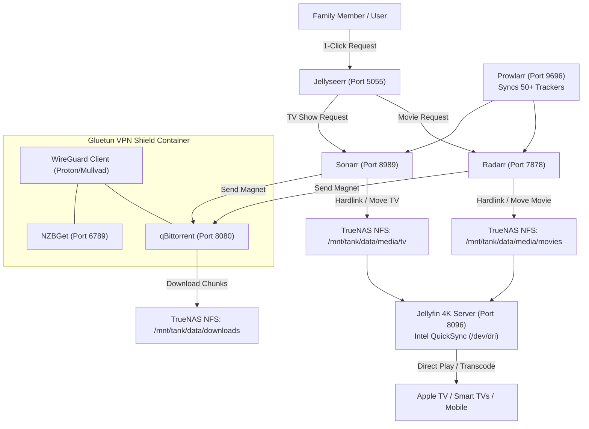

# 🎬 Servarr & Jellyfin Media Stack (VM 100)

[](https://jellyfin.org)
[](https://www.docker.com)
[](https://github.com/qdm12/gluetun)
[](https://gethomepage.dev)

A complete, fully automated home theater media and streaming stack hosted in an Ubuntu 24.04 Docker VM. Features **Intel QuickSync 4K hardware transcoding**, automated media aggregation (*Arr apps), and **VPN-isolated BitTorrent/Usenet downloads**.

---

## 🔗 Official Documentation & External Links

| Service | Official Website | Documentation | GitHub Repository |
| :--- | :--- | :--- | :--- |
| **Jellyfin** | [jellyfin.org](https://jellyfin.org) | [jellyfin.org/docs](https://jellyfin.org/docs) | [jellyfin/jellyfin](https://github.com/jellyfin/jellyfin) |
| **Jellyseerr** | [jellyseerr.dev](https://jellyseerr.dev) | [docs.jellyseerr.dev](https://docs.jellyseerr.dev) | [fallenbagel/jellyseerr](https://github.com/fallenbagel/jellyseerr) |
| **Radarr** | [radarr.video](https://radarr.video) | [wiki.servarr.com/radarr](https://wiki.servarr.com/radarr) | [Radarr/Radarr](https://github.com/Radarr/Radarr) |
| **Sonarr** | [sonarr.tv](https://sonarr.tv) | [wiki.servarr.com/sonarr](https://wiki.servarr.com/sonarr) | [Sonarr/Sonarr](https://github.com/Sonarr/Sonarr) |
| **Prowlarr** | [prowlarr.com](https://prowlarr.com) | [wiki.servarr.com/prowlarr](https://wiki.servarr.com/prowlarr) | [Prowlarr/Prowlarr](https://github.com/Prowlarr/Prowlarr) |
| **Gluetun VPN**| — | [github.com/qdm12/gluetun-wiki](https://github.com/qdm12/gluetun-wiki) | [qdm12/gluetun](https://github.com/qdm12/gluetun) |
| **qBittorrent**| [qbittorrent.org](https://www.qbittorrent.org)| [qbittorrent.org/doc](https://www.qbittorrent.org) | [qbittorrent/qBittorrent](https://github.com/qbittorrent/qBittorrent) |
| **Autobrr** | [autobrr.com](https://autobrr.com) | [autobrr.com/introduction](https://autobrr.com/introduction) | [autobrr/autobrr](https://github.com/autobrr/autobrr) |
| **Homepage** | [gethomepage.dev](https://gethomepage.dev) | [gethomepage.dev/configs](https://gethomepage.dev/configs) | [gethomepage/homepage](https://github.com/gethomepage/homepage) |

---

## 🏗️ Media Ingestion & VPN Shield Architecture



---

## 🌐 Network Ports Reference

| Port | Service | Access Policy | Description |
| :---: | :--- | :---: | :--- |
| `80` | **Homepage** | Local / Tailscale | Unified family dashboard |
| `8096` | **Jellyfin** | Local / Tailscale | Media server streaming port |
| `5055` | **Jellyseerr** | Local / Tailscale | Request discovery portal |
| `8080` | **qBittorrent** | Isolated (VPN) | WebUI routed strictly through Gluetun |
| `6789` | **NZBGet** | Isolated (VPN) | Usenet WebUI routed through Gluetun |
| `9696` | **Prowlarr** | Local / Internal | Universal indexer sync manager |
| `7878` | **Radarr** | Local / Internal | Movie management & auto-grabber |
| `8989` | **Sonarr** | Local / Internal | TV episode manager & auto-grabber |
| `8686` | **Lidarr** | Local / Internal | Music collection manager |
| `6767` | **Bazarr** | Local / Internal | Subtitle synchronization daemon |
| `7474` | **Autobrr** | Local / Internal | Real-time IRC announce monitor |

---

## 🚀 Deployment Guide

1. **Verify NFS Storage Mount:**
   Ensure TrueNAS NFS share is mounted at `/mnt/storage/data` inside the VM:
   ```bash
   df -h /mnt/storage/data
   ```

2. **Configure Environment:**
   Copy `.env.example` to `.env`:
   ```bash
   cp .env.example .env
   nano .env
   ```
   *Fill in your WireGuard Private Key and home subnet CIDR.*

3. **Verify Intel GPU QuickSync:**
   ```bash
   ls -la /dev/dri
   # card0 and renderD128 must be visible
   ```

4. **Start the Stack:**
   ```bash
   docker compose up -d
   ```

5. **Verify VPN Protection:**
   ```bash
   docker exec -it qbittorrent curl ifconfig.me
   ```
   *The IP must match your VPN provider, never your residential ISP.*
