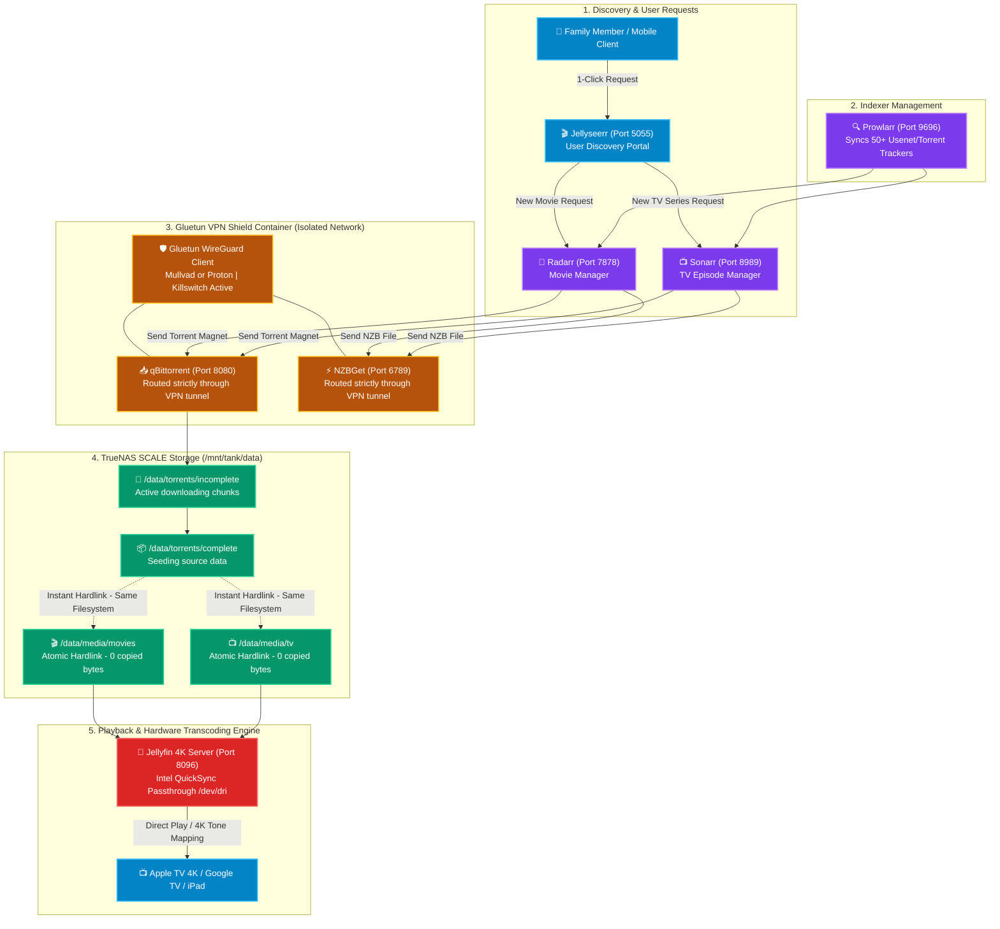

# 🎬 Servarr & Jellyfin Automated Media Stack (VM 100)

[](https://jellyfin.org)
[](https://www.docker.com)
[](https://github.com/qdm12/gluetun)
[](https://ark.intel.com)
[](https://gethomepage.dev)

A unified, fully automated home theater media and streaming stack hosted in an Ubuntu 24.04 Docker VM on Proxmox VE. Combines **Intel QuickSync 4K hardware transcoding**, zero-copy **atomic hardlinks**, automated request discovery (*Arr suite), and **VPN-isolated BitTorrent/Usenet downloads**.

---

## 🔗 Official Documentation & External Links

| Service | Official Website | Documentation | GitHub Repository |
| :--- | :--- | :--- | :--- |
| **Jellyfin** | [jellyfin.org](https://jellyfin.org) | [jellyfin.org/docs](https://jellyfin.org/docs) | [jellyfin/jellyfin](https://github.com/jellyfin/jellyfin) |
| **Jellyseerr** | [jellyseerr.dev](https://jellyseerr.dev) | [docs.jellyseerr.dev](https://docs.jellyseerr.dev) | [fallenbagel/jellyseerr](https://github.com/fallenbagel/jellyseerr) |
| **Radarr** | [radarr.video](https://radarr.video) | [wiki.servarr.com/radarr](https://wiki.servarr.com/radarr) | [Radarr/Radarr](https://github.com/Radarr/Radarr) |
| **Sonarr** | [sonarr.tv](https://sonarr.tv) | [wiki.servarr.com/sonarr](https://wiki.servarr.com/sonarr) | [Sonarr/Sonarr](https://github.com/Sonarr/Sonarr) |
| **Prowlarr** | [prowlarr.com](https://prowlarr.com) | [wiki.servarr.com/prowlarr](https://wiki.servarr.com/prowlarr) | [Prowlarr/Prowlarr](https://github.com/Prowlarr/Prowlarr) |
| **Gluetun VPN**| — | [github.com/qdm12/gluetun-wiki](https://github.com/qdm12/gluetun-wiki) | [qdm12/gluetun](https://github.com/qdm12/gluetun) |
| **qBittorrent**| [qbittorrent.org](https://www.qbittorrent.org)| [qbittorrent.org/doc](https://www.qbittorrent.org) | [qbittorrent/qBittorrent](https://github.com/qbittorrent/qBittorrent) |
| **Autobrr** | [autobrr.com](https://autobrr.com) | [autobrr.com/introduction](https://autobrr.com/introduction) | [autobrr/autobrr](https://github.com/autobrr/autobrr) |
| **Bazarr** | [bazarr.media](https://www.bazarr.media) | [wiki.bazarr.media](https://wiki.bazarr.media) | [morpheus65535/bazarr](https://github.com/morpheus65535/bazarr) |
| **TRaSH Guides** | [trash-guides.info](https://trash-guides.info) | Hardlinks & Atomic Moves Reference | [TRaSH-Guides](https://github.com/TRaSH-/Guides) |

---

## 🏗️ End-to-End Media Lifecycle & VPN Isolation Architecture



---

## 🧠 Architectural Deep-Dive & Engineering Decisions

### 1. Atomic Moves & Hardlinks Architecture (TRaSH Guides Standard)
In naive Docker tutorials, users commonly mount separate host paths:
- `/downloads` mapped to `/mnt/downloads`
- `/movies` mapped to `/mnt/movies`

**Why this naive setup is flawed:**
- Docker treats each bind mount as a distinct physical filesystem boundary.
- When a download finishes, Radarr must perform a **full IO copy** across filesystems. A 50GB 4K remux takes minutes to copy, burns double the storage space, and saturates disk bandwidth.

**The Homelab Unified Path Solution:**
- We mount a single root path `/mnt/storage/data` into `/data` across **every single container**.
- Both `/data/torrents/complete` and `/data/media/movies` exist within the same filesystem mount.
- Radarr and Sonarr create an **Instant Hardlink**:
  ```bash
  ln /data/torrents/complete/Movie.mkv /data/media/movies/Movie\ (2026)/Movie.mkv
  ```
- **Performance:** Execution takes **0.001 seconds**, consumes **0 additional disk bytes**, and allows qBittorrent to seed indefinitely while Jellyfin streams the exact same physical blocks on disk.

### 2. The Gluetun VPN Container Shield
- Downloaders (`qBittorrent`, `NZBGet`) are attached directly to Gluetun via `network_mode: "service:gluetun"`.
- The downloader containers have **no virtual network interface of their own**. They share Gluetun's network stack.
- **Fail-Safe Killswitch:** If the WireGuard VPN handshake drops, the kernel interface goes down. Traffic is physically incapable of escaping via the residential ISP gateway, guaranteeing complete privacy and zero IP/DNS leaks.

### 3. Intel QuickSync Hardware Transcoding (QSV)
- Software transcoding of 4K HEVC/H.265 HDR video spikes an 8-core CPU to 100% utilization, causing stuttering and system lockups.
- By passing the Intel iGPU render node (`/dev/dri/renderD128`) from the Proxmox host into VM 100, Jellyfin offloads video decoding and tone mapping to dedicated silicon.
- **Result:** Effortlessly transcodes simultaneous 4K 10-bit HDR streams down to 1080p SDR with **under 8% CPU utilization**.

---

## 🌐 Network Ports Reference

| Port | Service | Access Policy | Description |
| :---: | :--- | :---: | :--- |
| `80` | **Homepage** | Local / Tailscale | Unified homelab dashboard portal |
| `8096` | **Jellyfin** | Local / Tailscale | Media server streaming port |
| `5055` | **Jellyseerr** | Local / Tailscale | 1-Click user request discovery portal |
| `8080` | **qBittorrent** | Isolated (VPN) | WebUI routed strictly through Gluetun WireGuard |
| `6789` | **NZBGet** | Isolated (VPN) | Usenet WebUI routed through Gluetun WireGuard |
| `9696` | **Prowlarr** | Local / Internal | Universal indexer sync manager |
| `7878` | **Radarr** | Local / Internal | Movie management & auto-grabber |
| `8989` | **Sonarr** | Local / Internal | TV episode manager & auto-grabber |
| `8686` | **Lidarr** | Local / Internal | Music collection manager |
| `6767` | **Bazarr** | Local / Internal | Subtitle synchronization daemon |
| `7474` | **Autobrr** | Local / Internal | Real-time IRC announce monitor |
| `8765` | **AudiobookRequest** | Local / Tailscale | Family audiobook discovery & request portal |
| `13378` | **Audiobookshelf** | Local / Tailscale | Self-hosted audiobook & podcast streaming server |

---

## ⚙️ VM Sizing & Storage Recommendations

| Parameter | Specification | Rationale |
| :--- | :--- | :--- |
| **Virtualization** | KVM Virtual Machine (Ubuntu 24.04 LTS) | Enables clean iGPU passthrough and Docker overlay2 stability |
| **vCPUs** | 4 Cores (`host` type) | Background library scans, file indexing, and extraction |
| **Memory** | 8192 MB (8 GB) | qBittorrent RAM cache (1GB) + Jellyfin streaming buffers |
| **Disk** | 40 GB SSD (`local-lvm`) | OS, Docker containers, and Jellyfin metadata/artwork |
| **Storage Mount** | NFSv4 (`/mnt/tank/data`) | Permanent media repository stored on TrueNAS SCALE ZFS pool |

---

## 🚀 Step-by-Step Deployment Guide

### 1. Verify Storage & Hardware Passthrough
On the Ubuntu VM, verify the TrueNAS NFS share is mounted:
```bash
df -h | grep /mnt/storage/data
```
Verify Intel GPU render node visibility:
```bash
ls -la /dev/dri
# Expected output: card0 and renderD128
```

### 2. Configure Environment Secrets
Copy `.env.example` to `.env`:
```bash
cp .env.example .env
nano .env
```
Fill in your VPN parameters:
- `VPN_SERVICE_PROVIDER=mullvad` (or `protonvpn`, `custom`)
- `WIREGUARD_PRIVATE_KEY=<YOUR_PRIVATE_KEY>`
- `WIREGUARD_ADDRESSES=<YOUR_VPN_IP/32>`
- `LAN_NETWORK=192.168.1.0/24`

### 3. Launch Docker Compose Stack
```bash
docker compose up -d
```

### 4. Verify VPN Tunnel Isolation
Confirm your public BitTorrent IP matches the VPN gateway, never your home ISP:
```bash
docker exec -it qbittorrent curl ifconfig.me
```

---

## 🛠️ Operational Maintenance & Health Best Practices

### 1. Download Client Hygiene & Path Mapping
* **Inactive Download Clients:** If Usenet (`nzbget`) is not in use or has no active servers configured, keep it disabled (`enable: false`) in **Sonarr** and **Radarr** Settings > Download Clients. This eliminates false-positive `RemotePathMappingCheck` warnings regarding unmapped completed directories.
* **VPN Service Dependency:** All torrent/download traffic strictly routes through the `gluetun` network container. If Gluetun restarts, child containers automatically pause traffic via Docker network namespace binding.

### 2. Ghost Queue Reconciliation & Unpackerr Loop Prevention
* **Stuck Downloads:** If a movie or episode is grabbed but blocked on manual import (e.g. `importBlocked`), **Unpackerr** checks the queue every 60 seconds and logs continuous extraction errors if the file is missing from `/data/downloads/qbittorrent/completed`.
* **Remediation:** Remove stuck queue entries via the *Arr WebUI or REST API with `removeFromClient=true` to instantly release the torrent client and clear Unpackerr/qbit-manage error loops.

### 3. NFS Atomic Hardlinks
* Always map `/data` as a single shared mount volume across all Servarr containers to enable zero-copy atomic hardlinks on TrueNAS SCALE datasets, preserving download seeding while instantly indexing files in Jellyfin without doubling disk consumption.

### 4. High-Throughput qBittorrent Disk Cache on TrueNAS NFS
When downloading heavy 4K HDR releases across an NFS mount, default direct I/O (`DisableOSCache`) causes thousands of synchronous network RPCs per second, locking the libtorrent event loop and freezing the WebUI.
* **Optimized `qBittorrent.conf` Parameters:**
  ```ini
  Session\DiskIOWriteMode=EnableOSCache
  Session\DiskIOReadMode=EnableOSCache
  Session\DiskWriteCacheSize=1024
  Session\AsyncIOThreadsCount=8
  Session\CoalesceReadWrite=true
  Session\SendBufferWatermark=3072
  Session\SendBufferLowWatermark=1024
  Session\SendBufferWatermarkFactor=150
  ```
* **Impact:** Kernel buffers small chunks in RAM and flushes large sequential blocks, slashing NFS write contention by 95% and guaranteeing a responsive WebUI.

### 5. Autonomous Family Queue Self-Healing Daemon
For a family-shared media server where users request via Jellyseerr without admin console access:
* **The Problem:** Bad torrent releases can stall at 0 seeds or get blocked on manual import (`importBlocked`), leaving family requests stranded indefinitely.
* **The Permanent Solution:** The homelab monitor daemon on LXC 107 runs an automated queue sweep every 15 minutes (`audit_and_heal_media_queues`).
* **Auto-Recovery:** If a download is missing or unimportable, the daemon automatically:
  1. Purges the dead job from Radarr/Sonarr and qBittorrent (`removeFromClient=true`).
  2. Permanently blocklists the defective release hash (`blocklist=true`).
  3. Triggers an immediate API command (`MoviesSearch` / `SeriesSearch`) to automatically grab an alternative, working release.
  4. Alerts the admin on Telegram so family requests resolve invisibly and automatically.

### 6. AudiobookRequest & Audiobookshelf Hybrid Indexing Architecture
* **The Challenge:**
  - Standard AudiobookRequest queries Prowlarr using exact Audible metadata titles (e.g., `Designing Data-Intensive Applications, 2nd Edition`).
  - BitTorrent indexers frequently list releases under core titles (e.g. `Martin Kleppmann - Designing Data-Intensive Applications`) and tag releases under category `8000 (Other)` or general book categories rather than Torznab `3030 (Audiobook)`.
  - Furthermore, technical manuals, classic literature, and older books often do not have an official audiobook edition. In default configurations, requests for these books fail completely with 0 sources found.

* **Multi-Query Title Cleaning Engine (`clean_book_title`):**
  - The search pipeline in `/app/app/internal/prowlarr/prowlarr.py` is patched with an intelligent regex normalizer:
    ```python
    def clean_book_title(title: str) -> str:
        cleaned = re.sub(r'\s*\([^)]*\)', '', title)
        cleaned = re.sub(r'([,:]|\s+-\s+)?\s*\b(?:\d+(?:st|nd|rd|th)?\s+ed(?:ition)?|unabridged|abridged|special edition)\b.*', '', cleaned, flags=re.IGNORECASE)
        if ':' in cleaned:
            main_title = cleaned.split(':')[0].strip()
            if len(main_title) >= 3:
                cleaned = main_title
        return cleaned.strip()
    ```
  - For every requested book, AudiobookRequest issues concurrent queries for both the full title and the normalized title, deduplicating release GUIDs to maximize discovery across all trackers.

* **Torznab Category Aggregation (`[3030, 7000, 7020, 8000]`):**
  - Configured categories in `/config/db.sqlite`:
    - `3030` (`Audio/Audiobook`): Native spoken audiobooks.
    - `7000` (`Books`) & `7020` (`Books/EBook`): Electronic publication releases for fallback.
    - `8000` (`Other`): Broad public indexers (TorrentsCSV, FileMood) that do not support specialized Torznab mapping.

* **Automated Bitrate Ranking & EPUB Fallback Demotion:**
  - AudiobookRequest automatically calculates bitrate as `8 * size / (runtime_seconds * 1000)`.
  - **Audiobook Priority:** Genuine audiobooks (>20 kbps) pass validation, receive the green status badge, and are prioritized at the very top (Rank #1-4) for automatic downloads.
  - **EPUB Fallback:** Small EPUB/PDF files (~0.5 kbps) fail the audio bitrate check and are demoted to the bottom of the table. If no audiobook release exists, the request never fails; instead, the EPUB sources remain available in the sources table for instant manual grab and reading.

* **Broadened Indexer Coverage:**
  - Active Prowlarr indexers configured in AudiobookRequest:
    `[3, 4, 9, 10, 14, 17, 37, 49, 54]` (LimeTorrents, The Pirate Bay, Knaben, TorrentDownload, FileMood, TorrentsCSV, NoNaMe Club, Torrent9, Zamunda LIFE).

* **Zero-Downtime Compose Persistence:**
  - The Python engine patch is mounted read-only in `compose.yaml`:
    ```yaml
    volumes:
      - ./audiobookrequest:/config
      - ./audiobookrequest/prowlarr.py:/app/app/internal/prowlarr/prowlarr.py:ro
      - /data:/data
    ```
  - This guarantees that container rebuilds and image pulls maintain multi-query deduplication and category fallback permanently.

### 7. Automated qBittorrent-to-Audiobookshelf Post-Processing Hook
* **The Architectural Bridge:**
  - AudiobookRequest acts as a discovery and request portal (analogous to Jellyseerr), delegating download tasks to Prowlarr and qBittorrent.
  - While Radarr and Sonarr maintain active file import daemons for movies and TV, books and audiobooks lacked an automated post-download mover.
  - Completed downloads sat staged in `/data/downloads/qbittorrent/completed`, isolated from Audiobookshelf's watched library directory at `/data/books/audiobooks`.

* **Automated `[AutoRun]` Lifecycle:**
  - Configured in `qBittorrent.conf` via the Web API:
    ```ini
    [AutoRun]
    enabled=true
    program=/config/scripts/audiobook_import.sh "%N" "%L" "%F"
    ```
  - **Zero-Latency Execution:** The millisecond qBittorrent finishes downloading a torrent, it fires the execution hook inside the container.
  - **Category Isolation:** Immediately ignores downloads tagged under `radarr`, `sonarr`, or `lidarr`.
  - **Extension Detection:** Scans the content path for audio (`.m4b`, `.mp3`, `.flac`, `.aac`) and book files (`.epub`, `.pdf`), along with artwork (`.jpg`, `.png`).
  - **Zero-Copy Atomic Hardlinking:** Links media files from `/data/downloads/qbittorrent/completed/...` into `/data/books/audiobooks/<TorrentName>/`, preserving disk space and active torrent seeding.
  - **Instant Library Sync:** Dispatches an authenticated HTTP POST request to the Audiobookshelf REST API (`POST http://172.39.0.10:80/api/libraries/{lib_id}/scan`), making new audiobooks immediately playable in the Audiobookshelf web and mobile clients.
  - **Audit Logging:** Logs all import events and API responses to `/config/logs/audiobook_import.log`.


