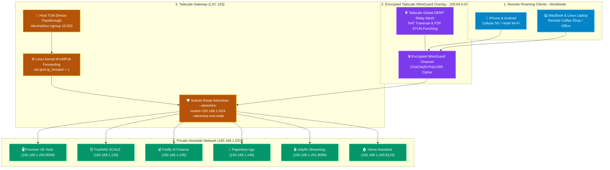

# 🛡️ Tailscale Subnet Router & Mesh Gateway (LXC 103)

[](https://tailscale.com)
[](https://www.debian.org)
[](https://tailscale.com/security)
[](https://github.com/tailscale/tailscale/blob/main/LICENSE)

A dedicated, ultra-lightweight unprivileged Debian 12 LXC container functioning 24/7 as an encrypted **Subnet Router and Exit Node**. Grants seamless zero-trust remote access to your entire home LAN from mobile devices and laptops worldwide without port forwarding, dynamic DNS, or exposing firewall ports.

---

## 🔗 Official Documentation & External Links

- **Official Website:** [tailscale.com](https://tailscale.com)
- **Subnet Routers Guide:** [tailscale.com/kb/1019/subnets](https://tailscale.com/kb/1019/subnets)
- **Exit Nodes Guide:** [tailscale.com/kb/1103/exit-nodes](https://tailscale.com/kb/1103/exit-nodes)
- **Tailscale on Proxmox LXC Guide:** [tailscale.com/kb/1130/lxc-unprivileged](https://tailscale.com/kb/1130/lxc-unprivileged)
- **Tailscale Admin Console:** [login.tailscale.com/admin](https://login.tailscale.com/admin)
- **GitHub Repository:** [tailscale/tailscale](https://github.com/tailscale/tailscale)

---

## 🏗️ Zero-Trust Remote Mesh Architecture



---

## 🧠 Architectural Deep-Dive & Engineering Decisions

### 1. Dedicated Subnet Router vs. Alternative Topologies
When architecting remote access into an on-premise homelab, three primary patterns exist:

| Architecture | Pros | Cons | Verdict |
| :--- | :--- | :--- | :--- |
| **Traditional Port Forwarding + Dynamic DNS** | Direct connection | Exposes home IP to public internet scanners; requires DDNS daemons; open ports invite brute-force attacks. | ❌ **Rejected** (Unsafe) |
| **Tailscale Installed on Every Container** | Fine-grained ACLs per container | Massive operational overhead; burns connection limits; requires managing 10+ node keys; cannot reach bare-metal devices (printers, smart switches). | ❌ **Rejected** (Sprawl) |
| **Tailscale on Proxmox VE Hypervisor Host** | Simple setup | Violates hypervisor isolation; routing tables and firewall rules directly touch the hypervisor kernel; risk of lockouts during updates. | ❌ **Rejected** (Anti-Pattern) |
| **Dedicated Unprivileged LXC Subnet Router** | Complete hypervisor isolation; single lightweight container (~60MB RAM); transparent access to all LAN devices without software installation; acts as an exit node. | Requires low-level TUN device passthrough. | ✅ **Selected Standard** |

### 2. Low-Level Kernel TUN Device Passthrough Mechanics
Unprivileged Proxmox LXC containers operate within separate user namespaces where the creation of virtual network devices (`/dev/net/tun`) is blocked by default for security.

We solve this cleanly without giving the container full privileged host access:
1. **Device Allow Rule:** Grants the container permission to access character device major number `10` and minor number `200` (the standard Linux TUN/TAP device):
   ```text
   lxc.cgroup2.devices.allow: c 10:200 rwm
   ```
2. **Bind Mount Entry:** Maps the host's `/dev/net/tun` directly into the container's `/dev/net/tun`:
   ```text
   lxc.mount.entry: /dev/net/tun dev/net/tun none bind,create=file
   ```
This provides Tailscale with raw kernel packet encapsulation capabilities while keeping the container's root user mapped to an unprivileged UID (`100000+`) on the host.

### 3. Exit Node Functionality for Secure Travel
By launching Tailscale with `--advertise-exit-node`:
- When traveling or connected to insecure public Wi-Fi (airports, cafes, hotels), you can activate the homelab as your **Exit Node** in the Tailscale mobile app.
- All cellular/laptop DNS and internet traffic is encrypted across WireGuard and routed through your home ISP connection, bypassing local network snooping, censorship, and geoblocking.

---

## ⚙️ Container Sizing & Resource Allocation

| Parameter | Specification | Engineering Rationale |
| :--- | :--- | :--- |
| **Virtualization** | Debian 12 LXC Container | Unprivileged container with host TUN device |
| **vCPUs** | 1 vCPU | Modern CPUs feature AES-NI and ChaCha20 crypto acceleration; 1 core easily handles 500+ Mbps of WireGuard throughput |
| **Memory** | 1024 MB (1 GB) | Tailscale daemon consumes ~50MB to 70MB active RAM; 1GB leaves ample headroom |
| **Swap** | 512 MB | Safety buffer |
| **Root Disk** | 8 GB SSD (`local-lvm`) | Extremely lightweight; only contains Debian base and `tailscaled` binary |
| **Network** | `vmbr0` (Static IP) | Directly attached to the primary LAN bridge |

---

## 🚀 Step-by-Step Deployment Guide

### 1. Provision LXC Container on Proxmox VE Host CLI
```bash
pct create 103 local:vztmpl/debian-12-standard_12.7-1_amd64.tar.zst \
  --hostname tailscale-gateway \
  --cores 1 \
  --memory 1024 \
  --swap 512 \
  --rootfs local-lvm:8 \
  --net0 name=eth0,bridge=vmbr0,ip=192.168.1.253/24,gw=192.168.1.1 \
  --unprivileged 1 \
  --features nesting=1 \
  --onboot 1
```

### 2. Configure TUN Device Passthrough (On Proxmox Host)
Add the device cgroup and bind mount rules to the container configuration:
```bash
cat << 'EOF' >> /etc/pve/lxc/103.conf
lxc.cgroup2.devices.allow: c 10:200 rwm
lxc.mount.entry: /dev/net/tun dev/net/tun none bind,create=file
EOF

# Start the container
pct start 103
```

### 3. Configure In-Container Routing & Install Tailscale
Enter the container (`pct enter 103`):
```bash
# Enable IPv4 and IPv6 kernel forwarding
cat << 'EOF' >> /etc/sysctl.d/99-tailscale.conf
net.ipv4.ip_forward = 1
net.ipv6.conf.all.forwarding = 1
EOF

sysctl -p /etc/sysctl.d/99-tailscale.conf

# Install official Tailscale package
curl -fsSL https://tailscale.com/install.sh | sh
systemctl enable --now tailscaled
```

### 4. Authenticate & Advertise Subnet Routes
```bash
tailscale up \
  --advertise-routes=192.168.1.0/24 \
  --advertise-exit-node \
  --accept-dns=false \
  --reset
```
*Click the generated authentication URL to authorize the gateway to your Tailscale tailnet.*

### 5. Approve Routes in Tailscale Admin Console
1. Navigate to the [Tailscale Admin Machines Console](https://login.tailscale.com/admin/machines).
2. Locate `tailscale-gateway` and click **Edit route settings...**.
3. Toggle on **`192.168.1.0/24`** under Subnet routes.
4. (Optional) Toggle on **Use as exit node**.
5. Test connecting from your mobile phone on 5G: navigate to `http://192.168.1.250:8006` or `http://192.168.1.245` — instant local access without opening a single port!
