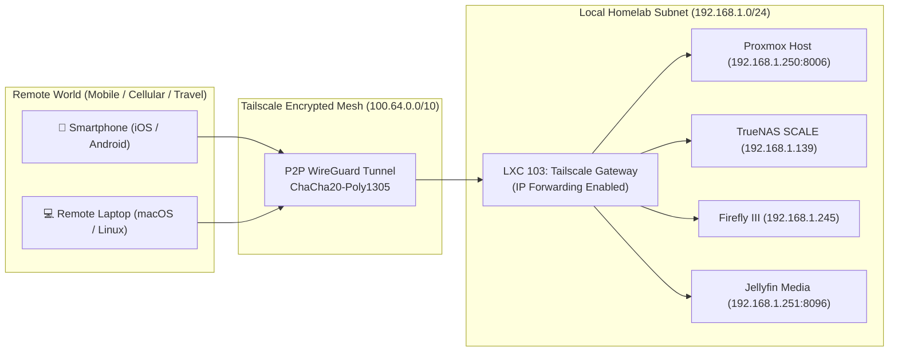

# 🛡️ Tailscale Subnet Router & Mesh Gateway (LXC 103)

[](https://tailscale.com)
[](https://www.debian.org)
[](https://github.com/tailscale/tailscale/blob/main/LICENSE)

A dedicated, lightweight unprivileged Debian 12 LXC container functioning 24/7 as an encrypted **Subnet Router and Exit Node**, granting seamless zero-trust remote access to your entire home LAN without port forwarding or exposing firewalls.

---

## 🔗 Official Documentation & External Links

- **Official Website:** [tailscale.com](https://tailscale.com)
- **Subnet Routers Guide:** [tailscale.com/kb/1019/subnets](https://tailscale.com/kb/1019/subnets)
- **Exit Nodes Guide:** [tailscale.com/kb/1103/exit-nodes](https://tailscale.com/kb/1103/exit-nodes)
- **Tailscale on Proxmox LXC:** [tailscale.com/kb/1130/lxc-unprivileged](https://tailscale.com/kb/1130/lxc-unprivileged)
- **Admin Console:** [login.tailscale.com/admin](https://login.tailscale.com/admin)
- **GitHub Repository:** [tailscale/tailscale](https://github.com/tailscale/tailscale)

---

## 🏗️ Remote Access Architecture



---

## ⚙️ Container Sizing & Recommendations

| Parameter | Specification | Notes |
| :--- | :--- | :--- |
| **Virtualization** | Debian 12 LXC Container | Unprivileged with host TUN device |
| **Cores** | 1 vCPU | WireGuard crypto is hardware-accelerated |
| **Memory** | 1024 MB (1 GB) | Minimal memory footprint (~60MB active) |
| **Disk** | 8 GB SSD (`local-lvm`) | Operating system only |
| **Network** | `vmbr0` (Static IP) | Connects to primary LAN bridge |

---

## 🚀 Proxmox Setup & Passthrough (Host Side)

1. **Provision Container:**
   ```bash
   pct create 103 local:vztmpl/debian-12-standard_12.7-1_amd64.tar.zst \
     --hostname tailscale-gateway \
     --cores 1 \
     --memory 1024 \
     --swap 512 \
     --rootfs local-lvm:8 \
     --net0 name=eth0,bridge=vmbr0,ip=192.168.1.253/24,gw=192.168.1.1 \
     --unprivileged 1 \
     --features nesting=1 \
     --onboot 1
   ```

2. **Crucial TUN Device Permission (Run on Proxmox Host):**
   ```bash
   cat << 'EOF' >> /etc/pve/lxc/103.conf
   lxc.cgroup2.devices.allow: c 10:200 rwm
   lxc.mount.entry: /dev/net/tun dev/net/tun none bind,create=file
   EOF
   
   pct start 103
   ```

---

## 🔧 In-Container Configuration

Enter container (`pct enter 103`):

1. **Enable IP Forwarding:**
   ```bash
   cat << 'EOF' >> /etc/sysctl.d/99-tailscale.conf
   net.ipv4.ip_forward = 1
   net.ipv6.conf.all.forwarding = 1
   EOF

   sysctl -p /etc/sysctl.d/99-tailscale.conf
   ```

2. **Install Tailscale:**
   ```bash
   curl -fsSL https://tailscale.com/install.sh | sh
   systemctl enable --now tailscaled
   ```

3. **Advertise Routes & Exit Node:**
   ```bash
   tailscale up \
     --advertise-routes=<YOUR_HOMELAB_SUBNET_CIDR> \
     --advertise-exit-node \
     --accept-dns=false \
     --reset
   ```

4. **Approve Routes:**
   Visit the [Tailscale Admin Machines Console](https://login.tailscale.com/admin/machines) ➔ Edit route settings for `tailscale-gateway` ➔ Enable the advertised subnet.
