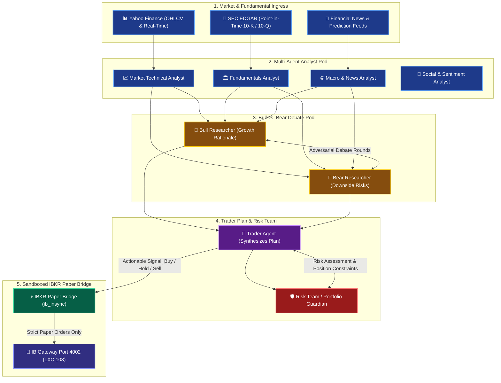

# 🤖 Multi-Agent Trading Intelligence Sandbox (LXC 110)

[](https://github.com/TauricResearch/TradingAgents)
[](https://pve.proxmox.com)
[](https://www.interactivebrokers.com)
[](https://langchain-ai.github.io/langgraph/)
[](https://opensource.org/licenses/MIT)

A dedicated, isolated sandbox environment running **TauricResearch TradingAgents** (arXiv:2412.20138) inside an unprivileged Debian 12 LXC container on Proxmox VE. The stack runs multi-agent qualitative debate and risk intelligence to evaluate and complement our existing quantitative engine (LXC 108).

---

## 🔗 Architecture & Multi-Agent Flow



---

## ⚙️ Container Sizing & Resources

| Parameter | Specification | Notes |
| :--- | :--- | :--- |
| **Virtualization** | Debian 12 (Bookworm) LXC Container | Unprivileged with `nesting=1,keyctl=1` |
| **VMID** | `110` | Registered under Proxmox VE node `pve` |
| **Hostname** | `trading-agents-paper` | Dedicated sandbox host |
| **IP Address** | `192.168.1.244/24` | Static IP on physical bridge `vmbr0` |
| **Gateway** | `192.168.1.254` | Homelab LAN gateway |
| **Cores** | 2 vCPUs | Python LangGraph orchestration |
| **Memory** | 2048 MB (2 GB) RAM / 512 MB Swap | Lightweight agent graph memory footprint |
| **Disk** | 12 GB NVMe SSD (`local-lvm`) | Root filesystem and dependency cache |

---

## 📦 Directory Structure Inside Container

```text
/opt/TradingAgents/
├── .env                       <-- Configuration & API tokens (chmod 600)
├── venv/                      <-- Python 3.11 virtual environment
├── tradingagents/             <-- Core multi-agent DAG framework
├── ibkr_paper_bridge.py       <-- Bridge connecting agent signals to IB Gateway
├── multi_agent_eval.py        <-- Batch multi-agent evaluation runner
└── evaluation_summary.json    <-- Persisted debate outputs and ratings
```

---

## 🛡️ Zero-Secrets Configuration Template

Create `/opt/TradingAgents/.env` inside the container:

```bash
# LLM Provider Configuration
GOOGLE_API_KEY=<YOUR_GOOGLE_GEMINI_API_KEY>
TRADINGAGENTS_LLM_PROVIDER=google
TRADINGAGENTS_DEEP_THINK_LLM=gemini-3.5-flash-lite
TRADINGAGENTS_QUICK_THINK_LLM=gemini-3.5-flash-lite
SEC_EDGAR_USER_AGENT=HomelabQuant <YOUR_EMAIL>
TRADINGAGENTS_OUTPUT_LANGUAGE=English
TRADINGAGENTS_MAX_DEBATE_ROUNDS=1
TRADINGAGENTS_MAX_RISK_ROUNDS=1
TRADINGAGENTS_NO_UPDATE_CHECK=1

# IBKR Gateway Paper Trading Configuration
IBKR_HOST=192.168.1.248
IBKR_PORT=4002
IBKR_CLIENT_ID=21
IBKR_ACCOUNT=<YOUR_PAPER_ACCOUNT_ID>
```

---

## ⚡ IBKR Paper Trading Bridge (`ibkr_paper_bridge.py`)

The bridge connects asynchronously via `ib_insync` to the IB Gateway running in LXC 108.
- **Port:** `4002` (Paper trading mode).
- **Socket Client ID:** `21` (Dedicated socket ID, preventing collisions with LXC 108 daemons on `clientId=1` and `clientId=2`).
- **Signal Actions:**
  - `BUY` / `STRONG BUY`: Enters long position with target share count.
  - `OVERWEIGHT`: Adds partial lot.
  - `SELL` / `STRONG SELL`: Trims or liquidates held shares (validates non-negative held quantity to prevent accidental shorting).
  - `UNDERWEIGHT`: Trims partial lot.
  - `HOLD` / `REVIEW`: No-op.

---

## 🚀 Execution & Verification Commands

```bash
# Access container console
pct enter 110

# Test IBKR connection and inspect current paper positions
/opt/TradingAgents/venv/bin/python3 /opt/TradingAgents/ibkr_paper_bridge.py

# Run multi-agent debate and evaluation on target tickers
/opt/TradingAgents/venv/bin/python3 /opt/TradingAgents/multi_agent_eval.py
```
