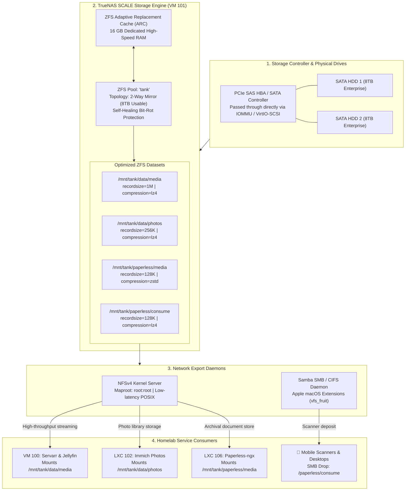

# 🗄️ TrueNAS SCALE ZFS Storage Appliance (VM 101)

[](https://www.truenas.com/truenas-scale)
[](https://openzfs.github.io/openzfs-docs)
[](https://www.debian.org)
[](https://en.wikipedia.org/wiki/Network_File_System)
[](https://www.truenas.com)

A high-performance, enterprise-grade storage appliance running as a virtual machine on Proxmox VE. Serves as the central data anchor for the entire homelab cluster, managing multi-terabyte **OpenZFS storage pools**, automated **snapshot lifecycles**, self-healing **scrub routines**, and low-latency **NFSv4 and SMB shares**.

---

## 🔗 Official Documentation & External Links

- **Official Website:** [truenas.com/truenas-scale](https://www.truenas.com/truenas-scale)
- **Documentation Hub:** [truenas.com/docs/scale](https://www.truenas.com/docs/scale)
- **TrueNAS Community Forum:** [forums.truenas.com](https://forums.truenas.com)
- **OpenZFS Documentation:** [openzfs.github.io/openzfs-docs](https://openzfs.github.io/openzfs-docs)
- **ZFS Capacity & Parity Calculator:** [wintelguy.com/zfs-calc.pl](https://wintelguy.com/zfs-calc.pl)
- **TrueNAS GitHub:** [github.com/truenas](https://github.com/truenas)

---

## 🏗️ Storage Topology & Cross-Service Dataflow



---

## 🧠 Architectural Deep-Dive & Engineering Decisions

### 1. ZFS Pool Topology Selection: 2-Way Mirror vs. RAID-Z2
When designing storage for a mixed virtualization and media workload:
- **Resilver Times & Drive Stress:**
  In a wide RAID-Z2 pool, replacing a failed 8TB drive requires recalculating parity by reading all remaining drives continuously for 24-48 hours. This intensive IO stress frequently triggers a second drive failure. In a **2-Way Mirror**, resilvering reads sequentially from a single drive, completing in a fraction of the time with minimal random IO stress.
- **Random IOPS Performance:**
  RAID-Z2 provides the random IOPS of only **one single disk**, regardless of how many drives are in the vdev. A mirrored pool provides the aggregate IOPS of all mirror vdevs, which is critical for concurrent database queries (PostgreSQL in Immich and Paperless).
- **Expansion Agility:**
  Mirrors allow expanding storage capacity incrementally by adding just **two drives at a time**, rather than committing to buying 4 to 8 identical drives at once.

### 2. Dataset Optimization Matrix
Different homelab workloads require distinct filesystem block configurations:

| Dataset | Recordsize | Compression | Atime | Rationale |
| :--- | :--- | :--- | :--- | :--- |
| `tank/data/media` | **1M (1024K)** | `lz4` | `off` | Movies & TV files are multi-gigabyte. A 1M recordsize slashes metadata overhead, reduces filesystem fragmentation, and delivers maximum sequential streaming throughput. |
| `tank/data/photos` | **256K** | `lz4` | `off` | RAW images and high-resolution JPEGs (3MB - 25MB) benefit from balanced record allocation. |
| `tank/paperless/media` | **128K** | `zstd` | `off` | Text-heavy PDF documents compress exceptionally well with Zstandard, yielding 30-40% storage savings without noticeable CPU overhead. |
| `tank/paperless/consume` | **128K** | `lz4` | `off` | Fast temporary staging directory for incoming mobile scans. |
| `tank/databases` | **16K** | `lz4` | `off` | Matches PostgreSQL and MariaDB database page sizes to prevent write amplification. |

### 3. Protocol Selection: NFSv4 vs. Samba (SMB)
- **NFSv4 (Linux-to-Linux):** Chosen for all Docker containers, LXCs, and VMs. NFSv4 operates directly inside the Linux kernel, bypassing user-space translation, maintaining native Linux POSIX permissions, and eliminating SMB locking overhead.
- **Samba SMB (Clients & Scanners):** Configured exclusively for client devices (macOS Finder with `vfs_fruit`, Windows File Explorer, and network scanners).

### 4. Enterprise Snapshot Lifecycle & Bit-Rot Protection
- **Automated ZFS Snapshots:**
  - **Frequent:** Every 1 hour (retained for 24 hours).
  - **Daily:** Every midnight (retained for 14 days).
  - **Weekly:** Every Sunday (retained for 8 weeks).
  - **Monthly:** 1st of every month (retained for 12 months).
- **Self-Healing Scrub:**
  - Bi-weekly pool scrub scheduled for Sunday at 02:00 AM.
  - OpenZFS reads all checksums across both mirror disks. If silent bit-rot is detected on one drive, ZFS automatically corrects the corrupted block using the clean mirror copy and logs the event to TrueNAS alerts.

---

## ⚙️ VM Sizing & Proxmox Configuration

| Resource | Specification | Engineering Rationale |
| :--- | :--- | :--- |
| **Virtualization** | KVM Virtual Machine | Grants true IOMMU PCI controller passthrough and kernel isolation |
| **Memory** | 16384 MB (16 GB) | Adheres to the ZFS rule-of-thumb: 1GB RAM per 1TB of storage + 8GB base |
| **vCPUs** | 4 Cores (`host` type) | Parity checks, compression algorithms (`zstd`), and network throughput |
| **Boot Drive** | 32 GB SSD (`local-lvm`) | TrueNAS OS, middleware configuration, and system logs |
| **SCSI Controller** | `virtio-scsi-single` | Provides independent IO queues with `iothread=1` and `discard=on` |

---

## 🚀 Proxmox VM Creation & Setup Guide

### 1. Create VM on Proxmox Host CLI
```bash
qm create 101 \
  --name truenas-scale \
  --memory 16384 \
  --cores 4 \
  --cpu host \
  --net0 virtio,bridge=vmbr0,firewall=0 \
  --scsihw virtio-scsi-single \
  --scsi0 local-lvm:32,discard=on,ssd=1 \
  --ostype l26 \
  --bios ovmf \
  --machine q35 \
  --onboot 1
```

### 2. Passthrough Physical Storage Disks
Pass the physical serial-identified disks directly to the VM:
```bash
# Find disk serial numbers:
ls -l /dev/disk/by-id/

# Attach disks to VM 101:
qm set 101 --scsi1 /dev/disk/by-id/ata-WDC_WD80EFZZ-XXXXXX
qm set 101 --scsi2 /dev/disk/by-id/ata-WDC_WD80EFZZ-YYYYYY
```

### 3. TrueNAS Pool & NFS Export Setup
1. Open the TrueNAS SCALE WebUI at `https://192.168.1.139`.
2. Go to **Storage** ➔ **Create Pool** ➔ Name: `tank` ➔ Select Mirror VDEV layout.
3. Create datasets following the optimization matrix above.
4. Under **Shares** ➔ **Unix Shares (NFS)**:
   - Path: `/mnt/tank/data`
   - Maproot User: `root`
   - Maproot Group: `root`
   - Allowed Networks: `192.168.1.0/24`
5. Start the NFS service and enable **Start Automatically**.
