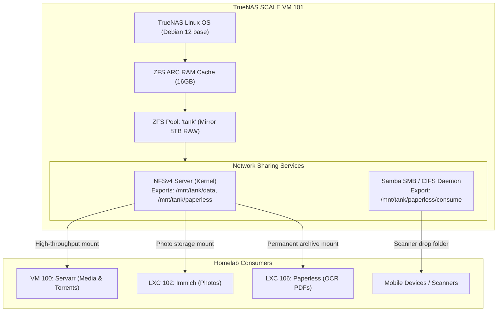

# 🗄️ TrueNAS SCALE ZFS Storage Appliance (VM 101)

[](https://www.truenas.com/truenas-scale)
[](https://openzfs.github.io/openzfs-docs)
[](https://www.truenas.com)

A dedicated storage appliance running as a virtual machine on Proxmox VE, managing multi-terabyte ZFS storage pools, automated snapshot lifecycles, and low-latency NFS/SMB shares.

---

## 🔗 Official Documentation & External Links

- **Official Website:** [truenas.com/truenas-scale](https://www.truenas.com/truenas-scale)
- **Documentation Hub:** [truenas.com/docs/scale](https://www.truenas.com/docs/scale)
- **TrueNAS Community Forum:** [forums.truenas.com](https://forums.truenas.com)
- **TrueNAS GitHub:** [github.com/truenas](https://github.com/truenas)
- **ZFS Capacity Calculator:** [wintelguy.com/zfs-calc.pl](https://wintelguy.com/zfs-calc.pl)

---

## 🏗️ Storage Dataflow Architecture



---

## ⚙️ Sizing & Resource Allocation

| Resource | Value | Rationale |
| :--- | :--- | :--- |
| **Virtualization** | KVM Virtual Machine | Direct disk controller passthrough |
| **Memory** | 16384 MB (16 GB) | Standard ZFS 1GB RAM per 1TB storage rule |
| **vCPUs** | 4 Cores (`host` type) | Parity calculation & compression operations |
| **OS Drive** | 32 GB SSD | System logs, middleware, and reporting |
| **Data Disks** | 2x 8TB SAS/SATA | Configured as ZFS Mirror (Raid 1) |

---

## 🚀 Proxmox VM Creation

Run directly on the Proxmox VE host CLI:

```bash
qm create 101 \
  --name truenas-scale \
  --memory 16384 \
  --cores 4 \
  --cpu host \
  --net0 virtio,bridge=vmbr0,firewall=0 \
  --scsihw virtio-scsi-single \
  --scsi0 local-lvm:32,discard=on,ssd=1 \
  --ostype l26 \
  --bios ovmf \
  --onboot 1
```

*Attach the TrueNAS SCALE ISO and complete initial setup.*

---

## 📂 Dataset Creation & Sharing

1. **Storage Pool (`tank`):**
   - VDEV: Mirror (2 drives)
   - Compression: `lz4`
   - Atime: `off`
2. **Datasets:**
   - `/mnt/tank/data/media` (Movies, TV, Music)
   - `/mnt/tank/data/downloads` (Complete / Incomplete torrents)
   - `/mnt/tank/data/photos` (Immich library)
   - `/mnt/tank/paperless/media` (Searchable PDFs)
   - `/mnt/tank/paperless/consume` (Scanner drop folder)
3. **NFS Exports:**
   - Go to **Shares** ➔ **Unix (NFS) Shares** ➔ Add `/mnt/tank/data` and `/mnt/tank/paperless`.
   - Maproot: `root:root`.
   - Allowed Networks: `<YOUR_HOMELAB_SUBNET>` (e.g. `192.168.1.0/24`).

---

## 🔍 Verification & Health Monitoring

```bash
# Inside TrueNAS CLI / Web Shell:
zpool status -v tank

# Check disk temperatures
smartctl -a /dev/sdX | grep -i temperature
```
