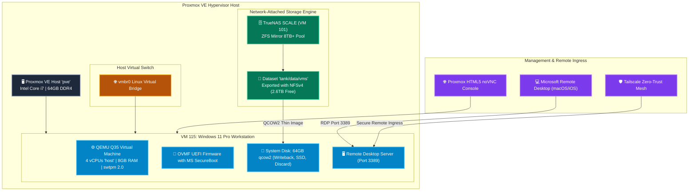

# 🪟 Windows 11 Pro Workstation (VM 115)

[](https://www.microsoft.com/windows)
[](https://www.proxmox.com)
[](https://www.qemu.org)
[](https://www.truenas.com)
[](https://learn.microsoft.com/en-us/windows-server/administration/performance-tuning/subsystem/kvm)

A dedicated, unattended, hardware-accelerated **Windows 11 Pro Workstation** running on Proxmox VE 8.x. Powered by an emulated Q35 chipset, OVMF UEFI firmware, software TPM 2.0 (swtpm), and backed by TrueNAS SCALE high-availability ZFS mirror storage.

---

## 🔗 Official Documentation & References

- **Microsoft Windows 11 Specifications:** [microsoft.com/windows/windows-11-specifications](https://www.microsoft.com/windows/windows-11-specifications)
- **Proxmox Windows 11 Best Practices:** [pve.proxmox.com/wiki/Windows_11_Guest_Best_Practices](https://pve.proxmox.com/wiki/Windows_11_Guest_Best_Practices)
- **Red Hat VirtIO Drivers for Windows:** [github.com/virtio-win/virtio-win-pkg-scripts](https://github.com/virtio-win/virtio-win-pkg-scripts)
- **Windows Unattended Setup Guide:** [learn.microsoft.com/windows-hardware/manufacture/desktop/automate-windows-setup](https://learn.microsoft.com/windows-hardware/manufacture/desktop/automate-windows-setup)

---

## 🏗️ System Architecture & Storage Topology



---

## ⚙️ Sizing & Resource Allocation

| Resource | Allocated Specification | Rationale & Configuration |
| :--- | :--- | :--- |
| **VM ID** | `115` | Next sequential high-performance desktop VM ID |
| **Machine Type** | `pc-q35-10.1` | Modern PCIe topology & native UEFI compatibility |
| **BIOS Firmware** | `OVMF (UEFI)` | Required for Windows 11 GPT boot & SecureBoot |
| **vTPM** | `swtpm v2.0` | Emulated discrete TPM chip for BitLocker / Win11 checks |
| **vCPUs** | `4 Cores` (`host` type) | Exposes native host CPU instruction sets (AES, AVX2, SSE4.2) |
| **Memory** | `8192 MB (8 GB)` | Dedicated RAM with zero memory ballooning |
| **Storage Pool** | `truenas-vms` (`tank/vms`) | Avoids NVMe thin-pool exhaustion; 2.6TB headroom |
| **Disk Type** | `64 GB qcow2` (SSD, Discard) | Sparse thin-allocated; TRIM discards unused blocks to ZFS |
| **Network (NIC)** | `e1000e` (Intel Gigabit) | Native Windows in-box driver; works immediately |
| **Display (VGA)** | `QXL` | Optimized for low-latency SPICE / noVNC web streaming |

---

## ⚡ Zero-Interaction Unattended Installation

The virtual machine is provisioned using an automated OEMDRV answer file (`autounattend.xml` embedded in `unattend.iso`):

1. **Hardware Requirement Bypasses:**
   - Injects `LabConfig` registry keys during the `windowsPE` pass to bypass TPM, RAM, CPU, SecureBoot, and Storage artificial checks.
2. **Automated Partitioning:**
   - Cleans Disk 0, formats GPT partition scheme:
     - 300 MB FAT32 EFI System Partition
     - 16 MB Microsoft Reserved (MSR) Partition
     - Full remainder NTFS System Volume (`C:\`)
3. **Out-of-Box Experience (OOBE) Suppression:**
   - Injects `BypassNRO` registry flag to skip forced Microsoft Account logins.
   - Suppresses diagnostic, telemetry, privacy, and advertising ID dialogues.
4. **Credential Provisioning:**
   - **Local Administrator Account:** `User`
   - **Password:** *None* (Empty / Blank password as requested)
   - **AutoLogon:** Enabled for seamless console boot
5. **Remote Desktop (RDP) Automation:**
   - `fDenyTSConnections` set to `0` on first logon.
   - Windows Firewall rule `remote desktop` group set to `enable=Yes`.
   - Unlimited password age policy enforced (`net accounts /maxpwage:unlimited`).

---

## 🛠️ Connectivity & Management

### 1. Web Console (noVNC)
Access directly from the Proxmox VE Web GUI:
```text
https://<PVE_HOST_IP>:8006/#v1:0:=qemu%2F115
```

### 2. Remote Desktop Protocol (RDP)
Connect using the native **Microsoft Remote Desktop** app on macOS, iOS, or iPadOS:
* **Host:** `<VM_IP_OR_HOSTNAME>` (Port `3389`)
* **Username:** `User`
* **Password:** *(Leave blank)*

---

## 🩺 Diagnostics & Health Verification

Run these commands on the Proxmox host to verify VM state:

```bash
# Check runtime status
qm status 115

# View real-time disk I/O and hardware statistics
qm status 115 -verbose

# Capture instantaneous display screenshot
echo "screendump /tmp/vm115.ppm" | qm monitor 115

# Gracefully reboot or shutdown
qm shutdown 115
```
